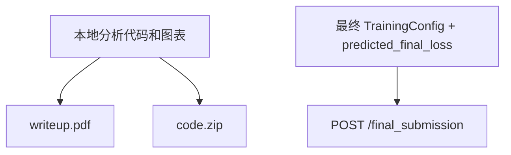
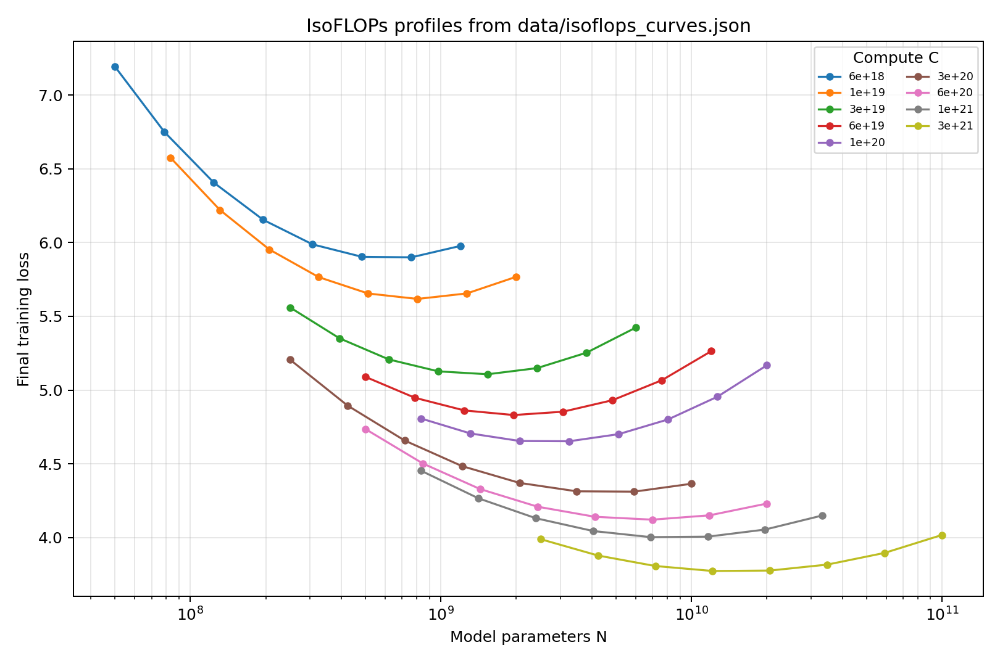
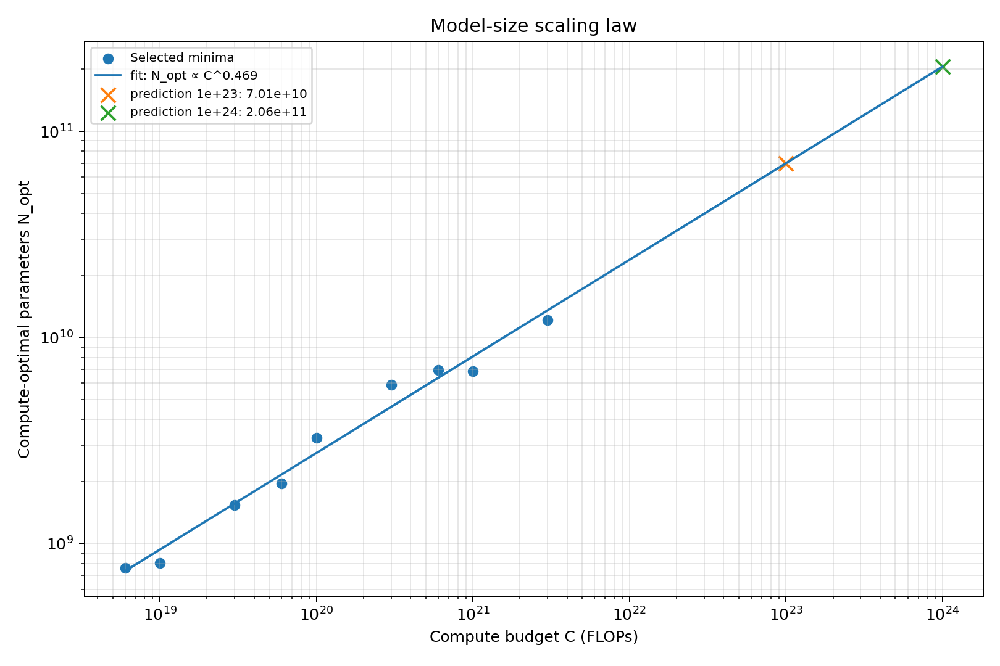
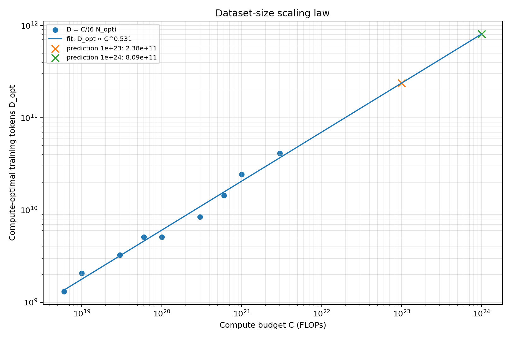
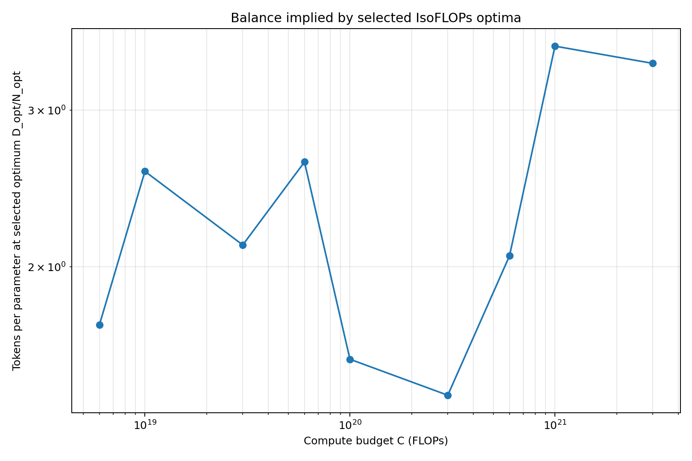
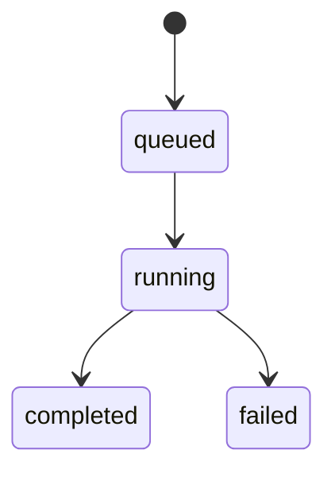
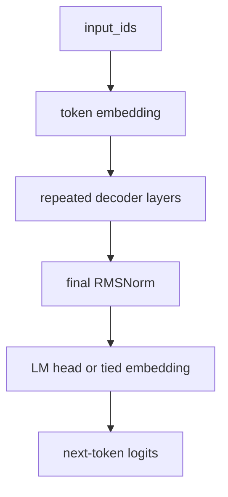
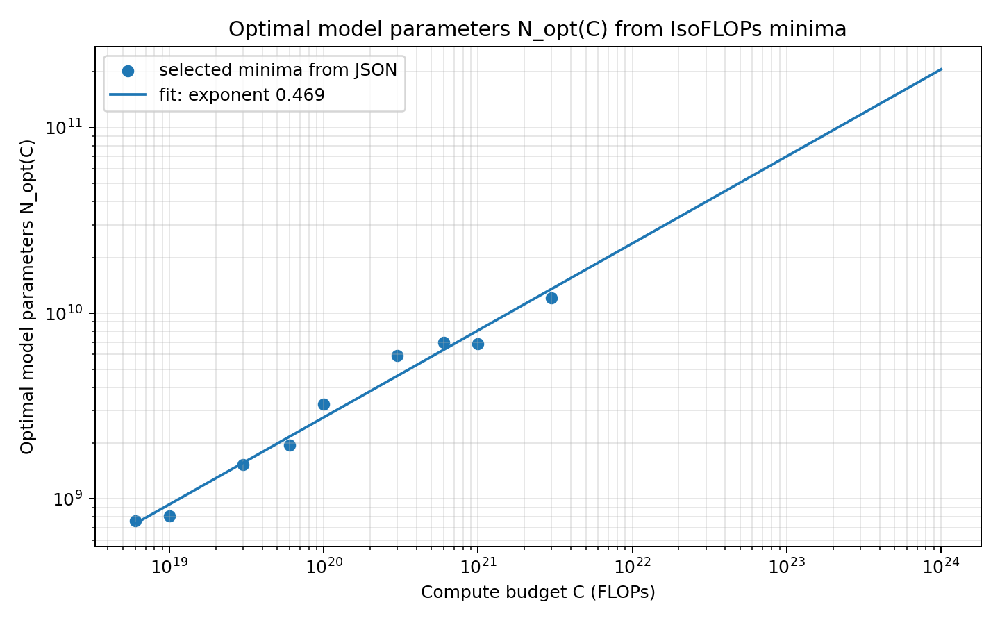
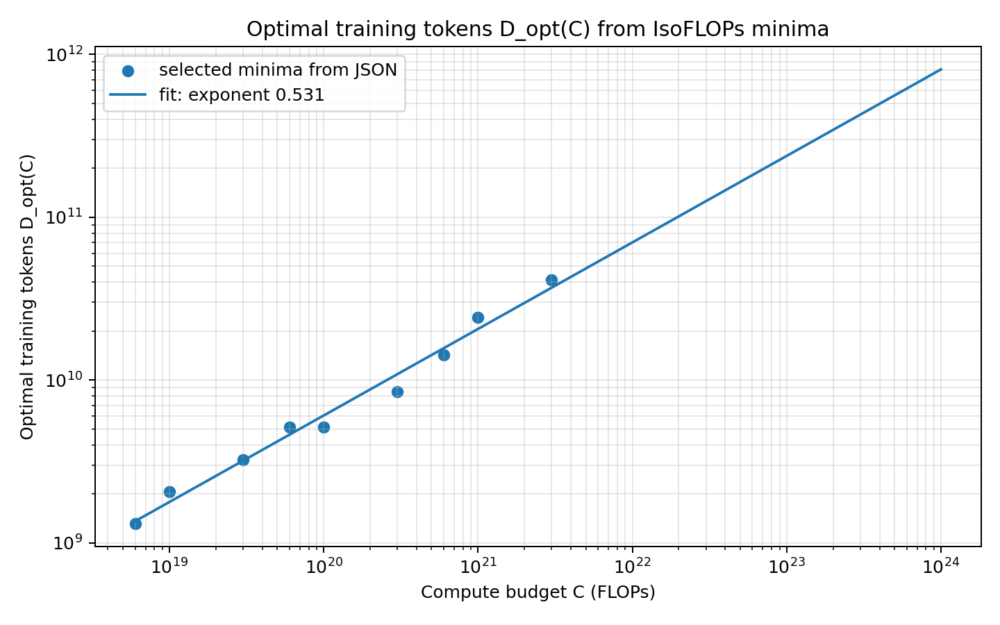
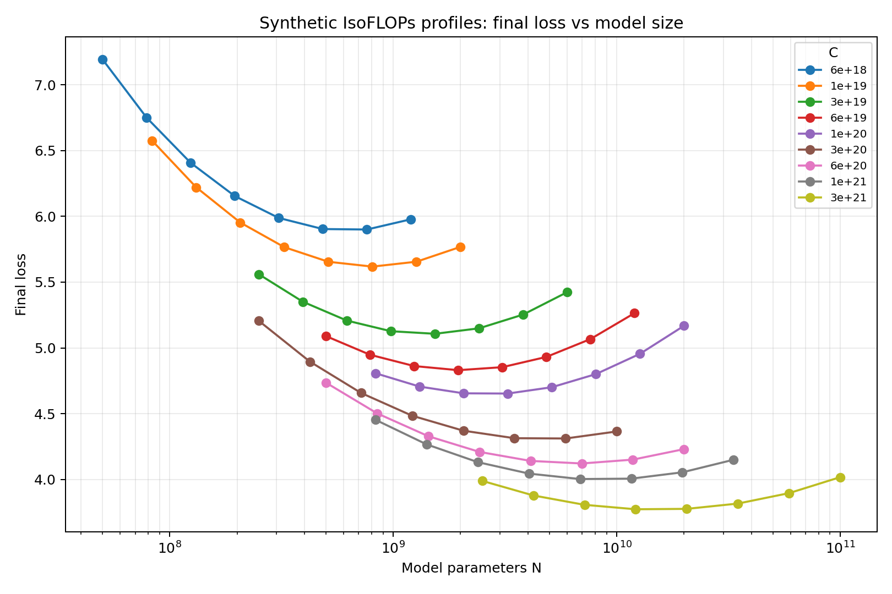

# CS336 Assignment 3: Scaling 深度课件式解析报告

---

## 目录

1. [Assignment 基本信息](#1-assignment-基本信息)
2. [PDF / Handout 结构化解析](#2-pdf--handout-结构化解析)
3. [代码结构解析](#3-代码结构解析)
4. [前置知识课件](#4-前置知识课件)
5. [推荐完成顺序与实验设计路线](#5-推荐完成顺序与实验设计路线)
6. [学习路线：从作业到真实 pretraining planning](#6-学习路线从作业到真实-pretraining-planning)
7. [附录 A：文件级索引与速查](#附录-a文件级索引与速查)
8. [附录 B：writeup 模板与检查清单](#附录-bwriteup-模板与检查清单)

---

# 1. Assignment 基本信息

## 1.1 作业名称、版本与主题

**作业名称**：`CS336 Assignment 3 (scaling): Scaling Laws`  
**handout 版本**：`Version 26.0.5`  
**课程学期**：Spring 2026  
**主题方向**：语言模型 scaling laws、Chinchilla compute-optimal training、固定预算下的模型大小 / 数据量 / 超参数决策、API-based experiment management。

这份作业不是一个“调用 API 得到数字”的任务。它模拟的是一个真实的 pretraining budget planning 场景：你有一个有限的大规模训练预算，不能直接试错完整训练，因此必须用更小规模、更便宜的 pilot runs 去推断更大规模训练时的最优模型配置。

核心问题可以写成：

```text
给定最终训练预算：48 B200-hours
给定 scaling-law 探索预算：12 B200-hours
目标：选择一个最终模型训练配置，使最终 validation loss 尽可能低，并预测这个 loss。
```

这里的关键矛盾是：

```text
固定 compute / wall-clock budget 下：
  模型越大 -> 单 token 训练越贵，可训练 token 数 / steps 越少；
  模型越小 -> 可训练 token 数更多，但模型容量不足。

因此需要找到 N 与 D 的平衡点，而不是只追求更大模型或更多 tokens。
```

其中：

- `N`：模型参数量，尤其要注意 assignment 后面要求用 `12 * n_layer * d_model^2` 估计 non-embedding parameters。
- `D`：训练 token 数，即 `total_train_tokens`。
- `C`：训练 compute，handout 中回顾公式为 `C ≈ 6ND`。
- 最终 API leaderboard 目标是 **48 B200-hours** 下的 validation loss，而不是 `isoflops_curves.json` 中 synthetic FLOPs 数据本身。

---

## 1.2 最终目标

作业最终要完成两件事。

第一，完成 handout 中的 **`chinchilla_isoflops` problem**。这个问题使用 `data/isoflops_curves.json` 中的合成数据，复现 Chinchilla paper 中 IsoFLOPs 方法的简化版本：

1. 对每个固定 compute budget `C_i`，找到该预算下 final training loss 最小的 run。
2. 得到一组 `<C_i, N_opt(C_i)>` 和 `<C_i, D_opt(C_i)>` 点。
3. 对 `N_opt` 和 `D_opt` 分别拟合 power law。
4. 外推到 `10^23` 和 `10^24` FLOPs。
5. 输出 model-size scaling law plot、dataset-size scaling law plot，以及一句话预测结果。

第二，完成 **`scaling_laws` leaderboard problem**。这个问题需要你使用 hosted training API，在 **12 B200-hours** 的 scaling-law 预算内设计并提交一批训练实验，用这些实验拟合 scaling law，然后提交一个你认为在 **48 B200-hours** 下最优的最终训练配置和预测 final validation loss。

这两个问题的关系是：

```mermaid
flowchart LR
  A[Problem: chinchilla_isoflops<br/>synthetic IsoFLOPs data] --> B[学会从固定 compute 曲线找 N_opt 和 D_opt]
  B --> C[学会拟合 N_opt(C), D_opt(C) power laws]
  C --> D[Problem: scaling_laws<br/>真实 API pilot runs]
  D --> E[用有限 12 B200-hour 实验预算预测 48 B200-hour 最终配置]
```

---

## 1.3 学生路径：hosted API

README 的学生路径非常短，说明真正复杂的地方不在安装，而在实验设计。

学生应：

1. 使用 `uv sync` 安装基础依赖。
2. 设置环境变量 `A3_API_KEY` 为 8 位 Stanford ID，例如：

```sh
export A3_API_KEY=06123456
```

3. 通过 hosted API：

```text
http://hyperturing.stanford.edu:8000
```

提交实验、查询预算、查询实验状态、提交最终配置。

4. 使用 `examples/client_example.ipynb` 作为 API 起步示例。
5. 也可以打开 dashboard：

```text
http://hyperturing.stanford.edu:8000/dashboard
```

如果不在 Stanford network，handout 提醒可能需要 VPN。

学生路径的重点是：**训练应该通过 API 完成，不是本地自己训练大模型**。`training/` 目录对学生主要是理解模型结构、约束、参数量和运行流程的参考。

---

## 1.4 非学生 / 本地 / Modal 路径

README 中的 non-students 路径用于复现服务端、下载数据、直接运行训练或启动 API / dispatcher。

安装 server 依赖：

```sh
uv sync --extra server
```

下载 tokenized data：

```sh
uv run modal run scripts/1_download_tokenized_data.py
```

直接运行训练：

```sh
uv run cs336_scaling/training/run.py
```

启动 API 和 dispatcher 前需要设置数据库与内部 API key：

```sh
DATABASE_URL_PROD="postgresql://..."
DATABASE_URL_DEV="postgresql://..."
INTERNAL_API_KEY="SOMEKEY"
```

然后运行：

```sh
DB_ENV=prod uv run fastapi run &
DB_ENV=prod uv run dispatcher &
```

非学生路径说明这个 repo 实际包含一个较完整的训练服务系统：FastAPI 后端、PostgreSQL 数据库、Modal worker、B200 GPU training function、dispatcher、公平队列、budget accounting、dashboard、worker event logging。

---

## 1.5 代码结构总览

核心目录结构如下：

```text
assignment3-scaling-main/
  README.md
  cs336_assignment3_scaling.pdf
  data/
    isoflops_curves.json
  examples/
    client_example.ipynb
    dashboard.html
  cs336_scaling/
    client.py
    config.py
    app.py
    auth.py
    budget.py
    api/
      public.py
      internal.py
    db/
      tables.py
      sql_pydantic_types.py
    schemas/
      __init__.py
      base.py
      event.py
      experiment.py
    scheduler/
      experiment_selector.py
      dispatch_loop.py
    training/
      training_config.py
      run.py
      data.py
      loop.py
      optimizer.py
      model/
        config.py
        basic_model.py
        rope.py
        jax_utils.py
    tokenized_data.py
  tests/
    test_api.py
    test_scheduler.py
    conftest.py
  scripts/
    1_download_tokenized_data.py
    db/seed_users.py
  make_submission.sh
  entrypoint.sh
  pyproject.toml
```

从作业视角，最关键的文件可以分成五组。

| 文件组 | 作用 | 做作业时如何使用 |
|---|---|---|
| `cs336_assignment3_scaling.pdf` | handout，定义问题、预算、API endpoints、deliverables | 必读；writeup 的要求主要来自这里 |
| `data/isoflops_curves.json` | synthetic IsoFLOPs runs | 用于完成 `chinchilla_isoflops` |
| `client.py` + `client_example.ipynb` | hosted API 的 Python 客户端与示例 | 提交 / 查询实验、最终提交 |
| `training_config.py` + `model/config.py` + `optimizer.py` | TrainingConfig schema 与配置约束 | 所有实验配置必须满足这些约束 |
| `api/public.py` + `budget.py` + `scheduler/` + tests | 服务端行为、预算扣费、重复 config、队列公平性 | 理解为什么某些请求被拒绝、为什么预算被预留 |

---

## 1.6 提交内容

Handout 明确要求提交到 Gradescope：

1. `writeup.pdf`：完整描述你的 scaling-law 方法、实验设计、拟合过程、最终预测。要求足够详细，让别人能 reproduce。
2. `code.zip`：包含你为拟合 scaling law 和计算估计所写的代码。

另外，还要通过 API 提交：

1. predicted optimal hyperparameters，也就是最终训练配置。
2. predicted final validation loss。

这意味着最终结果存在两个提交通道：



`make_submission.sh` 会打包当前目录为 `cs336-assignment-3-submission.zip`，但会排除很多文件类型，包括 `*.json`、`*.txt`、`*.log`、`*.pkl`、`*.pickle`、`*.bin`、`*.pt`、`*.pth`、`.venv`、缓存目录等。这个脚本适合提交代码，但如果你的分析脚本依赖自己生成的 JSON 文件，默认会被排除；需要在 writeup 或代码中确保可复现，或者调整你的项目组织方式。

---

## 1.7 Writeup 应包含什么

根据 handout 的 `scaling_laws` 问题，writeup 至少需要回答：

1. 你如何在 12 B200-hours 预算下选择要 query 的 runs？
2. 你如何拟合 scaling law？使用了什么具体方法？
3. 你的 scaling law 对实验数据拟合得怎么样？
4. 对 48 B200-hours，scaling law 预测的 optimal model size 是多少？预测 loss 是多少？
5. 对这个 predicted optimal number of parameters，你会选择什么 hyperparameters？
6. 你如何估计 non-embedding parameters？handout 提醒使用：

```text
non-embedding params ≈ 12 * n_layer * d_model^2
```

一个合格 writeup 不应该只有最终配置和一个 loss 数字，而应该说明：

```text
实验选择依据 -> API budget 管理 -> 数据清洗与失败 run 处理 -> scaling law 拟合 -> 拟合诊断 -> 48h 配置推断 -> 不确定性与备选方案
```

---

# 2. PDF / Handout 结构化解析

## 2.1 Assignment Overview：真实 pretraining budget planning 的模拟

Handout 的开场设定是：你负责训练 ClosedAI 的下一代语言模型。这个模型训练成本巨大，所以必须在训练前就尽可能选对配置。

它把问题转化为：

```text
给定固定 compute budget，找最低 training loss 的 compute-optimal model。
```

这里不是“越大越好”。原因是如果 compute 固定，`N` 变大时，训练每个 token 所需 compute 增加，可训练的 `D` 或 optimizer steps 就会减少。极端情况下，模型大到连一个 gradient step 都超过预算，则模型几乎无法训练，loss 反而很差。

反过来，如果模型太小，即使能训练很多 token，模型容量也不足，loss 也会高。

因此固定 budget 下 validation / training loss 相对 model size 往往呈现一个近似 U-shape：

```text
loss
 ^
 |  too small: capacity-limited
 |  \ 
 |   \       near compute-optimal
 |    \_____/\
 |          \ \ too large: under-trained
 +--------------------------> model size N, with C fixed
```

这就是 IsoFLOPs profile 的核心直觉。

---

## 2.2 Scaling laws 背景

Scaling laws 经验性描述了语言模型训练损失与以下变量之间的关系：

- model size / parameter count `N`
- training tokens `D`
- training compute `C`
- 有时还包括 dataset quality、architecture、optimizer、batch size 等因素

典型形式是 power law，例如：

```text
L(N) ≈ A * N^{-alpha} + E
L(D) ≈ B * D^{-beta} + E
L(N, D) ≈ E + A / N^alpha + B / D^beta
```

其中 `E` 可理解为 irreducible loss / entropy-like floor。实际拟合时，是否加 `E`、是否拟合二维 loss surface、是否只拟合 optima power law，都取决于数据量和拟合稳定性。

Handout 在 review 部分重点介绍了 Chinchilla paper 中的一种方法：**IsoFLOPs profiles**。

---

## 2.3 Compute 估算公式 `C ≈ 6ND`

Handout 回顾：训练一个 Transformer，参数量为 `N`，训练数据量为 `D` tokens，训练 compute 近似为：

```text
C ≈ 6 * N * D
```

直觉：

- 每个 token 的 forward / backward / optimizer update 的成本与参数量成正比。
- 经验上常用 `6ND` 作为 Transformer training FLOPs 的粗略估算。
- 这个公式忽略了很多实际因素，如 attention quadratic term、embedding/head、activation recomputation、kernel efficiency、sequence length、batch size、hardware utilization、编译和 eval overhead。

在本作业中，这个公式有两个层次：

1. 在 `chinchilla_isoflops` synthetic 问题里，`compute_budget` 已经以 FLOPs 给出，可以直接用：

```text
D = C / (6N)
```

2. 在真实 API leaderboard 问题里，最终预算是 wall-clock time：`48 B200-hours`。这时不能只用 `6ND`；还要用 pilot runs 估计 runtime 和实际吞吐。更稳妥的做法是同时拟合：

```text
loss ≈ f(N, D, hyperparams)
runtime_seconds ≈ g(N, D, architecture, batch_size, n_evals, dtype)
```

最终选择要满足：

```text
runtime_seconds(config) <= 48 * 3600
```

同时 loss 尽量低。

---

## 2.4 Chinchilla / IsoFLOPs 方法

IsoFLOPs 方法的流程：

```mermaid
flowchart TD
  A[选择若干 compute budgets C_i] --> B[对每个 C_i 训练多种 model sizes N_ij]
  B --> C[令 D_ij = C_i / (6N_ij)]
  C --> D[得到每个 run 的 final loss L_ij]
  D --> E[对每个 C_i 找 loss 最低的 N_opt(C_i)]
  E --> F[由 D_opt(C_i)=C_i/(6N_opt) 得到最优 token 数]
  F --> G[拟合 N_opt ∝ C^a 和 D_opt ∝ C^b]
  G --> H[外推到目标 compute]
```

Chinchilla paper 原始方法会对每条 IsoFLOPs profile 拟合一个 quadratic curve 来找最小点。Handout 这里简化建议：**直接取每个 compute budget 下 final loss 最小的 run 作为 minimum**。

这个简化很重要：它降低了作业实现复杂度，也提醒你在真实 API 实验中要让每条 profile 覆盖足够多的 `N` 范围，否则你取到的“最小点”可能只是网格边界，而不是真正最优点。

### 为什么固定 compute 下不能只增大模型？

固定 `C` 时：

```text
D = C / (6N)
```

如果 `N` 增大，`D` 必须减小。也就是说，你获得更大的模型容量，但训练 token 数减少。太大的模型会 under-trained：参数很多，但更新太少，loss 无法充分下降。

### 为什么不能只增大数据 token 数？

如果固定 `C`，增加 `D` 意味着减小 `N`。这会让模型容量不足。小模型即使看更多 tokens，也可能因为表达能力不够，无法达到更低 loss。

### 为什么 N 与 D 需要平衡？

因为 `N` 控制容量，`D` 控制训练信号量，两者同时决定最终 loss。Chinchilla 的核心 insight 是：很多早期大模型训练得太少 token、模型过大，compute-optimal regime 需要相对更多 tokens 和更小一些的模型。

---

## 2.5 `chinchilla_isoflops` Problem 解析

### 基本信息

| 项目 | 内容 |
|---|---|
| Problem 名称 | `chinchilla_isoflops`: IsoFLOPs scaling laws |
| 分值 | 5 points |
| 输入文件 | `data/isoflops_curves.json` |
| 数据格式 | JSON array，每个 object 有 `parameters`、`compute_budget`、`final_loss` |
| 方法 | 每个 compute budget 内找 final_loss 最小 run，得到 `N_opt`；再由 `D=C/(6N)` 得到 `D_opt` |
| 输出图表 | model-size scaling law plot；dataset-size scaling law plot |
| 输出结论 | 预算 `10^23` 与 `10^24` FLOPs 下的 predicted optimal model size 和 dataset size |

### JSON 数据实际结构

我读取 `data/isoflops_curves.json` 后得到：

```text
总 runs: 72
compute budgets: 9 个
每个 compute budget: 8 个 model-size choices
```

按 handout 推荐的“每个 budget 取最低 final_loss run”方法，得到下面的 sanity-check 表。不同拟合细节可能导致最终数字略有变化，但这个表可用于检查你自己的解析是否明显错误。

| compute budget C | N_opt by min loss | D_opt = C / (6N) | final_loss | D/N |
|---:|---:|---:|---:|---:|
| `6e18` | 762,093,419 | 1,312,175,089 | 5.899930 | 1.722 |
| `1e19` | 806,647,749 | 2,066,164,157 | 5.617943 | 2.561 |
| `3e19` | 1,536,852,354 | 3,253,402,962 | 5.107177 | 2.117 |
| `6e19` | 1,952,041,776 | 5,122,841,182 | 4.830586 | 2.624 |
| `1e20` | 3,253,402,960 | 5,122,841,182 | 4.652893 | 1.575 |
| `3e20` | 5,903,836,027 | 8,469,069,902 | 4.311219 | 1.435 |
| `6e20` | 6,971,055,968 | 14,345,028,997 | 4.121241 | 2.058 |
| `1e21` | 6,859,328,563 | 24,297,810,658 | 4.002835 | 3.542 |
| `3e21` | 12,148,905,329 | 41,155,971,378 | 3.773188 | 3.388 |

如果用简单 log-log linear regression 拟合：

```text
log10 N_opt = 0.065733 + 0.468683 * log10 C
log10 D_opt = -0.843884 + 0.531317 * log10 C
```

那么外推结果约为：

| target C | predicted N_opt | predicted D_opt |
|---:|---:|---:|
| `1e23` | 7.005e10 | 2.379e11 |
| `1e24` | 2.061e11 | 8.086e11 |

下面是基于该 JSON 实际生成的辅助图，已经放在本报告同目录的 `CS336_A3_Scaling_LectureReport.assets/` 中。









注意：这里的 `N_opt` 与 `D_opt` 是 synthetic IsoFLOPs problem 的 sanity-check 数值，不是 48 B200-hour leaderboard 的最终答案。leaderboard 需要你实际用 API 实验结果拟合。

### 推荐图表

Problem (a) 的图：

```text
x-axis: compute budget C, log scale
 y-axis: N_opt(C), log scale
 points: 每个 C_i 下取到的 N_opt
 line: fitted power law N_opt = A C^a
 extend: 至少外推到 10^24 FLOPs
```

Problem (b) 的图：

```text
x-axis: compute budget C, log scale
 y-axis: D_opt(C), log scale
 points: 每个 C_i 下由 C/(6N_opt) 得到的 D_opt
 line: fitted power law D_opt = B C^b
 extend: 至少外推到 10^24 FLOPs
```

### 容易遗漏的点

1. `D_opt` 不在 JSON 中直接给出，需要用 `D=C/(6N)` 算。
2. 不要把所有 runs 混在一起直接拟合 loss vs N；本题要求先按固定 `C` 分组找 minimum。
3. 不要只画散点，要画 fitted scaling law 并外推到至少 `10^24`。
4. 题目要求一句话回答 `10^23` 和 `10^24` 的 predicted optimal size。
5. 如果你使用 quadratic interpolation 而不是直接取 minimum，需要在 writeup 里说明；handout 推荐直接取 minimum。

---

## 2.6 Constructing Scaling Laws：真实 API 部分

Handout 第 3 节要求使用 training API 设计真实实验，目标是选择 48 B200-hours 下最低 validation loss 的配置。

关键约束：

```text
探索预算：12 B200-hours
最终预算：48 B200-hours
所有 runs：single B200
训练数据：tokenized DCLM，最多 500B training tokens
vocab size：32K
context length：512
loss：mean next-token cross-entropy over 512-token sequences
API model：无 dropout
optimizer：AdamW 或 SGD，warmup-cosine schedule
```

### API 训练时发生什么？

一个 submitted experiment 会按照 `n_evals` 切成多个 chunks：

```text
tokens per chunk = total_train_tokens / n_evals
每个 chunk 训练后跑一次 validation
status.val_losses 中保存每次 eval 的 validation loss
completed run 的 final validation loss = val_losses[-1]
```

这意味着 `n_evals` 不只是日志频率，它会影响：

- 你能否观察 learning curve 形状。
- validation overhead。
- `total_optimizer_steps` 必须能被 `n_evals` 整除。

### 数据顺序与 seed

Handout 说明：

- training data order 是固定 deterministic order。
- validation set 固定。
- `model_seed` 只控制模型初始化，不控制数据顺序。
- final leaderboard validation loss 会使用更多 tokens。

这带来两个后果：

1. 不同配置之间的数据顺序可比性更强。
2. 用少量 seed repeat 可以估计 initialization noise，但 repeat 很耗 budget；要谨慎。

### failed / timeout runs

Failed timeout experiments 可能有 partial validation losses，但 handout 明确说它们不是 completed runs。拟合 final-loss scaling law 时要非常小心：

- completed run：可以用 `val_losses[-1]` 作为 final validation loss。
- running run：只能用于观察趋势，不能当 final。
- failed timeout：partial losses 可辅助判断 learning curve / runtime，但不应直接当完成实验的 final loss。

---

## 2.7 API endpoints 解析

Handout 与 `api/public.py` / `client.py` 对应如下。

| Endpoint | Python client | 作用 |
|---|---|---|
| `GET /budget` | `get_budget()` | 返回 used / remaining / total budget seconds |
| `POST /submit` | `submit_experiment(training_config)` | 提交一个 training run 到队列 |
| `GET /experiments` | `list_experiments()` | 返回当前用户所有 experiments |
| `GET /experiment/{id}` | `get_experiment(id)` | 查询单个 experiment |
| `POST /final_submission` | `save_final_submission(...)` / `save_final_submission_json(...)` | 保存最终训练配置与 predicted final loss |
| `GET /final_submission` | `get_final_submission()` | 查看当前最终提交 |

所有 public API 都需要请求头：

```text
X-API-Key: <8-digit student id>
```

`client.py` 中 `_api_headers()` 会检查环境变量 `A3_API_KEY`：必须长度为 8 且全是数字，否则抛 `ValueError`。

---

## 2.8 Budget tracking：queued / running / completed 如何计算预算

这是本作业最容易浪费预算的地方。

Handout 规则：

```text
queued 或 running experiments：按完整 max_runtime_seconds 预留预算。
completed 或 failed experiments：按实际 reported runtime 重新计算，clip 到至少 1 秒、至多 max_runtime_seconds。
如果 run 提前完成，未使用的 reserved budget 会返还。
如果 run timeout，按 max_runtime_seconds 计费。
```

源码 `budget.py` 的逻辑可概括为：

```text
if status in {completed, failed}:
    charged_seconds = min(max(1.0, used_runtime_seconds), max_runtime_seconds)
elif status in {queued, running}:
    charged_seconds = max_runtime_seconds
else:
    charged_seconds = 0
```

这意味着：

- 你提交一个 `max_runtime_seconds=3600` 的 run，即使还没开始，也会立刻占用 1 小时预算。
- 如果它 12 分钟完成，budget 会从 1 小时扣费变成约 12 分钟扣费。
- 如果你一次性排队很多长 run，`remaining_seconds` 会立刻下降，可能阻止你继续提交更重要的实验。
- 如果 `max_runtime_seconds` 设太小，run 可能 timeout，partial losses 不能直接当 completed final loss 用。
- 如果 `max_runtime_seconds` 设太大，queued/running 阶段会锁住预算。

`examples/client_example.ipynb` 里示范：提交一个 reserve 60 秒的实验后，预算先显示用掉 60 秒；完成后实际只用约 10.18 秒，剩余预算返还。

### 预算管理建议

把 `max_runtime_seconds` 当作“预算保证金”而不是“预计训练时间”。推荐流程：

1. 先做 tiny / small dry run，估计 runtime。
2. 对类似规模配置设置 `max_runtime_seconds ≈ measured_runtime * 1.2` 到 `1.5`，留出少量安全边际。
3. 不要一次性排队太多长 run；分批提交，等 completed/refund 后再继续。
4. 长 run 前先确认该 architecture 不会因为 config、memory 或 runtime 出错。
5. 保留 5-10% 预算作为补救和 final sanity check。

---

## 2.9 Training config constraints

Handout 和 `TrainingConfig` schema 共同定义了实验配置约束。

### 固定 class variables

`TrainingConfig` 中固定：

```text
seq_len = 512
n_val_tokens = 2^18 = 262,144
```

`total_train_tokens` 最大：

```text
total_train_tokens <= 500,000,000,000
```

### token divisibility constraints

源码要求：

```text
tokens_per_optimizer_step = seq_len * train_batch_size

1. total_train_tokens % tokens_per_optimizer_step == 0
2. total_optimizer_steps % n_evals == 0
3. n_val_tokens % (seq_len * val_batch_size) == 0
```

合并前两个条件，实用上建议直接保证：

```text
total_train_tokens is divisible by 512 * train_batch_size * n_evals
```

例如：

```text
train_batch_size = 128
n_evals = 16
512 * 128 * 16 = 1,048,576
```

所以 `total_train_tokens` 选择 `1,048,576`、`8,388,608`、`67,108,864` 这类倍数会比较稳。

对 validation：

```text
n_val_tokens = 262,144
seq_len = 512
n_val_sequences = 512
```

因此 `val_batch_size` 必须整除 512。常见合法值有：1, 2, 4, 8, 16, 32, 64, 128, 256, 512。

### architecture constraints

`BasicTransformerConfig` 字段：

```text
attention_bias: bool
head_dim: int
hidden_size: int
intermediate_size: int
num_attention_heads: int
num_hidden_layers: int
num_key_value_heads: int
rms_norm_eps: float
rope_theta: int
tie_word_embeddings: bool
dtype: "float32" or "bfloat16"
vocab_size: int
```

`TrainingConfig` 进一步验证：

```text
hidden_size == num_attention_heads * head_dim
num_attention_heads % num_key_value_heads == 0
num_key_value_heads == num_attention_heads   # GQA is not supported
head_dim must be even for RoPE
intermediate_size >= hidden_size
rms_norm_eps > 0
rope_theta > 0
positive int fields > 0
```

注意：虽然字段里有 `num_key_value_heads`，但 validator 明确要求它等于 `num_attention_heads`，因此本作业 API 模型不支持 GQA。不要以为可以通过减少 KV heads 节省 compute。

### optimizer constraints

支持 AdamW 和 SGD。示例使用 AdamW。

Warmup-cosine schedule 字段：

```text
peak_value
final_lr_frac
warmup_frac
init_value
```

约束：

```text
0 <= warmup_frac < 1
0 <= final_lr_frac <= 1
init_value >= 0
peak_value > 0
grad_clip_norm is None or > 0
```

AdamW 额外约束：

```text
weight_decay >= 0
0 <= beta1 < 1
0 <= beta2 < 1
eps > 0
eps_root >= 0
```

### dtype

`dtype` 只能是：

```text
"float32" or "bfloat16"
```

示例和真实 B200 训练通常应使用 `bfloat16`，但如果你做 tiny debug 或本地 CPU 测试，测试中也出现过 `float32`。

---

## 2.10 Final submission

`POST /final_submission` 请求体：

```json
{
  "training_config": { ... },
  "predicted_final_loss": 2.75
}
```

API 允许重复提交，最新提交覆盖之前的。

`FinalSubmissionRequest` 要求：

```text
training_config: TrainingConfig
predicted_final_loss > 0
```

源码中 `save_final_submission` 不检查 12-hour scaling-law budget，也不做 duplicate experiment 约束；它只是保存你的 final configuration 和 loss prediction。

需要注意一个细节：handout 的 `POST /submit` 说 `max_runtime_seconds` 必须在 1 秒到 12 小时之间；但 `TrainingConfig` schema 只要求 `max_runtime_seconds >= 1`，而 `final_submission` 不走 `/submit` 的 remaining budget check。对于 48 B200-hour final config，通常应让 `training_config` 与 48-hour target 语义一致，例如明确设置或说明 final runtime target；具体如何处理要以 API 最终接受的 schema 为准，并在提交前用 `get_final_submission()` 验证。

---

## 2.11 `scaling_laws` leaderboard / problem 解析

### 基本信息

| 项目 | 内容 |
|---|---|
| Problem 名称 | `scaling_laws`: Constructing scaling laws leaderboard |
| 分值 | 50 points |
| 实验预算 | 12 B200-hours hard cap |
| 最终目标 | 选择 48 B200-hours 下最低 validation loss 的 model config |
| 实验方式 | 通过 hosted training API 查询 validation loss |
| final 提交 | predicted optimal hyperparameters + predicted final validation loss |
| writeup 要求 | 完整方法论、实验设计、拟合、诊断、最终预测，可复现 |

### Handout 明确建议 writeup 至少讨论的问题

1. 固定 12 B200-hour scaling-law budget 下，如何决定 query 哪些 runs？
2. 如何拟合 scaling law？具体方法是什么？是否参考 Kaplan、Chinchilla、Yang 等？
3. scaling law 对实验数据拟合得如何？
4. 给定 48 B200-hours，预测的 optimal model size 是多少？predicted loss 是多少？
5. 对 predicted optimal number of parameters，会用什么 hyperparameters？
6. 如何估计 non-embedding parameters？使用：

```text
non-embedding params ≈ 12 * n_layer * d_model^2
```

### 容易遗漏的 deliverables

- API final submission 不等于 Gradescope writeup；两者都要做。
- writeup 要有方法，不只是最后一个 config JSON。
- 要报告 predicted final validation loss，而不是只报告 best pilot run loss。
- 需要说明如何从 pilot scale 外推到 48 B200-hours。
- 要说明 budget usage 和失败 / timeout / duplicate runs 如何处理。
- 最终 config 必须和 predicted loss 的计算一致。例如不能用一个 60s pilot config 的 loss 当 48h final config 的 predicted loss。

---

## 2.12 Problem / TODO / Deliverable 总表

Handout 中的显式 graded problems 只有两个；指定源码文件中没有需要学生填空的核心 TODO。也就是说，本作业的“TODO”主要体现在实验设计、分析代码和 writeup，而不是补全仓库中的某个函数。

| 类别 | 名称 | 分值 | 输入文件 / 数据来源 | 需要产出 | 图表要求 | 容易遗漏的要求 |
|---|---|---:|---|---|---|---|
| Problem | `chinchilla_isoflops` | 5 | `data/isoflops_curves.json` | 对每个 compute budget 取最低 loss run；拟合 `N_opt(C)` 与 `D_opt(C)`；回答 `1e23` 和 `1e24` FLOPs 下的最优模型大小和数据量 | model-size scaling law plot；dataset-size scaling law plot；显示 fit points 和外推曲线 | `D` 不是 JSON 字段，要用 `C/(6N)`；不要把所有点混在一起直接拟合；必须给一句话数值结论 |
| Problem | `scaling_laws` | 50 | Hosted training API completed runs | 12 B200-hour 内设计实验并拟合 scaling law；提交 48 B200-hour final config 与 predicted final validation loss | 自行决定，但建议至少包含 experiment table、loss curves、scaling-law fit、runtime calibration、final candidate comparison | queued/running 会预扣预算；failed timeout 不能当 completed final loss；final loss 必须对应 final config；writeup 要可复现 |
| Deliverable | `writeup.pdf` | 计入上述问题 | 你的实验日志、API results、拟合脚本输出 | 完整描述方法、结果、诊断、最终预测 | 图表应在正文中解释，不只是附图 | 只写最终配置、不写如何决定，会丢失大量可解释性 |
| Deliverable | `code.zip` | 计入上述问题 | 你写的分析代码、绘图代码、拟合代码 | Gradescope 提交代码包 | 不要求单独图表，但代码应能重建图表/结果 | `make_submission.sh` 排除 `*.json`/`*.txt`/`*.log`，不要让关键中间文件只存在这些格式里 |
| Deliverable | API `final_submission` | leaderboard 相关 | `training_config` + `predicted_final_loss` | 最新一次 final submission 会覆盖之前提交 | Dashboard 可查看 final submission | 提交后用 `get_final_submission()` 验证；不要保留 pilot run 的短 `max_runtime_seconds` 语义 |

---

# 3. 代码结构解析

## 3.1 `README.md`

README 是入口说明。它主要传达：

- 完整作业描述在 PDF。
- 学生只需要基础依赖：`uv sync`。
- 设置 `A3_API_KEY`。
- hosted API 和 docs/dashboard 地址。
- 示例 notebook 在 `examples/client_example.ipynb`。
- 非学生可安装 `server` extra，下载 tokenized data，直接跑训练，或启动 API + dispatcher。

README 非常短，说明本作业真正的信息分散在 handout、schema、API tests、training code 中。

---

## 3.2 `client.py`：学生最常用 API wrapper

`client.py` 定义：

```python
API_BASE_URL = "http://hyperturing.stanford.edu:8000"
API_KEY = os.getenv("A3_API_KEY", "")
```

核心函数：

| 函数 | Endpoint | 返回类型 | 作用 |
|---|---|---|---|
| `get_budget()` | `GET /budget` | `BudgetSummary` | 查询 used / remaining / total seconds |
| `submit_experiment(training_config)` | `POST /submit` | `SubmitResponse` | 验证并提交 TrainingConfig |
| `list_experiments()` | `GET /experiments` | `list[ExperimentResponse]` | 列出当前用户 experiments |
| `get_experiment(experiment_id)` | `GET /experiment/{id}` | `ExperimentResponse` | 查询单个 experiment |
| `save_final_submission(training_config, predicted_final_loss)` | `POST /final_submission` | `FinalSubmissionResponse` | 提交最终配置与预测 loss |
| `save_final_submission_json(submission)` | `POST /final_submission` | `FinalSubmissionResponse` | JSON 形式提交 final submission |
| `get_final_submission()` | `GET /final_submission` | `FinalSubmissionResponse | None` | 查询最终提交 |

重要行为：

1. `_api_headers()` 会拒绝非 8 位数字的 `A3_API_KEY`。
2. `submit_experiment()` 会先用 `TrainingConfig.model_validate(...)` 本地验证，再 `model_dump(mode="json")` 发送。
3. `_request_json()` 会对非 2xx HTTP response 抛 `RuntimeError`，并包含 response text。因此 400/409 错误会以 RuntimeError 出现在 notebook 中。
4. `save_final_submission()` 会构造 `FinalSubmissionRequest`，所以 `predicted_final_loss` 必须大于 0。

### 学生使用建议

在 notebook 里不要手写 `requests.post`，优先用 `client.py`，因为它帮你做 Pydantic validation 和响应类型校验。只有当你要 debug HTTP 细节时才直接使用 `requests`。

---

## 3.3 `config.py`：服务端设置和预算总量

`Settings` dataclass 中的关键字段：

```text
total_budget_seconds = 12.0 * 3600.0
max_concurrent_workers = 100
zero_running_user_headroom = 10
dispatch_interval_seconds = 5
reconcile_interval_seconds = 30
modal_app_name = "a3-scaling"
```

`settings_from_env()` 根据 `DB_ENV` 选择 `DATABASE_URL_DEV` 或 `DATABASE_URL_PROD`，同时读取 `INTERNAL_API_KEY`、`API_BASE_URL`、`LAUNCH_MODE`。

作业角度最重要的是：

```text
12 B200-hours = 43200 seconds
```

这就是 `/budget` 中 `total_budget_seconds` 的默认值。

---

## 3.4 `schemas/experiment.py`：experiment 状态机

该文件定义 experiment status 的 Pydantic schema。

状态类型：



对应字段：

| status_type | 字段 | 含义 |
|---|---|---|
| `queued` | `queued_at` | 等待 dispatcher 调度 |
| `running` | `queued_at`, `dispatched_at`, `run_id`, `val_losses` | worker 已开始，可能已有部分 val losses |
| `completed` | `queued_at`, `dispatched_at`, `run_id`, `used_runtime_seconds`, `val_losses`, `completed_at` | 正常完成 |
| `failed` | `queued_at`, `dispatched_at`, `run_id`, `used_runtime_seconds`, `reason`, `failed_at` | 失败或 timeout |

失败原因有两类：

```text
timeout: partial_val_losses
unexpected: failure string
```

这解释了为什么 failed timeout run 可能有 partial losses，但它不是 completed run。

---

## 3.5 `schemas/__init__.py`：API response/request schema

关键 schema：

```text
BudgetSummary:
  used_seconds
  remaining_seconds
  total_budget_seconds

SubmitResponse:
  experiment_id
  budget_summary

ExperimentResponse:
  experiment_id
  training_config
  status

FinalSubmissionRequest:
  training_config
  predicted_final_loss > 0

FinalSubmissionResponse:
  training_config
  predicted_final_loss
  submitted_at
```

`BudgetSummary.with_reserved_runtime_seconds()` 用于 `/submit` 返回时立即体现新 run 的 reserved budget。

---

## 3.6 `training/model/config.py`：Transformer config schema

`BasicTransformerConfig` 是 architecture config 的 schema。字段与 handout POST `/submit` 中列出的 `architecture_config` 一致。

这个 schema 本身只定义字段类型；真正的合法性检查在 `TrainingConfig.validate_training_config()` 中完成。

### 典型配置

Notebook 示例：

```text
attention_bias = False
head_dim = 64
hidden_size = 448
intermediate_size = 1280
num_attention_heads = 7
num_hidden_layers = 9
num_key_value_heads = 7
rms_norm_eps = 1e-6
rope_theta = 1_000_000
tie_word_embeddings = False
dtype = "bfloat16"
vocab_size = 32_000
```

这个配置的几个含义：

- `hidden_size = 7 * 64 = 448` 合法。
- `num_key_value_heads = num_attention_heads`，无 GQA。
- `head_dim=64` 是偶数，RoPE 合法。
- `tie_word_embeddings=False`，因此 input embedding 和 output LM head 都有参数。

---

## 3.7 `training/training_config.py`：最重要的约束文件

`TrainingConfig` 是所有 API submission 的核心 schema。

字段：

```text
architecture_config: BasicTransformerConfig
optimizer_config: OptimizerConfig
seq_len: ClassVar[int] = 512
train_batch_size: int > 0
val_batch_size: int > 0
n_val_tokens: ClassVar[int] = 2^18
n_evals: int > 0
total_train_tokens: int > 0 and <= 500B
max_runtime_seconds: float >= 1
model_seed: int >= 0
```

派生属性：

```text
tokens_per_optimizer_step = 512 * train_batch_size
eval_every_tokens = total_train_tokens / n_evals
optimizer_steps_per_eval = eval_every_tokens / tokens_per_optimizer_step
total_optimizer_steps = total_train_tokens / tokens_per_optimizer_step
unique_id = stable_json_hash(self)
```

### 关键推论

如果 `total_train_tokens` 不能整除 `512 * train_batch_size * n_evals`，通常会触发 validator：

```text
total_train_tokens must be divisible by seq_len * train_batch_size
```

或：

```text
total optimizer steps must be divisible by n_evals
```

因此设计 token grid 时，应先定 `train_batch_size` 与 `n_evals`，再选择合法 `total_train_tokens`。

### 示例计算

若：

```text
train_batch_size = 128
n_evals = 16
total_train_tokens = 8,388,608
```

则：

```text
tokens_per_optimizer_step = 512 * 128 = 65,536
total_optimizer_steps = 8,388,608 / 65,536 = 128
eval_every_tokens = 8,388,608 / 16 = 524,288
optimizer_steps_per_eval = 524,288 / 65,536 = 8
```

这说明一个 run 会有 16 次 eval，每次 eval 前训练 8 个 optimizer steps。

---

## 3.8 `training/optimizer.py`：AdamW / SGD 与 LR schedule

支持：

```text
SGDConfig
AdamWConfig
WarmupCosineDecay
```

示例使用 AdamW：

```text
peak_value = 3e-4
final_lr_frac = 0.1
warmup_frac = 0.05
init_value = 0.0
weight_decay = 1e-2
beta1 = 0.9
beta2 = 0.95
eps = 1e-8
eps_root = 1e-8
grad_clip_norm = 1.0
```

LR schedule 是 warmup-cosine：

```text
warmup_steps = int(total_optimizer_steps * warmup_frac)
decay_steps = total_optimizer_steps
end_value = peak_value * final_lr_frac
```

### 实验设计含义

`peak_value`、`warmup_frac`、`final_lr_frac` 可能显著影响小模型和大模型的 final loss。你可以：

- 固定 architecture 和 tokens，扫一小组 learning rates。
- 看不同 size 下最优 LR 是否遵循某种趋势。
- 对最终 config 使用相近规模中表现稳健的 LR，而不是默认值。

但 LR sweep 很容易耗预算；建议先在较小 scale 做，确认趋势后再扩展。

---

## 3.9 `training/model/basic_model.py`：模型结构与参数量

模型大致是 decoder-only causal LM：



每个 decoder layer：

```text
RMSNorm -> self-attention -> residual
RMSNorm -> SwiGLU-like MLP -> residual
```

Attention：

- q/k/v/o projections。
- q_norm 和 k_norm 是 RMSNorm over `head_dim`。
- RoPE positional embedding。
- causal attention。
- GQA 字段存在但 validator 禁止 GQA，因此 q/k/v heads 数相同。

MLP：

```text
gate_proj: hidden -> intermediate
up_proj: hidden -> intermediate
down_proj: intermediate -> hidden
activation: silu(gate) * up
```

Embedding：

- `embed_tokens`: `vocab_size * hidden_size`
- 如果 `tie_word_embeddings=False`，还有 `lm_head`: `hidden_size * vocab_size`
- 如果 `tie_word_embeddings=True`，输出 head 共享 input embedding weight。

### 参数量估计

Handout 在 final writeup 部分要求：

```text
non-embedding params ≈ 12 * n_layer * d_model^2
```

这个估计常用于 Chinchilla 风格模型大小分析，忽略 embedding、norm、小常数项，并假定 MLP ratio 与标准 Transformer 近似。

源码模型的更细近似是：

```text
per layer attention weights ≈ 4 * d_model^2
per layer MLP weights ≈ 3 * d_model * intermediate_size
layer norm / qk norm params 相对较小
embedding params = vocab_size * d_model
untied lm_head params = vocab_size * d_model
```

如果 `intermediate_size ≈ 8/3 * d_model`，则：

```text
MLP ≈ 8 * d_model^2
attention + MLP ≈ 12 * d_model^2
```

这就对应 handout 给出的 `12 * n_layer * d_model^2`。

如果你选择 `intermediate_size = 4 * d_model`，那么非 embedding 参数更接近：

```text
attention + MLP ≈ 4d^2 + 12d^2 = 16d^2 per layer
```

因此 writeup 中一定要说明你使用的参数量定义：

- 是 handout 要求的 non-embedding estimate？
- 还是源码模型 exact trainable params？
- scaling law 拟合和 final config 中是否保持同一口径？

---

## 3.10 `training/run.py`：真实训练流程参考

学生不应直接用本地训练替代 API，但 `run.py` 帮助理解 API 返回的 loss 是如何产生的。

流程：

1. 创建 output path，写入 `training_config.json`。
2. 初始化 WandB run。
3. 下载 / 准备 DCLM data。
4. 构建 JAX mesh，做 FSDP sharding。
5. 根据 `model_seed` 创建模型。
6. `count_params(model)` 记录 trainable params。
7. build optimizer。
8. 编译 `outer_loss`，估算 memory。
9. 循环 `n_evals` 个 chunks：
   - 检查 timeout。
   - 取当前 chunk 的 train data。
   - 执行训练 steps。
   - 计算 validation loss。
   - append 到 `val_losses`。
   - 通过 internal API 上报 validation loss event。
10. completed 后上报 `CompletedPayload`，包含 `used_runtime_seconds` 和 `val_losses`。
11. 如果 timeout，上报 `FailedPayload`，reason 为 `TimeoutReason(partial_val_losses=...)`。
12. 如果 unexpected exception，上报 `UnexpectedReason`。

这个流程解释了几个现象：

- running 状态下可以看到逐步增长的 `val_losses`。
- timeout 后可能有 partial losses。
- 编译、数据下载、validation 都会影响 wall-clock runtime。
- `max_runtime_seconds` 是训练 loop 的超时依据之一。
- `model_seed` 只进入模型初始化。

---

## 3.11 `training/data.py`：数据切片与固定顺序

训练数据逻辑：

- `Batch.train_data` 根据 `batch_idx` 和 `eval_every_tokens` 决定 token range。
- 每个 chunk 内按 sequence 读取 512-token examples。
- 每个数据 chunk 的 sequence order 用 `np.random.default_rng(chunk_idx).permutation(...)`，由 chunk index 决定，不由 `model_seed` 决定。
- validation data 从固定 validation file 的前 `n_val_tokens + 1` tokens 读取。

这与 handout 的“data order fixed”一致。

实验设计含义：

- 同一 `total_train_tokens` 下，不同 model configs 看到的是同一 deterministic data prefix / order，因此横向比较更公平。
- 改 `model_seed` 只改变初始化，不改变数据。
- 如果你想估计数据顺序噪声，本作业 API 不直接提供 data seed；只能估计 initialization noise。

---

## 3.12 `training/loop.py`：loss 定义

`sharded_sequence_loss` 使用：

```text
optax.softmax_cross_entropy_with_integer_labels(logits, labels)
per-token CE over 512-token sequence
mean over sequence and batch
```

`outer_loss` 先训练一个 chunk，再跑 validation，返回：

```text
OuterLossResult:
  val_loss
  train_losses
  model
  state
  opt_state
```

因此 API 返回的 `val_losses` 是每个 chunk 后的 validation CE loss。completed run 的 final validation loss 就是最后一个。

---

## 3.13 `api/public.py`：服务端 public API 行为

### `/submit`

提交逻辑：

1. 锁当前用户 row，防止并发提交预算竞争。
2. 计算当前 budget summary。
3. 如果 `training_config.max_runtime_seconds > remaining_seconds`，返回 400 insufficient budget。
4. 计算 `training_config.unique_id`。
5. 如果同一用户已提交过相同 training config，返回 409 conflict。
6. 创建 experiment，状态为 queued。
7. 写入 QueueEvent。
8. 返回 experiment id 和预留后的 budget summary。

### `/experiments`

返回当前用户所有 experiments，按 queued time 和 id 排序。

### `/experiment/{id}`

只允许查询当前用户自己的 experiment；不存在则 404。

### `/budget`

调用 `compute_user_budget_summary()`。

### `/final_submission`

- `GET`：返回当前用户 final submission 或 `None`。
- `POST`：insert 或 update final submission；最新提交覆盖旧提交。

### 实验设计含义

- Duplicate config 不会再次扣 budget，但会让你的 notebook 抛 RuntimeError。
- 如果你想 rerun 同样配置估计噪声，需要至少改变 `model_seed`；但这也改变了实验定义，会消耗预算。
- 提交 final submission 不消耗 12-hour scaling-law budget，但最终成绩会用你提交的 final config。

---

## 3.14 `budget.py`：预算公式的源码确认

源码中定义：

```text
FINISHED_EXPERIMENT_STATUSES = ("completed", "failed")
ACTIVE_EXPERIMENT_STATUSES = ("queued", "running")
```

Budget charge：

```text
completed / failed:
  least(greatest(1.0, used_runtime_seconds), max_runtime_seconds)
queued / running:
  max_runtime_seconds
```

然后对当前用户所有 experiments sum，得到：

```text
used_seconds
total_budget_seconds = 43200
remaining_seconds = total_budget_seconds - used_seconds
```

这个实现与 handout 完全对应，也是实验规划时必须内化的规则。

---

## 3.15 `scheduler/experiment_selector.py`：调度公平性

`select_experiments_for_dispatch()` 的目标是在有限 `max_concurrent_workers` 下选择 queued experiments。

核心逻辑：

1. 统计每个用户当前 running jobs 数。
2. 计算系统剩余 capacity。
3. 对每个用户的 queued jobs 按 queued time 排序。
4. 给 queued jobs 计算 `effective_running_count`：

```text
initial_running_count + row_number_within_user - 1
```

5. 全局按以下顺序选：

```text
effective_running_count ascending
queued_at ascending
experiment id ascending
```

这等价于一种公平调度：优先给 running jobs 少的用户发车，同一用户多个 queued jobs 会逐个排在更后。

`test_scheduler.py` 验证了：

- 有 4 个当前 running jobs、capacity=5 时，会按 running count 和 queue time 选 5 个 queued jobs。
- 没有 capacity 时，不选任何 queued jobs，但仍正确报告 currently_running_jobs。

### 对学生的影响

调度公平性不会改变你的 budget accounting，但会影响排队时间。不要把 running 时间超过 `max_runtime_seconds` 立刻解释为扣费异常；handout 说明 running 状态包括 startup time 和 preemption，可能显示时间超过 max runtime。最终 completed/failed 后 budget 会按 reported runtime clipped 重算。

---

## 3.16 `examples/client_example.ipynb`：推荐入口

Notebook 单元结构：

1. 检查 `A3_API_KEY`。
2. import `client.py` 函数和 config classes。
3. `get_budget()`，初始应为 0 used / 43200 remaining。
4. 构造一个 `TrainingConfig`。
5. `submit_experiment(training_config)`。
6. 演示 JSON dict 形式提交相同 config 会 409 duplicate。
7. `list_experiments()` 查询 queued / running 状态。
8. `get_experiment(id)` 查询 completed status 和 losses。
9. 再次 `get_budget()` 展示 runtime refund。
10. `save_final_submission(training_config, 7.2)` 演示 final submission。

Notebook 的示例 config 比 `run.py` default 更长：

```text
total_train_tokens = 8,388,608
max_runtime_seconds = 60.0
```

而 `run.py` default 是：

```text
total_train_tokens = 16 * 2^16 = 1,048,576
max_runtime_seconds = 30
```

做作业时可以从 notebook config 开始，但不要把它当成最优 config。它只是 API smoke test。

---

## 3.17 `examples/dashboard.html`：实验管理界面

Dashboard 是一个纯前端 HTML 页面。它支持：

- 设置 API URL 和 API key。
- 自动刷新，每 10 秒。
- 展示 experiments 数量、best validation loss、runtime used、budget remaining。
- 展示 final submission。
- 按 status / search / sort 过滤实验。
- 查看单个 experiment 的 JSON config 和 raw response。
- 画 validation loss trend。
- 从现有 experiment 复制 config、复用 config、设置为 final。
- 通过 JSON dialog 提交 experiment 或 final submission。

它调用的 endpoints 与 `client.py` 一致：

```text
GET /budget
POST /submit
GET /experiments
GET /experiment/{id}
POST /final_submission
GET /final_submission
```

### 用 dashboard 做什么？

适合监控和筛选：

- 当前有哪些 queued/running/completed/failed runs。
- 哪个 completed run loss 最低。
- 哪些 runs timeout。
- 哪些 configs 可以复制作为下一轮实验基础。
- final submission 是否已经保存。

但真正的 scaling law 拟合最好在 notebook / script 中完成，因为 dashboard 不做系统拟合。

---

## 3.18 `tests/test_api.py`：API 行为测试

测试覆盖了：

1. `/dashboard` 返回 HTML，且包含 `Scaling Experiments Dashboard`。
2. 新用户 `/budget` 返回 0 used、43200 remaining。
3. 连续提交多个 jobs：
   - experiment id 递增。
   - budget 立即按 max_runtime_seconds 累加。
   - `/budget` 和 `/submit` 返回的 budget_summary 一致。
   - `/experiments` 返回 queued 状态。
   - `/experiment/1` 返回和 list 中对应 entry 一致。
4. duplicate training config：
   - 第一次 submit 成功。
   - 第二次同 config 返回 409。
   - budget 不重复扣。
   - DB 中 training_config_unique_id 等于 config.unique_id。
5. final submission：
   - `POST /final_submission` 接受 training config 和 predicted loss。
   - `GET /final_submission` 能取回同样内容。

这些 tests 是理解 API contract 的可靠依据。

---

## 3.19 `tests/test_scheduler.py`：调度逻辑测试

测试验证：

- Selector 会优先选择 running count 较少的用户。
- 对同一用户，queued jobs 按 queued_at 和 id 排序。
- capacity 不足时只选 capacity 数量。
- capacity 为 0 时不 dispatch queued jobs，但仍正确计数 running jobs。

这个测试说明：排队系统不是简单 FIFO，而是带用户公平性的调度。

---

## 3.20 `scripts/1_download_tokenized_data.py`

该脚本用于非学生 / 服务端路径，在 Modal 上准备 tokenized DCLM 数据。

关键行为：

- `make_chunk()`：对一个 DCLM parquet shard 做 tokenization cache。如果已有结果则复用，否则删除旧目录并重建。
- `make_final_dclm_data()`：构建最终 DCLM data。
- `modal_main()`：
  - 读取 shuffled DCLM shard URLs。
  - 设置 `n_dclm_chunks = 3333`。
  - 并行 tokenization。
  - 最后调用 `make_final_dclm_data.remote()`。

这说明 API 背后使用的是大规模 DCLM tokenized data，不是 toy data。

---

## 3.21 `scripts/db/seed_users.py`

用于生产数据库初始化用户。

行为：

- 默认读取 `seeds/students.csv`。
- CSV 第一行必须严格为：

```text
sunet_id,api_key
```

- 会先设置 `DB_ENV=prod`。
- 调用 `init_db()`。
- 如果数据库非空，则拒绝 seed：`refusing to seed a non-empty database`。

这对学生做作业没有直接影响，但解释了 API key 如何映射到 user。

---

## 3.22 `entrypoint.sh`

Modal worker 容器入口，启动 tailscale：

```sh
tailscaled --tun=userspace-networking --state=mem: --socks5-server=localhost:1080 --outbound-http-proxy-listen=localhost:1080 &
tailscale up --auth-key="${TAILSCALE_AUTHKEY}" --hostname="${HOSTNAME}"
exec "$@"
```

作用是让 Modal worker 能通过 Tailscale / internal proxy 回连内部 API，上报 started / validation_loss / finish events。

---

## 3.23 `make_submission.sh`

打包脚本：

```sh
zip -r cs336-assignment-3-submission.zip . \
  -x '*egg-info*' \
  -x '*mypy_cache*' \
  -x '*pytest_cache*' \
  -x '*build*' \
  -x '*ipynb_checkpoints*' \
  -x '*__pycache__*' \
  -x '*.pkl' \
  -x '*.pickle' \
  -x '*.txt' \
  -x '*.log' \
  -x '*.json' \
  -x '*.out' \
  -x '*.err' \
  -x '.git*' \
  -x '.venv/*' \
  -x '*.bin' \
  -x '*.pt' \
  -x '*.pth'
```

注意：它会排除所有 JSON。这对保存实验结果的人很重要：不要让你的分析 pipeline 只能依赖本地生成的 JSON 文件而无法重现。

---

# 4. 前置知识课件

## 4.1 Scaling laws

Scaling laws 是经验规律：随着模型规模、数据规模、compute 增长，loss 通常按近似 power law 下降。

常见形式：

```text
L(N) = E + A N^{-alpha}
L(D) = E + B D^{-beta}
L(C) = E + G C^{-gamma}
L(N,D) = E + A N^{-alpha} + B D^{-beta}
```

理解 scaling laws 时要区分：

| 概念 | 含义 |
|---|---|
| model-size scaling | 固定数据 / compute 的情况下 loss 随 N 变化 |
| dataset-size scaling | 固定模型 / compute 的情况下 loss 随 D 变化 |
| compute scaling | compute-optimal 路径上 loss 随 C 变化 |
| IsoFLOPs profile | 固定 C，扫 N，同时 D=C/(6N) |
| compute-optimal frontier | 每个 C 上 loss 最低的点形成的轨迹 |

本作业的第一题是从 IsoFLOPs profiles 学 compute-optimal frontier；第二题是用 API 实验构造自己的 frontier。

---

## 4.2 Chinchilla compute-optimality

Chinchilla 的核心启发：在固定 compute 下，大模型训练 token 太少会 under-trained；更 compute-optimal 的策略往往是训练相对小一点的模型、用更多 tokens。

用作业语言说：

```text
固定 C ≈ 6ND
如果 N 太大，D 太小，训练不足。
如果 N 太小，D 很大，模型容量不足。
最优点在中间。
```

这不是一个静态常数比例问题；实际最优比例受：

- 数据质量
- tokenizer
- architecture
- optimizer
- batch size
- learning rate
- training duration
- evaluation set
- hardware/runtime overhead

影响。因此作业要求你自己通过 pilot runs 建模，而不是直接套 Chinchilla 论文里的比例。

---

## 4.3 Log-log regression

Power law：

```text
y = A x^b
```

取 log：

```text
log y = log A + b log x
```

这就变成线性回归。

在 `chinchilla_isoflops` 中：

```text
N_opt(C) = A_N * C^a
D_opt(C) = A_D * C^b
```

取 log：

```text
log N_opt = log A_N + a log C
log D_opt = log A_D + b log C
```

拟合后可以外推。

### 注意事项

1. log base 不重要；base e 和 base 10 只改变 intercept，不改变 slope。
2. 不能对 0 或负数取 log；loss 如果拟合 `L-E`，要保证 `L>E`。
3. 外推比插值危险得多，要做 residual diagnostics 和不确定性分析。
4. 如果数据点少，power-law exponent 对 outlier 很敏感。

---

## 4.4 Power-law fitting 方法选择

本作业可能用到三类拟合。

### 方法 A：IsoFLOPs minima -> power law

适合第一题，也可作为第二题的一种方法。

```text
对每个 C_i 找 best N_i
拟合 N_i = A C_i^a
拟合 D_i = B C_i^b
```

优点：简单、可解释。  
缺点：需要每个 C_i 有足够密的 N sweep；否则 best point 可能在边界。

### 方法 B：二维 loss surface

拟合：

```text
L(N,D) = E + A N^{-alpha} + B D^{-beta}
```

优点：可以利用所有 runs，而不是每条 IsoFLOPs 只取一个 minimum。  
缺点：非线性拟合不稳定；需要合理初始化、边界、异常点处理。

### 方法 C：先拟合 loss vs compute-optimal frontier，再拟合 runtime

真实 API 目标是 wall-clock 48h，而不是 synthetic FLOPs。因此可以拆成：

```text
loss_model: validation loss as function of N, D, hyperparams
runtime_model: seconds as function of N, D, architecture, batch/eval
constraint: runtime <= 48*3600
```

优点：更贴近 API 目标。  
缺点：需要更多实验和更谨慎的统计建模。

---

## 4.5 Validation loss extrapolation

API 返回的是 validation loss sequence：

```text
val_losses = [loss_after_chunk_1, ..., loss_after_chunk_n]
```

可以从中获得两种信息：

1. final loss：completed run 的 `val_losses[-1]`。
2. learning curve shape：loss 随 tokens / steps 的下降趋势。

在预算有限时，learning curve 也能帮助判断：

- 某个 run 是否还没收敛。
- learning rate 是否过大导致不稳定。
- model 是否明显 undertrained。
- 是否值得在第二轮给类似 config 更多 tokens / runtime。

但 writeup 中要区分：

```text
已完成 run 的 final loss
vs
未完成 / timeout run 的 partial loss
vs
对更长训练的 extrapolated loss
```

不要把 partial loss 当成 final loss。

---

## 4.6 Model parameter counting

本作业至少有三种 parameter count 口径：

| 口径 | 含义 | 用途 |
|---|---|---|
| JSON `parameters` | `isoflops_curves.json` 中 synthetic run 的参数量 | 第一题直接使用 |
| `count_params(model)` | 源码中 JAX tree 的 trainable array size 总和 | 服务端日志 / 精确模型参数 |
| `12 * n_layer * d_model^2` | handout 要求估计 non-embedding parameters | final writeup 中估计模型大小 |

最常见错误是混用口径。例如：

- 拟合时用 total params，报告时用 non-embedding params。
- 计算 C=6ND 时把 embedding params 算进去，但选择 architecture 时按 non-embedding params 反推。
- 忽略 `tie_word_embeddings` 对 total params 的影响。

推荐做法：

1. 在分析表中同时记录：

```text
n_layer, d_model, intermediate_size, vocab_size, tie_word_embeddings,
non_embedding_estimate = 12 * n_layer * d_model^2,
embedding_estimate = vocab_size * d_model,
lm_head_estimate = 0 if tied else vocab_size * d_model
```

2. 拟合 scaling law 时固定一种口径。
3. writeup 明确说明使用哪种 `N`。

---

## 4.7 Training token budgeting

`D = total_train_tokens` 不是随便填的，它同时影响：

- compute `C ≈ 6ND`
- runtime
- optimizer steps
- eval frequency
- API schema divisibility
- 是否超过 500B token 上限

实用公式：

```text
seq_len = 512
tokens_per_step = 512 * train_batch_size
total_steps = total_train_tokens / tokens_per_step
eval_every_tokens = total_train_tokens / n_evals
steps_per_eval = total_steps / n_evals
```

选择 `D` 时先问：

1. 这个 D 与 N 是否在目标 compute / runtime 范围内？
2. 是否满足 divisibility？
3. total_steps 是否太少？如果太少，warmup/cosine schedule 意义很弱。
4. `n_evals` 是否足够观察曲线？
5. eval overhead 是否可接受？

---

## 4.8 Hyperparameter sweep 设计

可调 hyperparameters：

```text
architecture:
  num_hidden_layers
  hidden_size
  head_dim
  num_attention_heads
  intermediate_size
  tie_word_embeddings
  dtype

training:
  train_batch_size
  val_batch_size
  n_evals
  total_train_tokens
  max_runtime_seconds
  model_seed

optimizer:
  AdamW or SGD
  peak learning rate
  warmup_frac
  final_lr_frac
  weight_decay
  betas
  eps / eps_root
  grad_clip_norm
```

不建议一开始全量随机搜索。原因：12 B200-hours 很少，维度太高。更好的设计是分阶段：

```text
阶段 1：固定一组稳健 optimizer，扫 N 和 D，确定 scaling frontier。
阶段 2：在少数代表性 N/D 点上扫 LR、batch、warmup。
阶段 3：用更新后的最佳 hparams 补关键 frontier 点。
阶段 4：为最终 48h config 做 sanity check / runtime calibration。
```

---

## 4.9 Experiment scheduler

服务端 scheduler 会公平地选择 queued jobs。你需要知道：

- queued jobs 也预留 budget。
- running jobs 会在 dashboard 中显示 partial val losses。
- dispatcher 可能因为全局 capacity 或公平性而延迟你的 job。
- 不要把“排队时间长”误解成“训练已耗尽 max_runtime_seconds”。预算最终按 status 和 reported runtime 计算。

从实验管理角度，你应该维护自己的 experiment table：

| id | status | N | D | C≈6ND | max_runtime | used_runtime | final_loss | notes |
|---:|---|---:|---:|---:|---:|---:|---:|---|

不要只依赖 dashboard 视觉判断。

---

## 4.10 API-based experiment management

API 管理实验的基本循环：

```mermaid
flowchart TD
  A[检查 budget] --> B[构造合法 TrainingConfig]
  B --> C[本地 Pydantic validate]
  C --> D[submit_experiment]
  D --> E[记录 experiment_id 和 config]
  E --> F[定期 list/get experiment]
  F --> G{status?}
  G -->|queued/running| F
  G -->|completed| H[保存 val_losses[-1], used_runtime]
  G -->|failed| I[记录原因, partial losses, 是否重跑]
  H --> J[更新 scaling-law dataset]
  I --> J
  J --> K[设计下一轮]
```

作业成功与否很大程度取决于这个 loop 是否有纪律。

---

# 5. 推荐完成顺序与实验设计路线

## 5.1 第 0 步：建立作业工作目录

建议把自己的分析代码与官方 repo 分开管理，至少有：

```text
analysis/
  01_isoflops.ipynb or .py
  02_api_smoke_test.ipynb
  03_experiment_log.csv
  04_fit_scaling_law.ipynb
  05_final_config.ipynb
figures/
  isoflops_model_size.png
  isoflops_dataset_size.png
  api_loss_curves.png
  scaling_fit.png
writeup/
  writeup.tex or writeup.md
```

但注意 `make_submission.sh` 默认排除 `*.json`、`*.txt` 等。用于提交的 code.zip 要确保分析可重现。

---

## 5.2 第 1 步：先读哪些文件

推荐顺序：

1. `README.md`：确认安装、API key、student vs non-student 路径。
2. `cs336_assignment3_scaling.pdf`：读完整 problem statement。
3. `examples/client_example.ipynb`：知道最小 API 使用流程。
4. `cs336_scaling/training/training_config.py`：理解所有 config constraints。
5. `cs336_scaling/training/model/config.py` 和 `optimizer.py`：知道可调字段。
6. `cs336_scaling/client.py`：知道客户端函数。
7. `tests/test_api.py`：理解 duplicate、budget、final submission 的行为。
8. `budget.py` 和 `api/public.py`：理解 queued/running/completed 如何扣预算。
9. `data/isoflops_curves.json`：完成第一题。
10. `training/run.py`、`training/data.py`、`training/loop.py`：理解训练和 loss 细节。
11. `scheduler/experiment_selector.py` 和 `test_scheduler.py`：理解排队逻辑。
12. `dashboard.html`：作为监控工具。

---

## 5.3 第 2 步：复现 `isoflops_curves.json`

目标不是重新训练，而是解析 JSON 并复现 handout 中的 IsoFLOPs 方法。

逻辑：

```text
load JSON
for each compute_budget C:
    collect runs with that C
    select run with minimal final_loss
    N_opt = run["parameters"]
    D_opt = C / (6 * N_opt)
fit log(N_opt) vs log(C)
fit log(D_opt) vs log(C)
plot and extrapolate
```

### sanity-check 数值

如果按“最低 final_loss run”并做 log-log linear fit，应该接近：

```text
N_opt(1e23) ≈ 7.01e10
N_opt(1e24) ≈ 2.06e11
D_opt(1e23) ≈ 2.38e11
D_opt(1e24) ≈ 8.09e11
```

如果你的结果差几个数量级，优先检查：

- 是否按 `compute_budget` 分组。
- 是否把 `parameters` 当作 `N`。
- 是否用 `D=C/(6N)`。
- 是否把 `6e18` 解析成字符串后排序出错。
- 是否 log 了原始 loss 而不是 N/D。

---

## 5.4 第 3 步：画 model-size 和 dataset-size scaling law

### Model-size plot

要求：

```text
x = C
y = N_opt(C)
points = observed minima
line = fitted power law
x range extends to at least 1e24
log-log axes
```

图中应标注：

- fitted exponent `a`
- predicted `N_opt(1e23)` 和 `N_opt(1e24)`
- 观测点来自 JSON minima

### Dataset-size plot

要求：

```text
x = C
y = D_opt(C) = C/(6N_opt)
points = computed from minima
line = fitted power law
x range extends to at least 1e24
log-log axes
```

图中应标注：

- fitted exponent `b`
- predicted `D_opt(1e23)` 和 `D_opt(1e24)`

### 可写入 writeup 的解释

```text
For each compute budget, I selected the run with the lowest final loss as the empirical optimum for that IsoFLOPs profile. I then computed the corresponding token count using D=C/(6N), and fitted a power law in log-log space separately for N_opt(C) and D_opt(C). This follows the simplified procedure recommended in the handout.
```

中文解释可以写：

```text
我没有对每条 IsoFLOPs 曲线再做二次插值，而是按照 handout 建议直接取每个 compute budget 下 observed final loss 最低的 run 作为经验最优点。随后用 log-log 线性回归拟合 N_opt 与 D_opt 对 C 的幂律关系，并外推到 10^23 和 10^24 FLOPs。
```

---

## 5.5 第 4 步：设计第一轮 API experiments

第一轮目标不是追求最低 loss，而是建立 calibration：

```text
1. API 是否能用？
2. 哪些 config 合法？
3. runtime 大致如何随 N、D、batch 变化？
4. 默认 optimizer 是否稳定？
5. validation loss 曲线是否正常下降？
```

### 推荐第一轮组成

总预算建议：不超过 1-2 B200-hours。

| run 类型 | 目的 | 数量建议 |
|---|---|---:|
| smoke test | 验证 API key、schema、budget、dashboard | 1 |
| tiny size sweep | 用短 runs 测 N 对 runtime/loss 的影响 | 3-5 |
| token sweep | 同一 N 下测 D 增长是否继续降低 loss | 2-3 |
| LR mini sweep | 默认 LR 附近检查稳定性 | 3 |

### 不建议第一轮做什么

- 不要一开始提交 12 个每个 1 小时的 run。
- 不要同时 sweep 太多变量。
- 不要直接上接近 48h 的 config。
- 不要设过大的 `max_runtime_seconds`，否则 queued/running 会锁住预算。
- 不要用 failed timeout run 当 final loss 数据点。

---

## 5.6 第 5 步：根据结果设计第二轮 experiments

第二轮开始要服务于 scaling law。

### 设计 Iso-time / Iso-compute profiles

因为 API 最终目标是 48h wall-clock，推荐同时记录：

```text
C_est = 6 * N * D
runtime_seconds
final_val_loss
```

然后可以构造两类 profile：

1. **近似 IsoFLOPs profiles**：选择一组 `C_est`，每组扫不同 N，D 由 `C/(6N)` 确定。
2. **近似 Iso-runtime profiles**：选择一组 runtime budgets，例如 5min、15min、45min，在每组内扫模型大小和 token 数，让实际 runtime 接近。

由于 API budget 是 wall-clock，Iso-runtime 更贴近最终目标；但 `C≈6ND` 对理论解释更清楚。writeup 中可以说明你如何在两者之间折中。

### 第二轮推荐分配

在 12 B200-hours 中，一个合理分配示例：

| 用途 | 预算比例 | 目的 |
|---|---:|---|
| API smoke / calibration | 5-10% | 防止 schema/runtime 误判 |
| scaling profiles | 50-60% | 拟合 N/D scaling law |
| hyperparameter sweeps | 20-30% | 找 LR、batch、warmup 稳健区间 |
| repeats / uncertainty | 5-10% | 估计 noise / 验证关键点 |
| buffer | 5-10% | 应对 timeout、失败、最终补点 |

这只是策略模板，不是固定答案。

---

## 5.7 第 6 步：避免浪费 12 B200-hour budget

### 预算浪费模式 1：`max_runtime_seconds` 设太大

queued/running 预扣完整 runtime。解决：先做短 run 测速，再设置 1.2-1.5 倍安全边际。

### 预算浪费模式 2：`max_runtime_seconds` 设太小

run timeout，partial losses 不能当 completed final loss。解决：给每个规模留少量 buffer，长 run 前先做短 calibration。

### 预算浪费模式 3：duplicate config

重复提交同一 config 返回 409，不扣预算，但浪费排查时间。解决：本地维护 config hash / experiment table；需要重复实验时明确改变 `model_seed`。

### 预算浪费模式 4：非法 config

Pydantic 会本地验证，但如果你绕过 client 或手写 JSON，很容易出错。解决：统一用 `TrainingConfig(...)` 构造并 `model_dump(mode="json")`。

### 预算浪费模式 5：探索维度太多

同时改 N、D、LR、batch、depth、width、intermediate、seed，数据无法解释。解决：阶段化，每轮只改少数变量。

### 预算浪费模式 6：不记录失败 run

失败 run 仍可能消耗预算；如果不记录，就无法解释 budget 或复盘。解决：所有 submitted experiment 都入表，包括 failed / timeout。

---

## 5.8 第 7 步：拟合 48 B200-hour final config

这是本作业最关键的推断。

### 不要直接从 synthetic `isoflops_curves.json` 得出最终 config

第一题的数据是 synthetic FLOPs curves，只用于练习方法。真实 final config 必须由 API pilot runs 产生的 validation loss 和 runtime 信息推断。

### 推荐建模步骤

1. 对每个 completed API run 计算或记录：

```text
N_est = 12 * n_layer * d_model^2  # 或你的统一参数口径
D = total_train_tokens
C_est = 6 * N_est * D
runtime_seconds = status.used_runtime_seconds
final_loss = status.val_losses[-1]
hparams = LR, batch, warmup, etc.
```

2. 过滤：

```text
只用 completed runs 拟合 final-loss scaling law
failed timeout partial losses 只作为辅助诊断
明显不稳定 LR run 可标注但不要盲目删除；删除需说明理由
```

3. 拟合 loss model：

```text
简单：IsoFLOPs minima -> N_opt(C), D_opt(C)
进阶：L(N,D)=E+A/N^alpha+B/D^beta
更实际：加入 hparam effects 或只使用 tuned hparam subset
```

4. 拟合 runtime model：

```text
runtime ≈ function(N, D, batch_size, n_evals, architecture)
```

5. 用 runtime constraint 找最终候选：

```text
runtime_pred(config) <= 48 * 3600
loss_pred(config) minimal
```

6. 将 predicted `N` 反推 architecture：

```text
N_nonembed ≈ 12 * n_layer * d_model^2
```

例如给定目标 `N_nonembed` 和选定 depth `L`：

```text
d_model ≈ sqrt(N_nonembed / (12L))
```

然后选择合法的：

```text
head_dim even, usually 64 or 128
num_attention_heads = d_model / head_dim must be integer
hidden_size = num_attention_heads * head_dim
num_key_value_heads = num_attention_heads
intermediate_size >= hidden_size, often around 8/3 to 4 times hidden_size
```

7. 选择 `D = total_train_tokens`：

```text
D close to D_opt or runtime-feasible token count
D divisible by 512 * train_batch_size * n_evals
D <= 500B
```

8. 选择 optimizer：

```text
Use best stable LR / warmup / batch from pilot runs at closest scale.
```

9. 预测 final loss：

```text
loss_pred = fitted scaling law evaluated at final N,D,hparams
include uncertainty band / sensitivity analysis in writeup
```

---

## 5.9 第 8 步：提交 final prediction

最终提交要通过：

```python
save_final_submission(training_config, predicted_final_loss)
```

然后验证：

```python
get_final_submission()
```

在 writeup 中，最终配置应表格化：

| 字段 | 值 |
|---|---:|
| num_hidden_layers | ... |
| hidden_size | ... |
| head_dim | ... |
| num_attention_heads | ... |
| intermediate_size | ... |
| dtype | bfloat16 |
| train_batch_size | ... |
| n_evals | ... |
| total_train_tokens | ... |
| max_runtime_seconds | ... |
| optimizer | AdamW / SGD |
| peak LR | ... |
| warmup_frac | ... |
| final_lr_frac | ... |
| weight_decay | ... |
| predicted final loss | ... |

并解释它与 predicted `N_opt`、`D_opt` 的对应关系。

---

## 5.10 第 9 步：writeup 如何组织

推荐结构：

```text
1. Introduction
   - assignment goal
   - 12h exploration vs 48h final
   - summary of final prediction

2. Chinchilla IsoFLOPs reproduction
   - method
   - data parsing
   - model-size scaling law plot
   - dataset-size scaling law plot
   - predicted N/D for 1e23 and 1e24

3. API experiment design
   - budget constraints
   - config constraints
   - first-round calibration
   - second-round scaling profile design
   - hyperparameter sweep design

4. Experimental results
   - experiment table
   - loss curves
   - runtime observations
   - failed/timeout handling

5. Scaling-law fit
   - parameter count convention
   - fitting method
   - equations
   - fitted parameters
   - diagnostics and residuals

6. Final 48 B200-hour prediction
   - convert scaling law to final N/D/config
   - predicted loss
   - sensitivity / uncertainty

7. Discussion
   - limitations
   - what you would do with more budget
   - lessons learned
```

---

## 5.11 常见坑完整清单

### 参数量与模型结构

- 把 embedding params 和 non-embedding params 混淆。
- 用 `12 * L * d^2` 估计时忘记它是 non-embedding 近似。
- 选择 `intermediate_size=4d` 却仍假设 exact params 是 `12Ld^2`。
- `hidden_size != num_attention_heads * head_dim`。
- `head_dim` 不是偶数，RoPE validator 报错。
- `num_key_value_heads != num_attention_heads`，GQA 不支持。
- `tie_word_embeddings` 改变 total params，但没有记录。

### tokens / batch / eval

- `total_train_tokens` 不是 `512 * train_batch_size` 的倍数。
- `total_optimizer_steps` 不能被 `n_evals` 整除。
- `val_batch_size` 不整除 512 个 validation sequences。
- `n_evals` 太大导致 eval overhead 上升。
- `total_train_tokens` 超过 500B。

### API / budget

- 忘记设置 `A3_API_KEY`。
- 不在 Stanford network / VPN，无法访问 hosted API。
- duplicate config 被 409 拒绝。
- queued/running 预扣完整 `max_runtime_seconds`，误以为预算消失。
- 一次排太多长 run，预算被锁住。
- `max_runtime_seconds` 太小导致 timeout。
- 把 failed timeout partial losses 当 completed final loss。
- final submission 后没有 `get_final_submission()` 验证。

### scaling law 拟合

- 第一题没有按 compute budget 分组。
- 第一题忘记 `D=C/(6N)`。
- 在 linear axes 上拟合 power law 而非 log-log。
- 外推到 48h 时忽略 runtime，只看 `6ND`。
- 删除 outlier 没有说明。
- 只报告 best pilot run，不做 extrapolation。
- final predicted loss 与 final config 不一致。

### writeup

- 只报告结果，不报告方法。
- 没有列出实验表。
- 没有解释为什么选择这些 runs。
- 没有 budget accounting。
- 没有说明 failed/timeout runs 如何处理。
- 没有说明参数量口径。
- 没有不确定性分析。

---

# 6. 学习路线：从作业到真实 pretraining planning

## 6.1 知识地图

```mermaid
flowchart TD
  A[Transformer training cost] --> B[C ≈ 6ND]
  B --> C[Scaling laws]
  C --> D[IsoFLOPs profiles]
  D --> E[N_opt(C), D_opt(C)]
  E --> F[Power-law extrapolation]
  F --> G[API pilot experiments]
  G --> H[Runtime + loss modeling]
  H --> I[48 B200-hour final config]
  I --> J[Writeup + final submission]

  K[TrainingConfig constraints] --> G
  L[Budget accounting] --> G
  M[Hyperparameter tuning] --> H
  N[Parameter counting] --> E
  N --> I
```

这份作业把真实大模型预训练前的决策压缩成一个可操作项目：

```text
在不能直接跑 full-scale training 的情况下，如何用少量小实验降低最终训练失败风险？
```

---

## 6.2 推荐关键词

基础关键词：

```text
scaling laws
compute-optimal training
Chinchilla
IsoFLOPs
power law
log-log regression
validation loss extrapolation
training compute
model parameters
training tokens
```

工程关键词：

```text
experiment tracking
budget accounting
hyperparameter sweep
learning curve extrapolation
runtime modeling
queue scheduler
API-based experiment management
```

架构关键词：

```text
decoder-only Transformer
RMSNorm
RoPE
SwiGLU
AdamW
warmup cosine schedule
bfloat16
```

---

## 6.3 推荐论文关键词

Handout bibliography 提到：

1. Kaplan et al. 2020：`Scaling Laws for Neural Language Models`
2. Hoffmann et al. 2022：`Training Compute-Optimal Large Language Models` / Chinchilla
3. Yang et al. 2022：`Tensor Programs V: Tuning Large Neural Networks via Zero-Shot Hyperparameter Transfer`

读论文时关注：

- 它们拟合的 loss function 形式是什么？
- 它们如何定义 compute？
- 它们是否使用 non-embedding params？
- 它们如何处理 irreducible loss offset？
- 它们如何选择 pilot run grid？
- 它们如何从小规模外推到大规模？
- 它们的结论在本作业 API setting 中哪些能直接用，哪些不能？

---

## 6.4 与真实 pretraining planning 的关系

真实 pretraining planning 通常要回答：

```text
1. 我们有多少 GPU-hours？
2. 目标模型参数量是多少？
3. 应该训练多少 tokens？
4. 数据 mixture 如何选？
5. 学习率、batch size、warmup、weight decay 如何设？
6. loss 能预测到什么水平？
7. 如果训练中途 loss 偏离预测怎么办？
8. 如果 runtime 比预计慢怎么办？
9. 是否值得用更多 pilot runs 换更低最终风险？
```

本作业对应其中的：

- GPU-hour budget planning
- N/D tradeoff
- scaling law fitting
- small-to-large extrapolation
- API experiment tracking
- final config selection

真实场景还会多出：

- 数据质量与 mixture scaling
- tokenizer 与 vocabulary 选择
- distributed training efficiency
- checkpointing / fault tolerance
- curriculum / dedup / filtering
- eval benchmark suite
- safety / alignment 后续成本

---

## 6.5 完成后应掌握的能力

完成作业后，你应该能：

1. 解释为什么固定 compute 下模型大小和数据量必须 trade off。
2. 从 IsoFLOPs curves 中提取 compute-optimal frontier。
3. 用 log-log regression 拟合 power laws。
4. 识别 scaling-law extrapolation 的风险。
5. 构造合法的 Transformer TrainingConfig。
6. 估计 non-embedding parameters。
7. 管理 API experiments、budget、queued/running/completed 状态。
8. 设计小规模 pilot runs 来回答大规模训练问题。
9. 将 runtime modeling 与 loss modeling 结合起来做最终决策。
10. 写出可复现的实验方法，而不是只给最终结果。

---

## 6.6 可额外做的小实验

### 小实验 1：不同 IsoFLOPs minimum 方法

比较：

```text
A. 直接取 lowest observed loss
B. 对每个 C 的 loss vs logN 拟合 quadratic，再取 minimum
C. bootstrap 每条 profile，估计 N_opt uncertainty
```

观察 `N_opt(1e24)` 的差异。

### 小实验 2：不同参数量口径

比较：

```text
N = 12Ld^2 non-embedding estimate
N = exact trainable params approximation including embeddings
N = API logged model_params, if available
```

观察 scaling exponent 是否变化。

### 小实验 3：loss surface 拟合

比较：

```text
IsoFLOPs optima power law
L(N,D)=E+A/N^alpha+B/D^beta
L(C)=E+G/C^gamma on best frontier
```

看哪个对 held-out pilot runs 预测更好。

### 小实验 4：采样策略

比较：

```text
grid over N at fixed C
random Latin hypercube over N,D,LR
successive halving: 先短跑很多，再长跑少数
```

讨论哪种更适合 12 B200-hours。

### 小实验 5：learning rate transfer

在小模型、中模型、大模型上各扫 3 个 LR，观察最佳 LR 是否随 `d_model` 或 `N` 变化。

### 小实验 6：runtime model

拟合：

```text
runtime_seconds ~ a * (6ND) + b * n_evals + c * compile_proxy(N) + intercept
```

用它预测哪些 configs 能在 48h 内完成。

---

# 附录 A：文件级索引与速查

## A.1 必读文件结论表

| 文件 | 主要信息 | 对作业的作用 |
|---|---|---|
| `cs336_assignment3_scaling.pdf` | 作业目标、two problems、API endpoints、budget rules、deliverables | 权威任务定义 |
| `README.md` | 安装、API key、student/non-student 路径 | 起步说明 |
| `data/isoflops_curves.json` | synthetic IsoFLOPs runs | 第一题数据 |
| `examples/client_example.ipynb` | API 使用流程 | 最小可用 notebook |
| `examples/dashboard.html` | 前端实验监控 | 查看 runs / budget / final submission |
| `cs336_scaling/client.py` | API wrapper | 学生提交实验主要入口 |
| `cs336_scaling/config.py` | 12h budget、DB/API settings | 预算总量来源 |
| `cs336_scaling/schemas/experiment.py` | queued/running/completed/failed schema | 状态理解 |
| `cs336_scaling/training/training_config.py` | 所有 config validators | 防止非法配置 |
| `cs336_scaling/training/model/config.py` | architecture fields | 构造模型配置 |
| `cs336_scaling/training/optimizer.py` | AdamW/SGD schema | 超参数 sweep |
| `cs336_scaling/training/run.py` | worker 训练流程 | 理解 val_losses 和 timeout |
| `cs336_scaling/training/data.py` | DCLM data order 和 batch slicing | 理解 fixed data order |
| `cs336_scaling/training/loop.py` | CE loss 与 eval | 理解 validation loss |
| `cs336_scaling/api/public.py` | public endpoints 实现 | 预算/duplicate/final 行为 |
| `cs336_scaling/budget.py` | budget charge formula | 避免浪费预算 |
| `cs336_scaling/scheduler/experiment_selector.py` | fair dispatch | 理解排队 |
| `tests/test_api.py` | API contract tests | 错误行为 sanity check |
| `tests/test_scheduler.py` | scheduler tests | 调度逻辑 sanity check |
| `make_submission.sh` | 打包排除规则 | 提交代码注意 |

---

## A.2 API 速查

```text
GET /budget
  -> {used_seconds, remaining_seconds, total_budget_seconds}

POST /submit
  body: TrainingConfig
  -> {experiment_id, budget_summary}
  errors:
    400 insufficient budget
    409 duplicate training config

GET /experiments
  -> list of ExperimentResponse

GET /experiment/{id}
  -> ExperimentResponse
  completed final loss = status.val_losses[-1]

POST /final_submission
  body: {training_config, predicted_final_loss}
  -> saved FinalSubmissionResponse
  latest overwrites previous

GET /final_submission
  -> FinalSubmissionResponse or None
```

---

## A.3 TrainingConfig 合法性速查

```text
seq_len = 512
n_val_tokens = 2^18

total_train_tokens > 0 and <= 500B
max_runtime_seconds >= 1
model_seed >= 0
train_batch_size > 0
val_batch_size > 0
n_evals > 0

total_train_tokens % (512 * train_batch_size) == 0
(total_train_tokens / (512 * train_batch_size)) % n_evals == 0
2^18 % (512 * val_batch_size) == 0

hidden_size == num_attention_heads * head_dim
num_attention_heads % num_key_value_heads == 0
num_key_value_heads == num_attention_heads
head_dim even
intermediate_size >= hidden_size
rms_norm_eps > 0
rope_theta > 0

dtype in {"float32", "bfloat16"}

warmup_frac in [0,1)
final_lr_frac in [0,1]
init_value >= 0
peak_value > 0
grad_clip_norm is None or > 0

AdamW:
  weight_decay >= 0
  beta1 in [0,1)
  beta2 in [0,1)
  eps > 0
  eps_root >= 0
```

---

## A.4 第一题 deliverable 速查

| 子题 | 必须提交 |
|---|---|
| (a) model size | plot: `C` vs `N_opt(C)`，含 observed points 和 fitted scaling law，外推到至少 `10^24`；一句话回答 `10^23` 和 `10^24` optimal model size |
| (b) dataset size | plot: `C` vs `D_opt(C)`，含 observed points 和 fitted scaling law，外推到至少 `10^24`；一句话回答 `10^23` 和 `10^24` optimal dataset size |

---

## A.5 第二题 deliverable 速查

| 项目 | 必须包含 |
|---|---|
| API experiments | 查询哪些 runs、为什么、每个 run 的配置和结果 |
| Budget | 12 B200-hours 内如何分配、queued/running/completed 如何处理 |
| Scaling-law method | 拟合公式、数据处理、参数量口径 |
| Diagnostics | fit quality、loss curves、异常/失败 run 处理 |
| Final config | 48 B200-hours 下 predicted optimal hyperparameters |
| Predicted loss | final validation loss prediction |
| API submission | `POST /final_submission` 已保存 |

---

# 附录 B：writeup 模板与检查清单

## B.1 实验记录表模板

| exp_id | status | L | d_model | heads | head_dim | intermediate | N_est | D tokens | batch | n_evals | LR | max_runtime | used_runtime | final_loss | notes |
|---:|---|---:|---:|---:|---:|---:|---:|---:|---:|---:|---:|---:|---:|---:|---|
|  |  |  |  |  |  |  |  |  |  |  |  |  |  |  |  |

建议每次提交后立刻填表，不要等所有实验结束再从 dashboard 手动回忆。

---

## B.2 Scaling-law 拟合检查清单

- [ ] 只用 completed runs 拟合 final loss。
- [ ] failed / timeout runs 单独记录。
- [ ] 明确 `N` 的口径。
- [ ] 明确 `D=total_train_tokens`。
- [ ] 如果使用 `C≈6ND`，说明 wall-clock 与 FLOPs 的关系及局限。
- [ ] 对 log-log fit 报告 exponent 和 intercept。
- [ ] 图中标出 observed points 和 fitted curve。
- [ ] 有 held-out 或 residual diagnostics。
- [ ] 讨论外推到 48h 的不确定性。

---

## B.3 Final config 检查清单

- [ ] `hidden_size == num_attention_heads * head_dim`
- [ ] `head_dim` 为偶数。
- [ ] `num_key_value_heads == num_attention_heads`。
- [ ] `intermediate_size >= hidden_size`。
- [ ] `total_train_tokens` 合法整除。
- [ ] `val_batch_size` 合法整除 validation sequences。
- [ ] `max_runtime_seconds` 与 48 B200-hour final target 一致。
- [ ] optimizer 参数合法。
- [ ] predicted final loss > 0。
- [ ] `save_final_submission` 后用 `get_final_submission` 验证。

---

## B.4 一句话核心总结

这份 assignment 的本质不是“寻找一个神秘最优 JSON”，而是训练你在昂贵预训练前做科学实验设计：用小规模、受控、可解释、预算内的 pilot runs，拟合模型大小、数据量、超参数、runtime 与 loss 之间的关系，再把这个关系外推到更大预算下的最终训练配置。

---

# 附录 C：本报告从 `isoflops_curves.json` 生成的辅助图

下面三张图是为了把 `chinchilla_isoflops` 的方法直观化。它们来自仓库中的 synthetic JSON 数据，只用于第一题 sanity-check 和讲义说明，不代表 `scaling_laws` leaderboard 的最终 48 B200-hour 配置。

## C.1 Model-size scaling law sanity-check



## C.2 Dataset-size scaling law sanity-check



## C.3 IsoFLOPs profiles sanity-check


