这是一份我自己学习cs336的笔记 ,仅供参考

# 1.Overview

##### 小规模的模型展现的特质不一定能外推到大规模的模型上  

1.参数占比随着规模变大发生改变

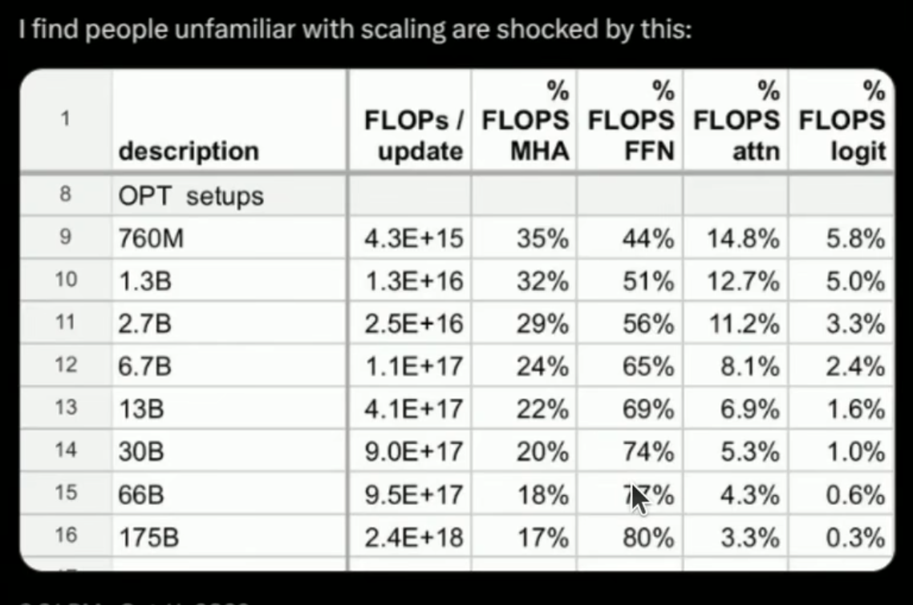

对于不同规模的模型 , 不同layer所占参数可能不同 , 因此可能对于attention的优化在小模型上效果更好 , 但在更大规模的模型上因为参数占比的缘故导致效果降低

2.涌现(emergence of behavior with scale)

这个就不赘述了

##### 可迁移的知识

1. how work(how to build)怎么构建
2. how to squeeze hardware, taking scaling seriously(调用硬件, 正确提升规模)
3. which data modeling decision yield good accuracy 哪些数据建模可以带来好的性能
4. profile and benchmark everying (对所有东西进行性能分析和基准测试)


可规模化扩展的算法更重要Right interpretation:algorithms that scale are what matter.

`accuracy = efficiency x resources`


Resource accounting:memory and compute characteristics(显存和算力分配 , 决定了能训练多大的模型) FLOPs

一般而言 , 训练模型需要20倍参数量的数据(70B model 需要 1.4T tokens)

##### 作业部分:

**Assignment 1: tokenization, model architecture, training**
**Assignment 2: kernels, parallelism, inference**
**Assignment 3: scaling laws**
**Assignment 4: evaluation, curation, transformation, filtering,**
**Assignment 5: RLHF, RL algorithms, RL systems**

##### 数据部分

模型需要什么能力:对话, 变成 , 多步完成任务的agent等 , 这些**能力都需要模型从数据中进行学习**

##### 评估evaluate

**评估的目的**

**Internal: guide model development (smoothness across scales, relative performance matters)**
内部评估：指导模型开发（重点关注不同规模下的性能稳定性、相对性能变化）

**External: measure absolute quality of a real use case (ecological validity matters)**
外部评估：衡量模型在真实场景下的绝对质量（重点关注生态效度 / 现实适用性）

**Examples of evaluations:**

评估示例：

**Perplexity: ideally run on private documents not on Internet (avoid contamination)**
困惑度（Perplexity）：理想情况下应在**未公开的私有文档**上运行（避免数据泄露 / 污染）

**Advanced use cases: GPQA, HLE, SWE-Bench, Terminal-Bench**
高级场景基准：GPQA、HLE、SWE-Bench、Terminal-Bench

**LMs are general purpose, require a diverse set of evaluations!**
语言模型是通用模型，因此需要一套多样化的评估体系！

##### data

数据从何而来: books, arXiv paper , github code , Internet
数据的license问题 , 格式问题(html , PDF , not text directories 怎么转换为文字token)

###### data process

1. 转换 transformation  , 从html,pdf 2 text
2. 过滤filtering :保留高质量数据 , 清除有害数据
3. 去重 deduplication
4. 数据组合 data mixing:不同来源的数据 , 如何配比 ,如何运用
5. rewriting,synthetic :合成数据集到真实数据的对齐方法，从而适配下游任务

type of data

- Pretrain :large and diverse (知识注入)
- mid-train: high quality , including long-context (高质量激发能力 , 长上下文数据培养长上下文能力)
- post-training : conversations,agentic traces with tool calling 对话 , 带工具调用的agent轨迹

##### alignment对齐

既然模型已经具备了基本的合理表现，我们可以通过**弱监督**进一步优化它。
为什么选择**弱监督**？因为 “评判结果” 比 “从零生成内容” 要容易得多。(chosen , reject)

评判方式有多种: human , verifier , LM judge(reward model …)
相关的算法如PPO,GRPO,DPO等

在 LLM 训练，尤其 **RL**，**rollout** 指：
**让当前策略模型生成一批样本轨迹，用来后续打分、计算奖励、更新模型。**

**rollout samples**：模型采样出来的回答样本
**rollout buffer**：存放 prompt、response、logprob、reward、value 等信息的缓存
**rollout phase**：生成样本的阶段
**rollout policy**：当前用于采样生成的策略模型
**number of rollouts**：采样多少条生成轨迹

**当规模扩大后，这需要构建大量新的基础设施，例如在推理阶段支持异步 rollout 采样。**

# 2.Token , tokenization

token是现在常用的方式 , 但他有以下问题

- 一个词以及它前面的空格属于同一个 token，例如：`" world"`。
- 同一个词出现在句首和句中时，会被表示成不同的 token，例如：`"hello" `and `" hello"` 因为1的空格问题会导致不一致。
- 数字会被切分成每隔几位一组的 token。

通常而言 , token的压缩比越大越好 , 因为attention的计算量是O($n^2$) , 增大vocab szie 可以降低句子序列长度 , 从而减少计算开销
但过大的vocab szie 会导致**稀疏性问题** , 因为vocab szie 的每个元素都是**独立元素** 

character_tokenizer: 直接用unicode≈150k , 但很多字符都不使用 , 效果不好
byte_tokenizer :用utf8 , 字符区间在0-255 , 部分字符用多个token指代,部分字符用多个token指代 , 压缩率较低
word_tokenzier : 词语很多 , vocab size很大(很有可能接近无穷),而且tokenize时可能会遇到没见过的token(以前会用`<unk>`)

##### BPE(Byte Pair Encoding) :

这是目前常用的构建tokenizer的算法, 流程图如下


```Mermaid
flowchart TD
    A["1. 预处理语料<br>拆分单词为字符序列<br>末尾加结束符 </w>"] --> B["2. 统计所有相邻字符对<br>出现频率计数"]
    B --> C["3. 选出**频率最高**的相邻字符对"]
    C --> D["4. 合并该字符对<br>生成新子词符号"]
    D --> E["5. 把语料中所有该相邻对<br>全部替换为新合并符号"]
    E --> F{"是否达到<br>预设词表大小 / 迭代次数?"}
    F -- 否 --> B
    F -- 是 --> G["6. 输出最终子词词表<br>BPE词表构建完成"]
```

# 3.pytorch

为了节省显存 , fp16看似是个好选择, 但由于表示范围上下限都缩减了(指数部分) , 因此很容易出现nan爆上下限 , 因此考虑使用**bf16**(指数部分和fp32一致, 尾数部分短了, 精度小了表示范围不变)

fp8甚至nvfp4目前在新的b200上有支持 , 但这些低精度需要借助一些小技巧(整个block做缩放 , 但单个数值只占4位) ,先不考虑

##### mix precision training 混合精度训练

这个非常重要 , 目前大部分训练都采用 : 下面是一种常见的方式

```
Use bf16 for parameters, activations, and gradients
Use fp32 for optimizer states
```

torch的AMP库可以提供这种自动处理 , *+法等安全操作使用bf16 , 指数这种危险操作用fp32 (对精度敏感与否)

###### einsum

可以理解为一种语法糖 , 实际上不会带来性能负担

torch.einsum(equation,∗∗operands) 使用基于爱因斯坦求和约定的符号，将输入operands的元素沿指定的维数求和
einops.einsum也可以做到而且更灵活 , 底层实现同样是numpy和torch

```python
#矩阵乘法例子引入

import torch

a = torch.rand(2, 3, 4)
b = torch.rand(2, 3, 4)

c = torch.einsum("bik,bkj->bij", a, b.transpose(-2, -1))
d = torch.einsum("bih,bjh->bij", a, b)
print(torch.allclose(c, a @ b.transpose(-2, -1)))
print(torch.allclose(d, a @ b.transpose(-2, -1)))

#等价操作 torch.mm(a, b)
#使用einops的einsum
from einops import einsum

z = einsum(
    a,b
    "batch seq1 hidden, batch seq2 hidden -> batch seq1 seq2"
)
print(torch.allclose(z, a @ b.transpose(-2, -1)))

```

用rearrange可以快速拆分合并维度

```python
import einops,torch
x=torch.randn(3,8)
y=torch.randn(4,6)
#拆分维度
x=einops.rearrange(x,'b (head hidden1) -> b head hidden1',head=2)
print("x shape:",x.shape)
print("y shape:",y.shape)
#矩阵乘法
z=einops.einsum(x,y,'... hidden1,hidden1 hidden2 -> ... hidden2')
print("z shape:",  z.shape)
#合并维度
z=einops.rearrange(z,'b head hidden2 -> b (head hidden2)')
print("z shape:",  z.shape)
```

##### FLOPS

通常而言 , NV计算卡上的FLOP/s指标都是指稀疏矩阵的计算 , 对于dense 矩阵要/2

计算量判断:

```python
b=16384 #num of data point
d=32768 #dimension
k=8192 #num of output
import torch
x=torch.ones(b,d,device='cuda')
w=torch.ones(d,k,device='cuda')
y=torch.mm(x,w)
```

上面**矩阵乘法**的**浮点计算量**约为 $actual NumFlops=2*b*d*k$  ,其中乘法计算`b*d*k` ,加法也是这个**计算量**

矩阵加法的计算量就是O(mn) , 计算量远低于矩阵乘法 , 因此不参与考虑

因此可以说 , 对于上述所说的矩阵乘法所需的计算量 为 $2*(token)*(parameters)$ 

而根据上述的计算量 , 我们就可以计算出在给定计算卡 , 给定token数据下 , 训练一个指定大小模型所需时间(由于数据运输 , 以及很多原因 ,实际上显卡不会完全发挥浮点性能  , 这个时间还得再打个折扣)

现代LLM如果浮点性能能达到标称的50%算是不错的水平  , 如果只有30%甚至10% , 那就是异常情况

##### What is the bottleneck?

###### 数据传输

memory带宽同样会影响算力利用率,冯诺伊曼架构决定了存算分离 , data 从memory->compute->memory中间的时间不少是不可忽略的 , 假设有源源不断的计算任务 , total_time=max(compute_time, communication_time)

• Memory-bound: communication time > computation time
• Compute-bound: computation time > communication time

已知:h100_accelerator_intensity = 295.3731 FLOPs / byte

###### 激活函数

为什么我们可以说使用ReLU和GeLU两种激活函数运算速度几乎没区别 :

```python
def arithmetic_intensity_gelu():

    n = 1024

    x = torch.ones(n, dtype=torch.bfloat16, device=cuda_if_available())
    y = F.gelu(x)  # GELU(x) = 0.5 x (1 + tanh(sqrt(2/pi) (x + 0.044715 x^3)))

    bytes = (2 * n) + (2 * n)  # Read x, write y (bf16 is 2 bytes/float)
    flops = 20 * n  # tanh can be approximated in various ways (e.g., polynomial)
```

AI = flops / bytes ≈ ≈ 5 FLOPs / byte  <h100_accelerator_intensity, 因此是内存瓶颈(memory bound)

###### 矩阵点积乘法

虽然GeLU比ReLU多做了很多工作 , 但由于其计算时间低于传输时间, 因此实际的开销仍然是内存瓶颈的 ,因此可以说不影响计算

```python
def arithmetic_intensity_dot_product():

    n = 1024

    x = torch.ones(n, dtype=torch.bfloat16, device=cuda_if_available())
    w = torch.ones(n, dtype=torch.bfloat16, device=cuda_if_available())

    y = x @ w

    bytes = (2 * n) + (2 * n) + 2  # Read x, read w, write y
    flops = 2 * n - 1  # n multiplications, n-1 additions
```

​    flops/bytes≈0.5 <h100_accelerator_intensity , 因此也是内存瓶颈

###### 矩阵向量积

```python
def arithmetic_intensity_matrix_vector_product():

    n = 1024

    x = torch.ones(n, dtype=torch.bfloat16, device=cuda_if_available())
    w = torch.ones(n, n, dtype=torch.bfloat16, device=cuda_if_available())

    y = x @ w

    bytes = (2 * n) + (2 * n * n) + (2 * n)  # Read x, read w, write y
    flops = n * (2 * n - 1)  # n dot-products

    arithmetic_intensity = flops / bytes  # ~1

    h100_accelerator_intensity = h100_flop_per_sec / h100_bytes_per_sec

    assert arithmetic_intensity < h100_accelerator_intensity
```

 flops/bytes≈1 <h100_accelerator_intensity , 因此也是内存瓶颈

###### 矩阵乘法

```python
def arithmetic_intensity_matmul():

    n = 1024

    x = torch.ones(n, n, dtype=torch.bfloat16, device=cuda_if_available())
    w = torch.ones(n, n, dtype=torch.bfloat16, device=cuda_if_available())

    y = x @ w

    bytes = (2 * n * n) + (2 * n * n) + (2 * n * n)  # Read x, read w, write y

    flops = n * n * (2 * n - 1)  # n^2 dot products

    arithmetic_intensity = flops / bytes  # ~n/3

    h100_accelerator_intensity = h100_flop_per_sec / h100_bytes_per_sec

    assert arithmetic_intensity > h100_accelerator_intensity
```

flops/bytes≈341 >h100_accelerator_intensity=295.3731 因此矩阵乘法是**计算瓶颈**(computing bound)

transformer大多计算都是矩阵乘法 , 因此对于尽可能使用flops很有帮助


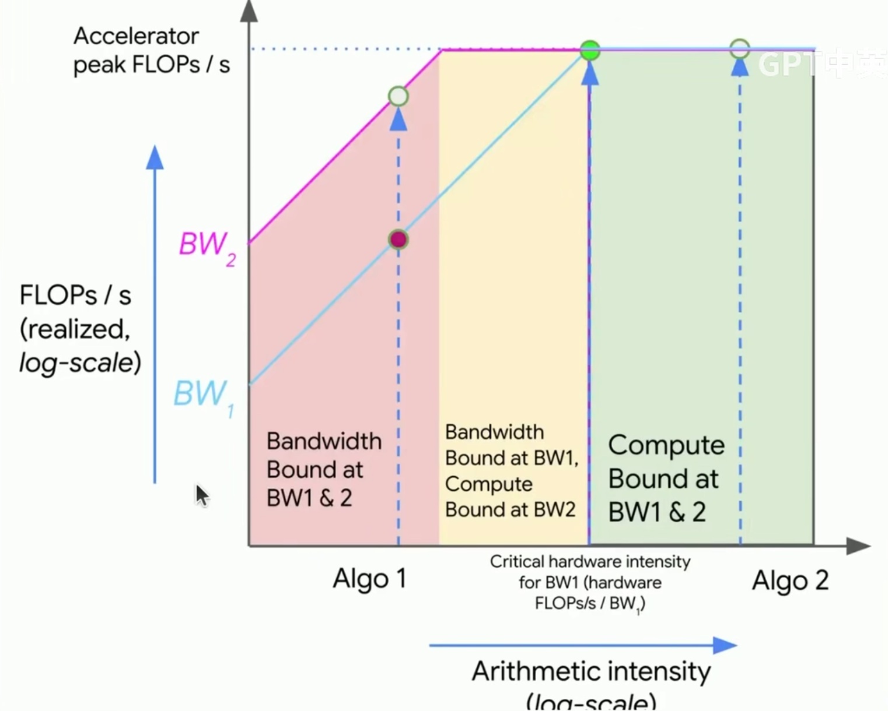

$BW_1和BW_2$ 是不同 **memory bandwidth 下 , 理论能达到的最大性能** , 
横轴是Arithmetic Intensity（算术强度）= FLOPs / Bytes ; 纵轴是实际 FLOPs/s
如图所示 , 当你的算法优化到一定程度时 , FLOPS会发挥到极限 , 即GPU 理论最大算力 
而拐点则是 compute-bound 与 memory-bound 的分界线 ,
 左侧数据搬运太慢 , GPU 等数据 此时提高带宽有用 ; 右边区域：compute-bound ,算力才是瓶颈

###### 计算量demo:

接下来部分看 [lecture_02.py](lectures-main\lecture_02.py) 的 def gradients_flops():方法 , 其中讲述了计算这样一个神经网络所需的浮点计算量

```python
B = 1024  # Number of points
D = 256   # Dimensio
x = torch.ones(B, D, device=cuda_if_available())
w1 = torch.randn(D, D, device=cuda_if_available(), requires_grad=True)
w2 = torch.randn(D, D, device=cuda_if_available(), requires_grad=True)
```

正向传播 h1->w2->h2 所需FLOPS = 2 * B * D * D
反向传播时

```
h1.grad = d loss / d h1
w2.grad = d loss / d w2
```

在矩阵的求导中包含转置 , 转置关系类似下面的

```
h1_grad = einsum(h2.grad, w2, "batch out, in out -> batch in")        
w2_grad = einsum(h2.grad, h1, "batch out, batch in -> in out")
```

因此反向传播计算量FLOPS = (2 * B * D * D)+ (2 * B * D * D) =4 * B * D * D (分别计算输入的梯度 以及参数的梯度)
算总账:

Forward pass: 2 (# data points) (# parameters) FLOPs")
Backward pass: 4 (# data points) (# parameters) FLOPs")
Total: 6 (# data points) (# parameters) FLOPs")

即所谓的 C=6ND 的由来

### optimizer

 [lecture_02.py](lectures-main\lecture_02.py) 的 optimizer():方法 , 描述了AdaGrad算法  , 他是Adam算法的前身, 简单理解如下

```python
Momentum = SGD + EMA(grad)          # 一阶动量
AdaGrad  = SGD + sum(grad^2)        # 累积二阶量
RMSProp  = SGD + EMA(grad^2)        # 二阶动量
Adam     = Momentum + RMSProp       # 一阶动量 + 二阶动量
```

SDG :`theta = theta - lr * grad`
Momentum : `theta = theta - lr * m` 其中 `m = beta * m + (1 - beta) * grad`
AdaGrad :  `theta = theta - lr * grad / sqrt(v + eps) `其中  `v = v + grad ** 2`  ,AdaGrad 的特点是：**每个参数都有自己的学习率** 但v会随着step不断累加, 导致最后lr趋近于0
RMSProp :  `theta = theta - lr * grad / sqrt(v + eps)` 其中 `v = beta * v + (1 - beta) * grad ** 2` 用beta控制对于过去和现在的记忆多少
Adam :`theta = theta - lr * m / sqrt(v + eps)`  m: 一阶动量，梯度方向的指数平均 ,v: 二阶动量，梯度平方的指数平均
其中` m = beta1 * m + (1 - beta1) * grad` 	 `v = beta2 * v + (1 - beta2) * grad ** 2`

# 4.Architectures

原始transformer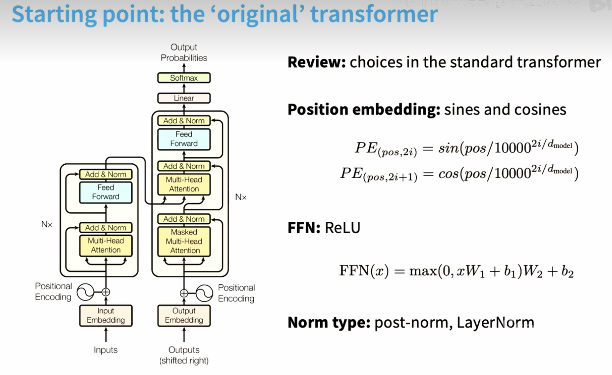

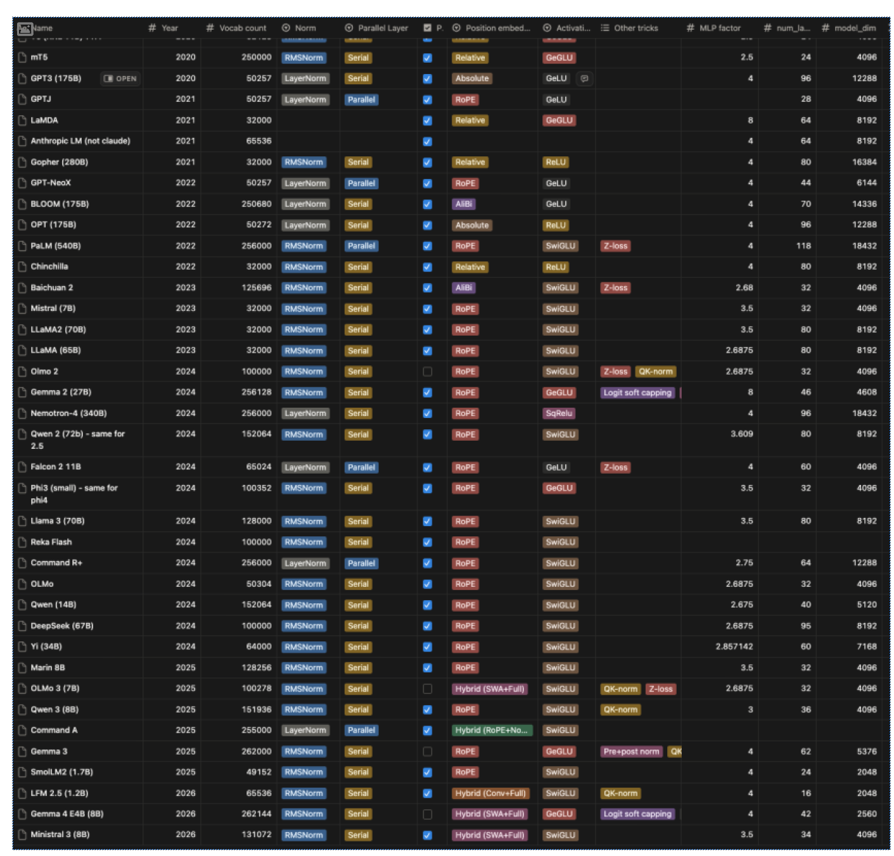

可以看见随着时间轴向下 , 架构基本趋同 ,即RMSNorm+Serial +PreNorm+RoPe+SwiGLU

copy from LLama : 

1. PreNorm
2. RoPE
3. SwiGLU 
4. liner layers have no bias

## What are we going to cover?

### Common architecture variations
- Activations, FFN
- Attention variants
- Position embeddings

### Hyperparameters that (do or don’t) matter
- What is ff_dim? Do multi_head dims always sum to model_dim?
- How many vocab elements?

### Stability tricks

#### Pre or Post norm (ResNorm and non-ResNorm)

在原始Transform中, Normalize层均位于**attention和FFN计算之后** ,即位于计算主干之中 ; 2024后 ,不在主干的 PreNorm成为主流(不在主干的PostNorm也不少)

结构示意图以及公式: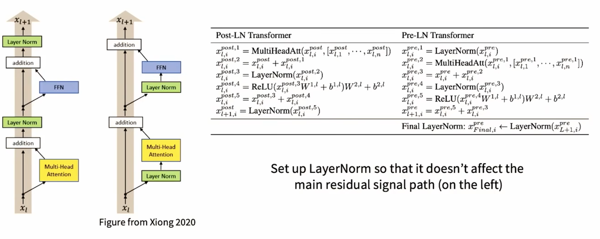

如图所示 , PreNorm讲Layer Norm 放在了非残差路径上 ;下图显示, PreNorm在长期训练后效果更好 ; 而且有专家表示 : 通过讲Layer Norm移出主干 , 有助于**keep residual stream clean** (残差流不做归一化 , 从始至终不经过计算 , 从而更符合residual 的理念,  最差也不会比不加layer差) , 梯度反向传播时可以直接到达任意一个layer , 使得梯度传播不再完全是一个高阶乘积

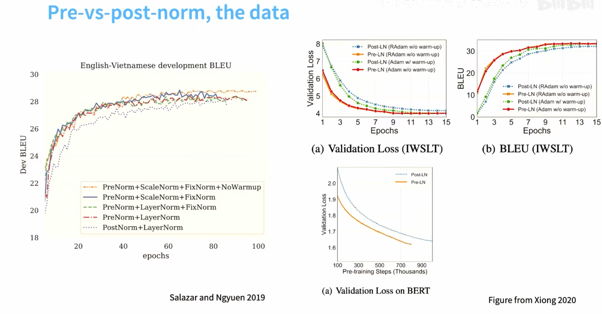

对比发现,PreNorm可以保持各个layer的梯度接近,传统的在主干的PostNorm则容易出现梯度爆炸或梯度消失(每过一个layer都做了一次norm)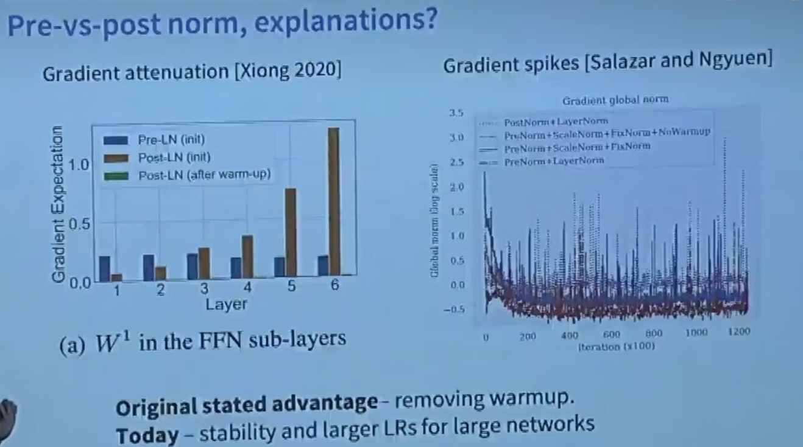

如果遇到稳定性问题 , 这种double Norm也有助于增强训练稳定性
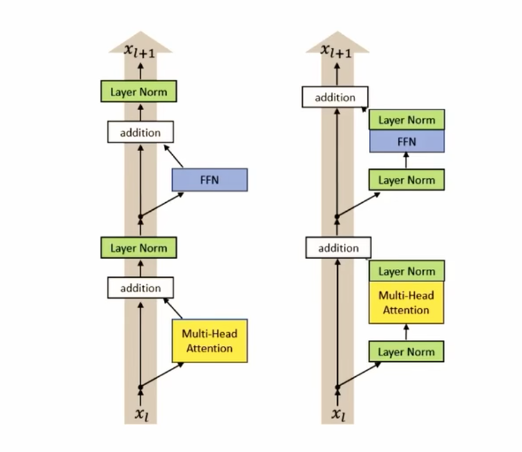

#### LayerNorm or RMSNorm 

公式对比

| 归一化方法    | 公式                                                         |
| ------------- | ------------------------------------------------------------ |
| **LayerNorm** | $$ \text{LN}(x) = \frac{x - \mu}{\sqrt{\sigma^2 + \epsilon}} \odot \gamma + \beta $$ 其中 $$\mu = \frac{1}{d}\sum_{i=1}^{d} x_i$$，$$\sigma^2 = \frac{1}{d}\sum_{i=1}^{d} (x_i - \mu)^2$$ |
| **RMSNorm**   | $$ \text{RMSN}(x) = \frac{x}{\sqrt{\frac{1}{d}\sum_{i=1}^{d} x_i^2 + \epsilon}} \odot \gamma $$ 其中 $$\text{RMS}(x) = \sqrt{\frac{1}{d}\sum_{i=1}^{d} x_i^2}$$ |

相较于LN , RMSN参数更少(没有β) , 计算量更小(不计算方差和均值)

下图是一个实验示例 , 虽然LayerNorm只占用了很小的计算量 , 但用了1/4的运行时间 , 显然是内存瓶颈的 ;data moving占据了相当大一部分运行时间(黑框是浮点运算量FLOPS , 白框是运行总时长s)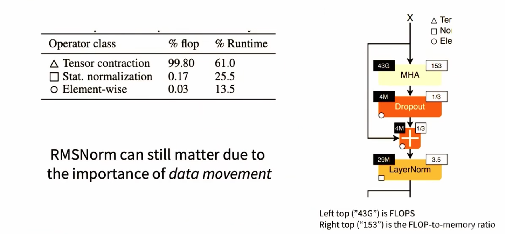

论文实验也表明, 在大型模型上使用RMSNorm也有助于提升运算效率(step/s)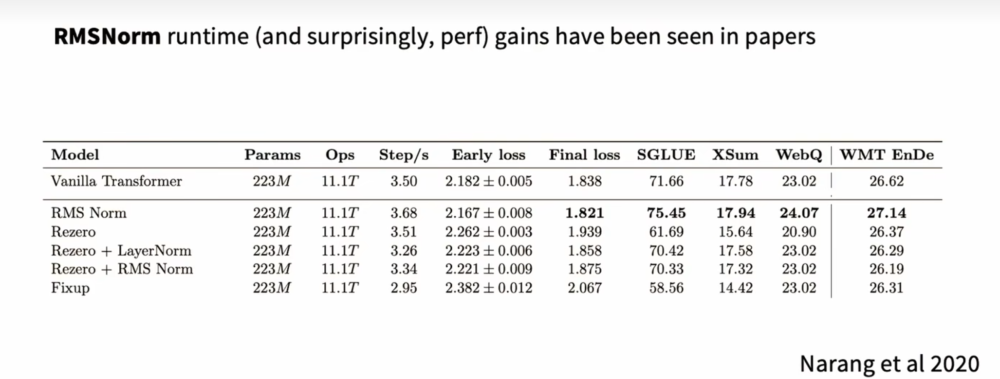

同理 , 标准FFN `H=WX+B`  ,这个偏置B也常因为传输速率和计算量的原因被去掉(访存久计算小 , 去掉提高计算效率)

#### activation

ReLU,GeLU,Swish,ELU,GLU,GeGLU,ReGLU,SeLU,SwiGLU,LiGLU….

GeGLU和SwiGLU是目前最常用的

###### GLU 

用门控代替FFN

普通前馈层：(ReLU版本)

$$
FF(x)=\max(0,xW_1)W_2
$$

原始激活部分：

$$
\max(0,xW_1)
$$

引入门控项后：

$$
\max(0,xW_1)
\rightarrow
\max(0,xW_1)\otimes(xV)
$$

ReGLU 前馈层：

$$
FF_{\mathrm{ReGLU}}(x)
=
\left(\max(0,xW_1)\otimes xV\right)W_2
$$
门控$xV$ 负责产生一个“门”，**控制哪些维度的信息被放大或抑制**

###### SwiGLU

Swish 激活函数：

$$
\mathrm{Swish}(x)=x\cdot\mathrm{sigmoid}(x)
$$

SwiGLU 前馈层：

$$
\mathrm{FFN}_{\mathrm{SwiGLU}}(x,W,V,W_2)
=
\left(\mathrm{Swish}_1(xW)\otimes xV\right)W_2
$$
注意到GeGLU 和 SwiGLU 这里有三个参数矩阵 , 而之前原始的FFN只有两个 , 因此可以考虑将维度变为原来的2/3 ,从而保持参数量不变

以上这些调整最重要的还是门控思想(gate) , 计算增加的成本基本为0(memory bond)且效果有提升

#### Pose embedding

| Sine embeddings     | 加到 token embedding 上     | 固定公式，不需要学习                                         |
| ------------------- | --------------------------- | ------------------------------------------------------------ |
| Absolute embeddings | 加可学习位置向量            | 对超出训练长度的位置泛化较弱 ,正余弦不用学习 , 但也有需要学习的版本 |
| Relative embeddings | 加到 attention score 计算中 | 直接建模 token 之间的相对距离 ,需要学习$e_{ij} = \dfrac{ x_i W^Q \left( x_j W^K + a_{ij}^K \right)^T }{ \sqrt{d_z} }$ |
| **RoPE embeddings** | 旋转 query/key              | 现在大模型中非常常见，适合长上下文扩展                       |

RoPE: 实际上我并不关心token的具体位置 , 关心的是两个token的相对距离 , 即建模成$\langle f(x, i), f(y, j) \rangle = g(x, y, i - j)$

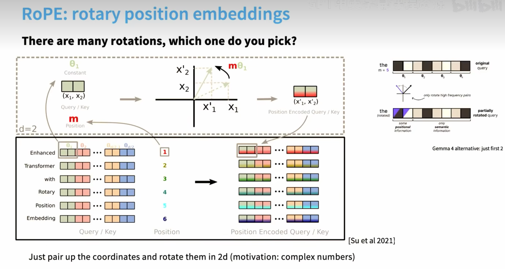

RoPE通过将token 拆分成两两一组的对 ,从而使得旋转在二维上实现 ; 通过调控 θ 来实现 远距离和近距离的attention注意力

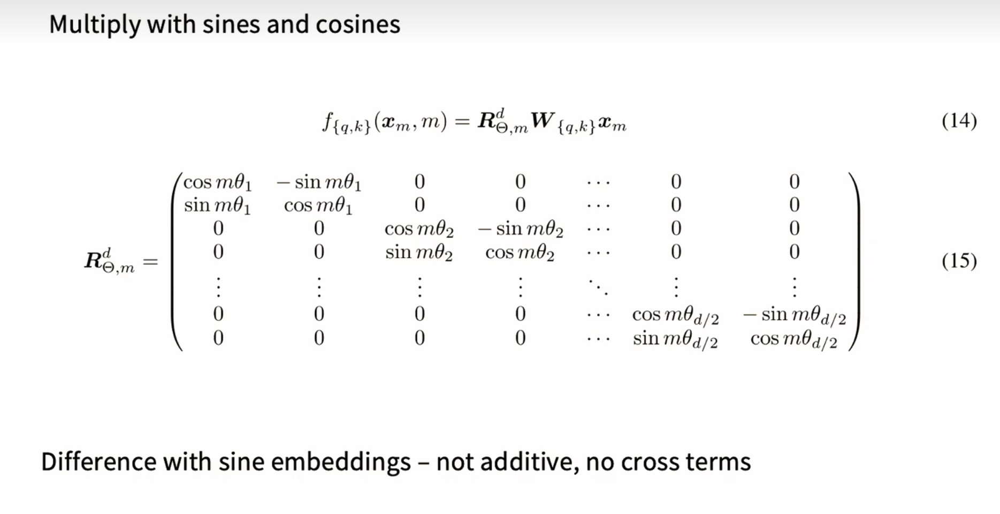

最后实现的就是这样一个矩阵

#### hyperparameter

常见的超参数
$d_{ff}=4d_{model}$ ff layer的维度是model hidden dim 的4倍 ,使用 SwiGLU/GEGLU 这类门控 FFN 时，中间维度可能不是严格 4 倍，而是为了参数量匹配设成大约 `2.67 × d_mode` (4*2/3=2.67)

$150>d_{model} / n_{layer} >50$​ dim和layer的关系一般如此,  避免太深或太宽 (100附近)
太深的模型会在并行化上遇到问题, 这意味着 Layer 2 必须等 Layer 1 算完，Layer 3 必须等 Layer 2 算完。即使你有很多 GPU，也不能简单地让所有层同时算完，因为它们之间有严格的前后依赖。 **层与层之间必须串行等待**。前向传播从左到右一层层走，反向传播从右到左一层层传梯度 ,  因此效率极低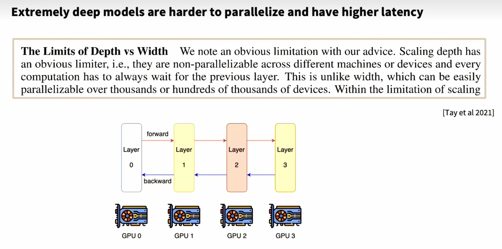

相反 , 一个很宽的模型很容易切割到多个GPU上 , 这称为 Tensor parallel(张量并行) , 相较于深模型会好处理的多

左图 :深高比在多个维度的计算上 , 最优解最终收敛到100附近 , 这也是我们上面得到的结论
右图 :影响模型性能最重要的部分其实是FLOPS , 而其他的超参数实际上并不严格 , 对于最终效果的影响也不太大 , 因此很多超参数的设计更注重于工程设计上而非模型效果(比如训练和推理时的最优效果)
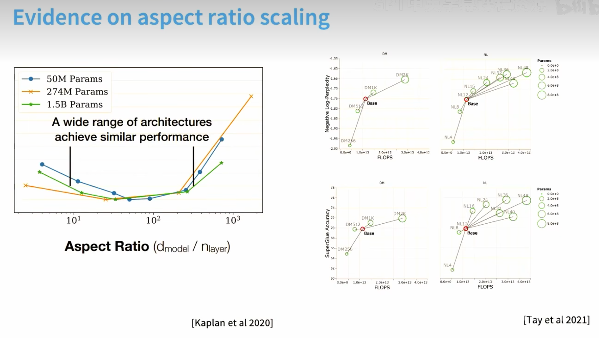

vocabulary size 词表大小

上面我们讨论过 , 词表太大和太小带来的影响

#### Dropout and Regularization

对于其他深度学习模型(CNNs…) , 我们常使用dropout等方式来防止模型过拟合 , 但在LLM上
**我们所拥有的数据基本是远超模型所能表达的能力(当前参数下) , 因此可以忽略过拟合的可能** , 毕竟很多时候pretrain ,  SFT都只会遍历1个epoch , 这也避免了过拟合的可能

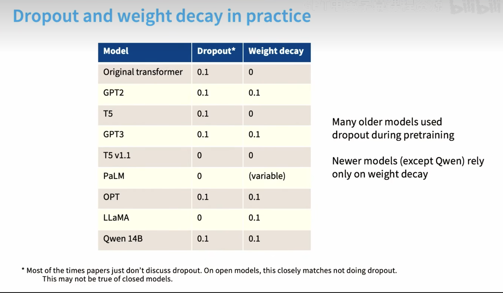

但实际上 , 现代不少模型的训练都使用了**Weight decay和 Dropout** ,即使Dropout已经用的比较少了 ,Weight decay仍然常见

###### Weight decay

Weight decay不仅仅是normalize 手段 , 还会和optimizer 交互 , 使得optimization更好 ; 因此
Weight decay实际上是一种 optimization intervention ,not only normalization intervention ; 证据如下图所示
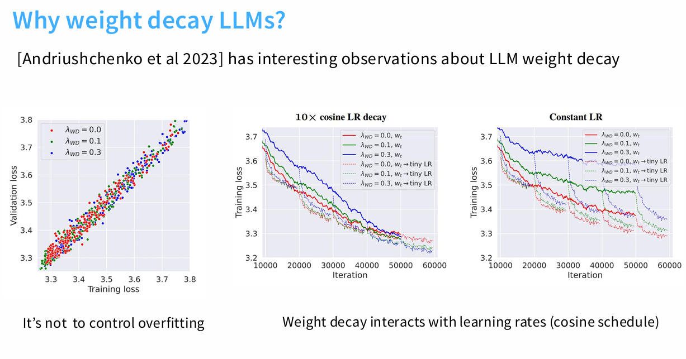

PP(pipeline parallel)

FSDP通常更简单,适合在模型较小时优先尝试;PP(pipeline parallel) 常用于超大模型,多节点训练时

NV关于Metatron的论文:如果batch_size太小,pipeline parallel的利用率会很低;
为了PP维持高利用率,则需要更大的batch size

#### 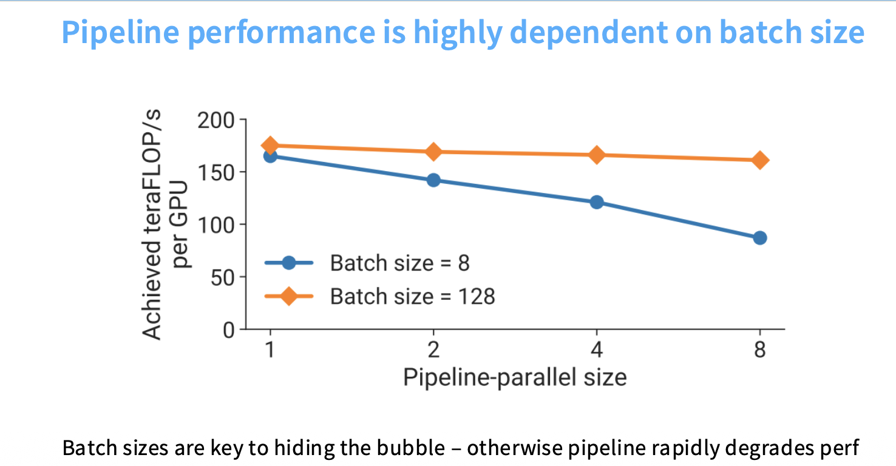


和FSDP( **Fully Sharded Data Parallel** , 比如刚刚的ZeRO1/2/3)比,pipeline parallel 的传输数据量少的多(不用传参数矩阵),

因此如果能通过优化pipeline parallel 的pipeline communicate cost, cut up 不同layers 做不同安排,从而在backward间穿插forward,减少bubble 提高利用率(下图来自deepseek)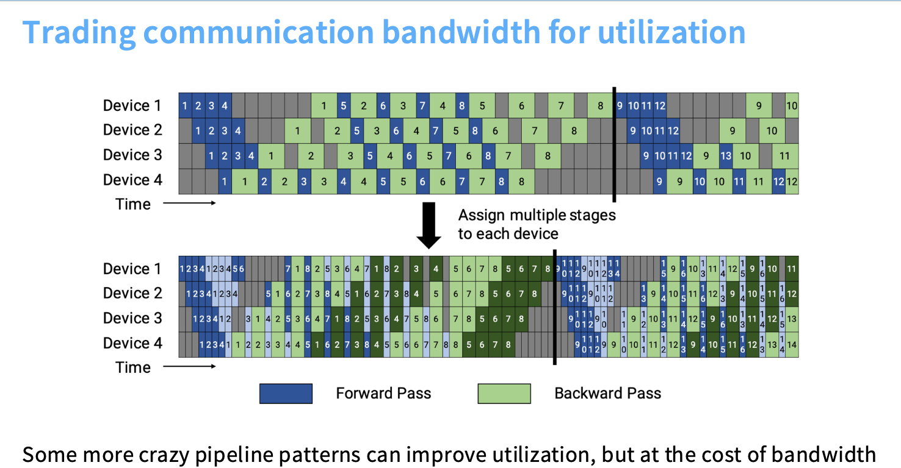


进一步优化:backwards拆分成b(backward)和w(weight gradients) ; 
b用于传递到再下一层进行进一步计算,因此需要优先计算;
而w仅用于本层参数优化(当前layer的导数),因此可以放在b后计算
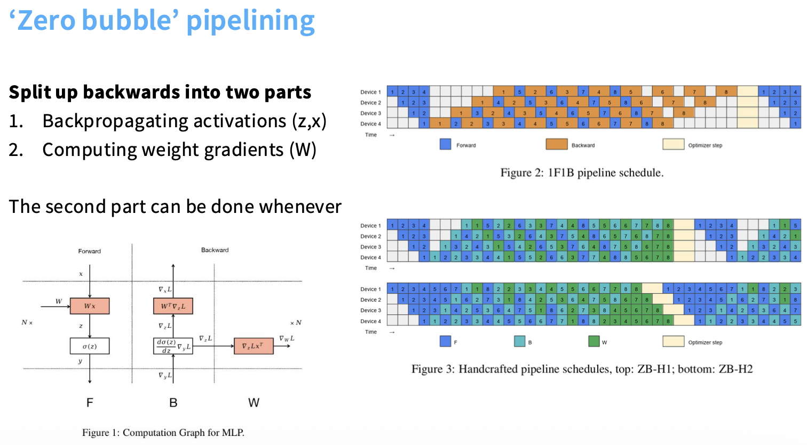

分块矩阵计算原生支持切分(大的矩阵计算切成多个小的),就像tiling一样通过分块 ; 
因此model在wide上做cut up的运算也很常见

### Tensor parallel

如图,以下是一个MLP的demo
将parameter拆分成两份,正向传播时X copy 2份,同时进入$$A_1$$ $$A_2$$
在所给demo中,f和g中不同过程中的函数不同(为了计算同步)
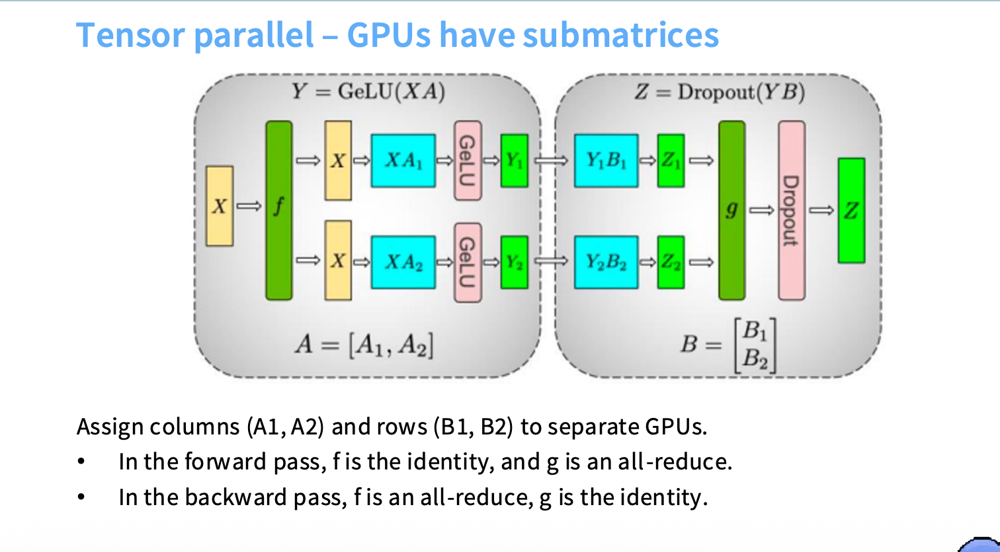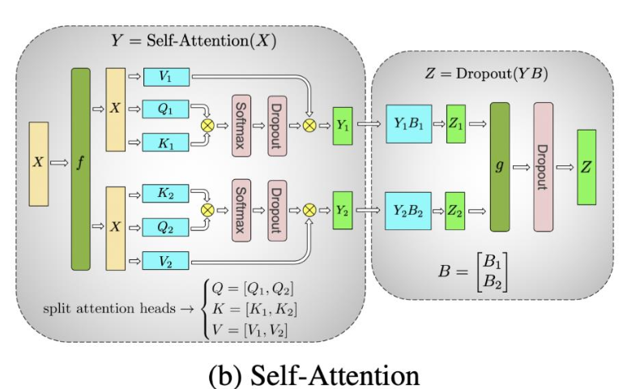

对比我们可以看出tensor parallel 在不同参数矩阵中有着不同的cut up way;
Columnwise - QKV , up-projection
Rowwise – Attention output, down-projection
Replicated – norms, routers, etc (这些非liner是不用做copy和cut up的)


以下数据基于8GPUs一个 node做的实验
显然当tensor parallel 超出single node 时,性能会暴跌,因此最好控制在single node中
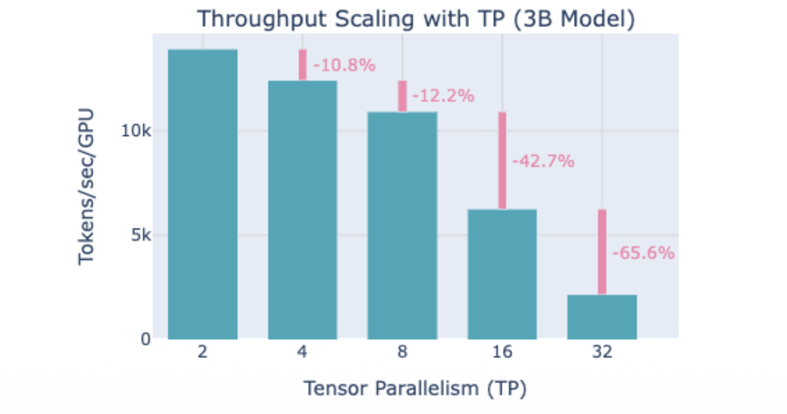

Tensor parallel 和 pipeline parallel 对比

优点

1. no bubble; no waiting
2. Low complexity
3. No need large batch

缺点

1. Cons — much larger communication than pipeline parallel.更多communication
2. 8bsh * ((n_devices - 1) / n_devices) per layer +all-reduce , 还要做all2all communicate , 传输开销超大 

如图,在运算过程中,存在很多dynamic memory cost , 如果能去掉那些高点的波峰,那我们就可以降低最大memory需求,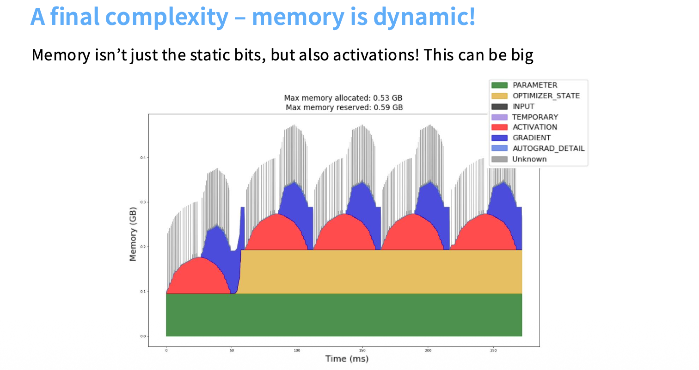


如下图,随着model scaling, activation 的占比远超 parameters的占比,因此我们需要考虑减少activation部分,而不是只考虑parameters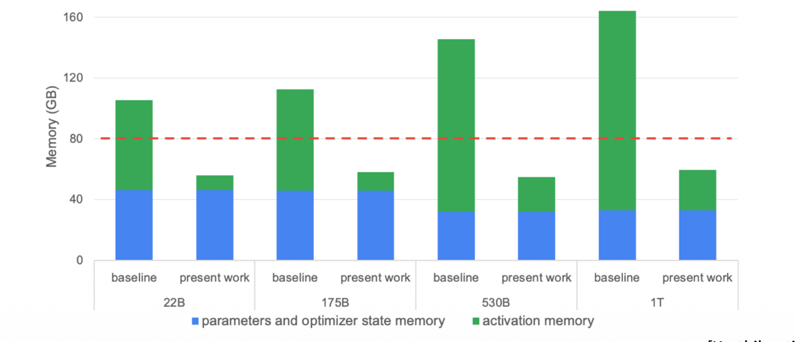

经验公式: 

$$\text{Activations memory per layer} = sbh\left(34 + 5\frac{as}{h}\right).$$ 
其中参数指代如图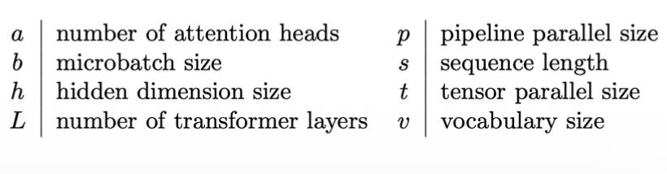
sbh这个值是transformer forward部分的基本单位,后续会经常见到
5as/h这部分来自quadratic attention的dropout部分,如果用flash attention就没有这些东西

##### Activation under tensor parallel

$$\text{Activations memory per layer} = sbh\left(10 + \frac{24}{t} + 5\frac{as}{ht}\right)$$
和上面的activation memory对比,大幅减少了;(大部分都/t)The remaining 10 term is for the LayerNorm (4sbh), Dropout (2sbh), and inputs to the attention and MLP (4sbh). These terms alone will continue to grow with size


##### Sequence Parallel 

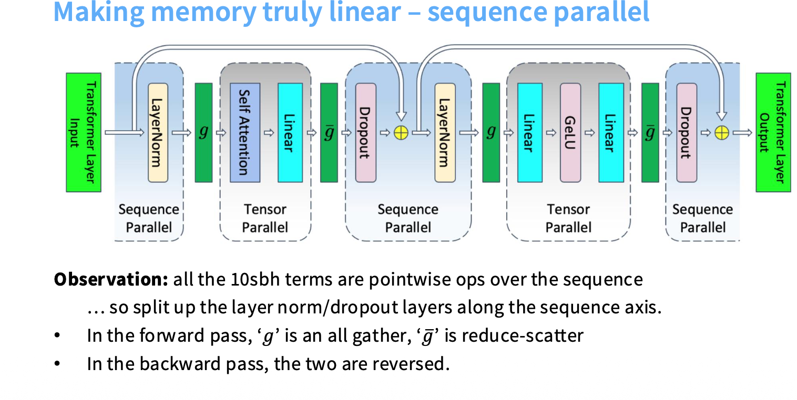Tensor Parallel 区域：
Self Attention、Linear、GeLU、Linear

Sequence Parallel 区域：
LayerNorm、Dropout、residual add 相关部分

