这是一份我自己学习cs336的笔记 ,仅供参考

# 1.Overview

##### 小规模的模型展现的特质不一定能外推到大规模的模型上  

1.参数占比随着规模变大发生改变


对于不同规模的模型 , 不同layer所占参数可能不同 , 因此可能对于attention的优化在小模型上效果更好 , 但在更大规模的模型上因为参数占比的缘故导致效果降低

2.涌现(emergence of behavior with scale)

这个就不赘述了

##### 可迁移的知识

1. how work(how to build)怎么构建
2. how to squeeze hardware, taking scaling seriously(调用硬件, 正确提升规模)
3. which data modeling decision yield good accuracy 哪些数据建模可以带来好的性能
4. profile and benchmark everying (对所有东西进行性能分析和基准测试)


可规模化扩展的算法更重要Right interpretation:algorithms that scale are what matter.

`accuracy = efficiency x resources`


Resource accounting:memory and compute characteristics(显存和算力分配 , 决定了能训练多大的模型) FLOPs

一般而言 , 训练模型需要20倍参数量的数据(70B model 需要 1.4T tokens)

##### 作业部分:

**Assignment 1: tokenization, model architecture, training**
**Assignment 2: kernels, parallelism, inference**
**Assignment 3: scaling laws**
**Assignment 4: evaluation, curation, transformation, filtering,**
**Assignment 5: RLHF, RL algorithms, RL systems**

##### 数据部分

模型需要什么能力:对话, 变成 , 多步完成任务的agent等 , 这些**能力都需要模型从数据中进行学习**

##### 评估evaluate

**评估的目的**

**Internal: guide model development (smoothness across scales, relative performance matters)**
内部评估：指导模型开发（重点关注不同规模下的性能稳定性、相对性能变化）

**External: measure absolute quality of a real use case (ecological validity matters)**
外部评估：衡量模型在真实场景下的绝对质量（重点关注生态效度 / 现实适用性）

**Examples of evaluations:**

评估示例：

**Perplexity: ideally run on private documents not on Internet (avoid contamination)**
困惑度（Perplexity）：理想情况下应在**未公开的私有文档**上运行（避免数据泄露 / 污染）

**Advanced use cases: GPQA, HLE, SWE-Bench, Terminal-Bench**
高级场景基准：GPQA、HLE、SWE-Bench、Terminal-Bench

**LMs are general purpose, require a diverse set of evaluations!**
语言模型是通用模型，因此需要一套多样化的评估体系！

##### data

数据从何而来: books, arXiv paper , github code , Internet
数据的license问题 , 格式问题(html , PDF , not text directories 怎么转换为文字token)

###### data process

1. 转换 transformation  , 从html,pdf 2 text
2. 过滤filtering :保留高质量数据 , 清除有害数据
3. 去重 deduplication
4. 数据组合 data mixing:不同来源的数据 , 如何配比 ,如何运用
5. rewriting,synthetic :合成数据集到真实数据的对齐方法，从而适配下游任务

type of data

- Pretrain :large and diverse (知识注入)
- mid-train: high quality , including long-context (高质量激发能力 , 长上下文数据培养长上下文能力)
- post-training : conversations,agentic traces with tool calling 对话 , 带工具调用的agent轨迹

##### alignment对齐

既然模型已经具备了基本的合理表现，我们可以通过**弱监督**进一步优化它。
为什么选择**弱监督**？因为 “评判结果” 比 “从零生成内容” 要容易得多。(chosen , reject)

评判方式有多种: human , verifier , LM judge(reward model …)
相关的算法如PPO,GRPO,DPO等

在 LLM 训练，尤其 **RL**，**rollout** 指：
**让当前策略模型生成一批样本轨迹，用来后续打分、计算奖励、更新模型。**

**rollout samples**：模型采样出来的回答样本
**rollout buffer**：存放 prompt、response、logprob、reward、value 等信息的缓存
**rollout phase**：生成样本的阶段
**rollout policy**：当前用于采样生成的策略模型
**number of rollouts**：采样多少条生成轨迹

**当规模扩大后，这需要构建大量新的基础设施，例如在推理阶段支持异步 rollout 采样。**

# 2.Token , tokenization

token是现在常用的方式 , 但他有以下问题

- 一个词以及它前面的空格属于同一个 token，例如：`" world"`。
- 同一个词出现在句首和句中时，会被表示成不同的 token，例如：`"hello" `and `" hello"` 因为1的空格问题会导致不一致。
- 数字会被切分成每隔几位一组的 token。

通常而言 , token的压缩比越大越好 , 因为attention的计算量是O($n^2$) , 增大vocab szie 可以降低句子序列长度 , 从而减少计算开销
但过大的vocab szie 会导致**稀疏性问题** , 因为vocab szie 的每个元素都是**独立元素** 

character_tokenizer: 直接用unicode≈150k , 但很多字符都不使用 , 效果不好
byte_tokenizer :用utf8 , 字符区间在0-255 , 部分字符用多个token指代,部分字符用多个token指代 , 压缩率较低
word_tokenzier : 词语很多 , vocab size很大(很有可能接近无穷),而且tokenize时可能会遇到没见过的token(以前会用`<unk>`)

##### BPE(Byte Pair Encoding) :

这是目前常用的构建tokenizer的算法, 流程图如下


```Mermaid
flowchart TD
    A["1. 预处理语料<br>拆分单词为字符序列<br>末尾加结束符 </w>"] --> B["2. 统计所有相邻字符对<br>出现频率计数"]
    B --> C["3. 选出**频率最高**的相邻字符对"]
    C --> D["4. 合并该字符对<br>生成新子词符号"]
    D --> E["5. 把语料中所有该相邻对<br>全部替换为新合并符号"]
    E --> F{"是否达到<br>预设词表大小 / 迭代次数?"}
    F -- 否 --> B
    F -- 是 --> G["6. 输出最终子词词表<br>BPE词表构建完成"]
```

# 3.pytorch

为了节省显存 , fp16看似是个好选择, 但由于表示范围上下限都缩减了(指数部分) , 因此很容易出现nan爆上下限 , 因此考虑使用**bf16**(指数部分和fp32一致, 尾数部分短了, 精度小了表示范围不变)

fp8甚至nvfp4目前在新的b200上有支持 , 但这些低精度需要借助一些小技巧(整个block做缩放 , 但单个数值只占4位) ,先不考虑

##### mix precision training 混合精度训练

这个非常重要 , 目前大部分训练都采用 : 下面是一种常见的方式

```
Use bf16 for parameters, activations, and gradients
Use fp32 for optimizer states
```

torch的AMP库可以提供这种自动处理 , *+法等安全操作使用bf16 , 指数这种危险操作用fp32 (对精度敏感与否)

###### einsum

可以理解为一种语法糖 , 实际上不会带来性能负担

torch.einsum(equation,∗∗operands) 使用基于爱因斯坦求和约定的符号，将输入operands的元素沿指定的维数求和
einops.einsum也可以做到而且更灵活 , 底层实现同样是numpy和torch

```python
#矩阵乘法例子引入

import torch

a = torch.rand(2, 3, 4)
b = torch.rand(2, 3, 4)

c = torch.einsum("bik,bkj->bij", a, b.transpose(-2, -1))
d = torch.einsum("bih,bjh->bij", a, b)
print(torch.allclose(c, a @ b.transpose(-2, -1)))
print(torch.allclose(d, a @ b.transpose(-2, -1)))

#等价操作 torch.mm(a, b)
#使用einops的einsum
from einops import einsum

z = einsum(
    a,b
    "batch seq1 hidden, batch seq2 hidden -> batch seq1 seq2"
)
print(torch.allclose(z, a @ b.transpose(-2, -1)))

```

用rearrange可以快速拆分合并维度

```python
import einops,torch
x=torch.randn(3,8)
y=torch.randn(4,6)
#拆分维度
x=einops.rearrange(x,'b (head hidden1) -> b head hidden1',head=2)
print("x shape:",x.shape)
print("y shape:",y.shape)
#矩阵乘法
z=einops.einsum(x,y,'... hidden1,hidden1 hidden2 -> ... hidden2')
print("z shape:",  z.shape)
#合并维度
z=einops.rearrange(z,'b head hidden2 -> b (head hidden2)')
print("z shape:",  z.shape)
```

##### FLOPS

通常而言 , NV计算卡上的FLOP/s指标都是指稀疏矩阵的计算 , 对于dense 矩阵要/2

计算量判断:

```python
b=16384 #num of data point
d=32768 #dimension
k=8192 #num of output
import torch
x=torch.ones(b,d,device='cuda')
w=torch.ones(d,k,device='cuda')
y=torch.mm(x,w)
```

上面**矩阵乘法**的**浮点计算量**约为 $actual NumFlops=2*b*d*k$  ,其中乘法计算`b*d*k` ,加法也是这个**计算量**

矩阵加法的计算量就是O(mn) , 计算量远低于矩阵乘法 , 因此不参与考虑

因此可以说 , 对于上述所说的矩阵乘法所需的计算量 为 $2*(token)*(parameters)$ 

而根据上述的计算量 , 我们就可以计算出在给定计算卡 , 给定token数据下 , 训练一个指定大小模型所需时间(由于数据运输 , 以及很多原因 ,实际上显卡不会完全发挥浮点性能  , 这个时间还得再打个折扣)

现代LLM如果浮点性能能达到标称的50%算是不错的水平  , 如果只有30%甚至10% , 那就是异常情况

##### What is the bottleneck?

###### 数据传输

memory带宽同样会影响算力利用率,冯诺伊曼架构决定了存算分离 , data 从memory->compute->memory中间的时间不少是不可忽略的 , 假设有源源不断的计算任务 , total_time=max(compute_time, communication_time)

• Memory-bound: communication time > computation time
• Compute-bound: computation time > communication time

已知:h100_accelerator_intensity = 295.3731 FLOPs / byte

###### 激活函数

为什么我们可以说使用ReLU和GeLU两种激活函数运算速度几乎没区别 :

```python
def arithmetic_intensity_gelu():

    n = 1024

    x = torch.ones(n, dtype=torch.bfloat16, device=cuda_if_available())
    y = F.gelu(x)  # GELU(x) = 0.5 x (1 + tanh(sqrt(2/pi) (x + 0.044715 x^3)))

    bytes = (2 * n) + (2 * n)  # Read x, write y (bf16 is 2 bytes/float)
    flops = 20 * n  # tanh can be approximated in various ways (e.g., polynomial)
```

AI = flops / bytes ≈ ≈ 5 FLOPs / byte  <h100_accelerator_intensity, 因此是内存瓶颈(memory bound)

###### 矩阵点积乘法

虽然GeLU比ReLU多做了很多工作 , 但由于其计算时间低于传输时间, 因此实际的开销仍然是内存瓶颈的 ,因此可以说不影响计算

```python
def arithmetic_intensity_dot_product():

    n = 1024

    x = torch.ones(n, dtype=torch.bfloat16, device=cuda_if_available())
    w = torch.ones(n, dtype=torch.bfloat16, device=cuda_if_available())

    y = x @ w

    bytes = (2 * n) + (2 * n) + 2  # Read x, read w, write y
    flops = 2 * n - 1  # n multiplications, n-1 additions
```

​    flops/bytes≈0.5 <h100_accelerator_intensity , 因此也是内存瓶颈

###### 矩阵向量积

```python
def arithmetic_intensity_matrix_vector_product():

    n = 1024

    x = torch.ones(n, dtype=torch.bfloat16, device=cuda_if_available())
    w = torch.ones(n, n, dtype=torch.bfloat16, device=cuda_if_available())

    y = x @ w

    bytes = (2 * n) + (2 * n * n) + (2 * n)  # Read x, read w, write y
    flops = n * (2 * n - 1)  # n dot-products

    arithmetic_intensity = flops / bytes  # ~1

    h100_accelerator_intensity = h100_flop_per_sec / h100_bytes_per_sec

    assert arithmetic_intensity < h100_accelerator_intensity
```

 flops/bytes≈1 <h100_accelerator_intensity , 因此也是内存瓶颈

###### 矩阵乘法

```python
def arithmetic_intensity_matmul():

    n = 1024

    x = torch.ones(n, n, dtype=torch.bfloat16, device=cuda_if_available())
    w = torch.ones(n, n, dtype=torch.bfloat16, device=cuda_if_available())

    y = x @ w

    bytes = (2 * n * n) + (2 * n * n) + (2 * n * n)  # Read x, read w, write y

    flops = n * n * (2 * n - 1)  # n^2 dot products

    arithmetic_intensity = flops / bytes  # ~n/3

    h100_accelerator_intensity = h100_flop_per_sec / h100_bytes_per_sec

    assert arithmetic_intensity > h100_accelerator_intensity
```

flops/bytes≈341 >h100_accelerator_intensity=295.3731 因此矩阵乘法是**计算瓶颈**(computing bound)

transformer大多计算都是矩阵乘法 , 因此对于尽可能使用flops很有帮助


$BW_1和BW_2$ 是不同 **memory bandwidth 下 , 理论能达到的最大性能** , 
横轴是Arithmetic Intensity（算术强度）= FLOPs / Bytes ; 纵轴是实际 FLOPs/s
如图所示 , 当你的算法优化到一定程度时 , FLOPS会发挥到极限 , 即GPU 理论最大算力 
而拐点则是 compute-bound 与 memory-bound 的分界线 ,
 左侧数据搬运太慢 , GPU 等数据 此时提高带宽有用 ; 右边区域：compute-bound ,算力才是瓶颈

###### 计算量demo:

接下来部分看 [lecture_02.py](lectures-main\lecture_02.py) 的 def gradients_flops():方法 , 其中讲述了计算这样一个神经网络所需的浮点计算量

```python
B = 1024  # Number of points
D = 256   # Dimensio
x = torch.ones(B, D, device=cuda_if_available())
w1 = torch.randn(D, D, device=cuda_if_available(), requires_grad=True)
w2 = torch.randn(D, D, device=cuda_if_available(), requires_grad=True)
```

正向传播 h1->w2->h2 所需FLOPS = 2 * B * D * D
反向传播时

```
h1.grad = d loss / d h1
w2.grad = d loss / d w2
```

在矩阵的求导中包含转置 , 转置关系类似下面的

```
h1_grad = einsum(h2.grad, w2, "batch out, in out -> batch in")        
w2_grad = einsum(h2.grad, h1, "batch out, batch in -> in out")
```

因此反向传播计算量FLOPS = (2 * B * D * D)+ (2 * B * D * D) =4 * B * D * D (分别计算输入的梯度 以及参数的梯度)
算总账:

Forward pass: 2 (# data points) (# parameters) FLOPs")
Backward pass: 4 (# data points) (# parameters) FLOPs")
Total: 6 (# data points) (# parameters) FLOPs")

即所谓的 C=6ND 的由来

### optimizer

 [lecture_02.py](lectures-main\lecture_02.py) 的 optimizer():方法 , 描述了AdaGrad算法  , 他是Adam算法的前身, 简单理解如下

```python
Momentum = SGD + EMA(grad)          # 一阶动量
AdaGrad  = SGD + sum(grad^2)        # 累积二阶量
RMSProp  = SGD + EMA(grad^2)        # 二阶动量
Adam     = Momentum + RMSProp       # 一阶动量 + 二阶动量
```

SDG :`theta = theta - lr * grad`
Momentum : `theta = theta - lr * m` 其中 `m = beta * m + (1 - beta) * grad`
AdaGrad :  `theta = theta - lr * grad / sqrt(v + eps) `其中  `v = v + grad ** 2`  ,AdaGrad 的特点是：**每个参数都有自己的学习率** 但v会随着step不断累加, 导致最后lr趋近于0
RMSProp :  `theta = theta - lr * grad / sqrt(v + eps)` 其中 `v = beta * v + (1 - beta) * grad ** 2` 用beta控制对于过去和现在的记忆多少
Adam :`theta = theta - lr * m / sqrt(v + eps)`  m: 一阶动量，梯度方向的指数平均 ,v: 二阶动量，梯度平方的指数平均
其中` m = beta1 * m + (1 - beta1) * grad` 	 `v = beta2 * v + (1 - beta2) * grad ** 2`

# 4.Architectures

原始transformer


可以看见随着时间轴向下 , 架构基本趋同 ,即RMSNorm+Serial +PreNorm+RoPe+SwiGLU

copy from LLama : 

1. PreNorm
2. RoPE
3. SwiGLU 
4. liner layers have no bias

## What are we going to cover?

### Common architecture variations
- Activations, FFN
- Attention variants
- Position embeddings

### Hyperparameters that (do or don’t) matter
- What is ff_dim? Do multi_head dims always sum to model_dim?
- How many vocab elements?

### 

#### Pre or Post norm (ResNorm and non-ResNorm)

在原始Transform中, Normalize层均位于**attention和FFN计算之后** ,即位于计算主干之中 ; 2024后 ,不在主干的 PreNorm成为主流(不在主干的PostNorm也不少)

结构示意图以及公式:

如图所示 , PreNorm讲Layer Norm 放在了非残差路径上 ;下图显示, PreNorm在长期训练后效果更好 ; 而且有专家表示 : 通过讲Layer Norm移出主干 , 有助于**keep residual stream clean** (残差流不做归一化 , 从始至终不经过计算 , 从而更符合residual 的理念,  最差也不会比不加layer差) , 梯度反向传播时可以直接到达任意一个layer , 使得梯度传播不再完全是一个高阶乘积


对比发现,PreNorm可以保持各个layer的梯度接近,传统的在主干的PostNorm则容易出现梯度爆炸或梯度消失(每过一个layer都做了一次norm)

如果遇到稳定性问题 , 这种double Norm也有助于增强训练稳定性


#### LayerNorm or RMSNorm 

公式对比

| 归一化方法    | 公式                                                         |
| ------------- | ------------------------------------------------------------ |
| **LayerNorm** | $$ \text{LN}(x) = \frac{x - \mu}{\sqrt{\sigma^2 + \epsilon}} \odot \gamma + \beta $$ 其中 $$\mu = \frac{1}{d}\sum_{i=1}^{d} x_i$$，$$\sigma^2 = \frac{1}{d}\sum_{i=1}^{d} (x_i - \mu)^2$$ |
| **RMSNorm**   | $$ \text{RMSN}(x) = \frac{x}{\sqrt{\frac{1}{d}\sum_{i=1}^{d} x_i^2 + \epsilon}} \odot \gamma $$ 其中 $$\text{RMS}(x) = \sqrt{\frac{1}{d}\sum_{i=1}^{d} x_i^2}$$ |

相较于LN , RMSN参数更少(没有β) , 计算量更小(不计算方差和均值)

下图是一个实验示例 , 虽然LayerNorm只占用了很小的计算量 , 但用了1/4的运行时间 , 显然是内存瓶颈的 ;data moving占据了相当大一部分运行时间(黑框是浮点运算量FLOPS , 白框是运行总时长s)

论文实验也表明, 在大型模型上使用RMSNorm也有助于提升运算效率(step/s)

同理 , 标准FFN `H=WX+B`  ,这个偏置B也常因为传输速率和计算量的原因被去掉(访存久计算小 , 去掉提高计算效率)

#### activation

ReLU,GeLU,Swish,ELU,GLU,GeGLU,ReGLU,SeLU,SwiGLU,LiGLU….

GeGLU和SwiGLU是目前最常用的

###### GLU 

用门控代替FFN

普通前馈层：(ReLU版本)

$$
FF(x)=\max(0,xW_1)W_2
$$

原始激活部分：

$$
\max(0,xW_1)
$$

引入门控项后：

$$
\max(0,xW_1)
\rightarrow
\max(0,xW_1)\otimes(xV)
$$

ReGLU 前馈层：

$$
FF_{\mathrm{ReGLU}}(x)
=
\left(\max(0,xW_1)\otimes xV\right)W_2
$$
门控$xV$ 负责产生一个“门”，**控制哪些维度的信息被放大或抑制**

###### SwiGLU

Swish 激活函数：

$$
\mathrm{Swish}(x)=x\cdot\mathrm{sigmoid}(x)
$$

SwiGLU 前馈层：

$$
\mathrm{FFN}_{\mathrm{SwiGLU}}(x,W,V,W_2)
=
\left(\mathrm{Swish}_1(xW)\otimes xV\right)W_2
$$
注意到GeGLU 和 SwiGLU 这里有三个参数矩阵 , 而之前原始的FFN只有两个 , 因此可以考虑将维度变为原来的2/3 ,从而保持参数量不变

以上这些调整最重要的还是门控思想(gate) , 计算增加的成本基本为0(memory bond)且效果有提升

#### Pose embedding

| Sine embeddings     | 加到 token embedding 上     | 固定公式，不需要学习                                         |
| ------------------- | --------------------------- | ------------------------------------------------------------ |
| Absolute embeddings | 加可学习位置向量            | 对超出训练长度的位置泛化较弱 ,正余弦不用学习 , 但也有需要学习的版本 |
| Relative embeddings | 加到 attention score 计算中 | 直接建模 token 之间的相对距离 ,需要学习$e_{ij} = \dfrac{ x_i W^Q \left( x_j W^K + a_{ij}^K \right)^T }{ \sqrt{d_z} }$ |
| **RoPE embeddings** | 旋转 query/key              | 现在大模型中非常常见，适合长上下文扩展                       |

RoPE: 实际上我并不关心token的具体位置 , 关心的是两个token的相对距离 , 即建模成$\langle f(x, i), f(y, j) \rangle = g(x, y, i - j)$


RoPE通过将token 拆分成两两一组的对 ,从而使得旋转在二维上实现 ; 通过调控 θ 来实现 远距离和近距离的attention注意力


最后实现的就是这样一个矩阵

#### hyperparameter

常见的超参数
$d_{ff}=4d_{model}$ ff layer的维度是model hidden dim 的4倍 ,使用 SwiGLU/GEGLU 这类门控 FFN 时，中间维度可能不是严格 4 倍，而是为了参数量匹配设成大约 `2.67 × d_mode` (4*2/3=2.67)

$150>d_{model} / n_{layer} >50$​ dim和layer的关系一般如此,  避免太深或太宽 (100附近)
太深的模型会在并行化上遇到问题, 这意味着 Layer 2 必须等 Layer 1 算完，Layer 3 必须等 Layer 2 算完。即使你有很多 GPU，也不能简单地让所有层同时算完，因为它们之间有严格的前后依赖。 **层与层之间必须串行等待**。前向传播从左到右一层层走，反向传播从右到左一层层传梯度 ,  因此效率极低

相反 , 一个很宽的模型很容易切割到多个GPU上 , 这称为 Tensor parallel(张量并行) , 相较于深模型会好处理的多

左图 :深高比在多个维度的计算上 , 最优解最终收敛到100附近 , 这也是我们上面得到的结论
右图 :影响模型性能最重要的部分其实是FLOPS , 而其他的超参数实际上并不严格 , 对于最终效果的影响也不太大 , 因此很多超参数的设计更注重于工程设计上而非模型效果(比如训练和推理时的最优效果)


vocabulary size 词表大小

上面我们讨论过 , 词表太大和太小带来的影响

#### Dropout and Regularization

对于其他深度学习模型(CNNs…) , 我们常使用dropout等方式来防止模型过拟合 , 但在LLM上
**我们所拥有的数据基本是远超模型所能表达的能力(当前参数下) , 因此可以忽略过拟合的可能** , 毕竟很多时候pretrain ,  SFT都只会遍历1个epoch , 这也避免了过拟合的可能


但实际上 , 现代不少模型的训练都使用了**Weight decay和 Dropout** ,即使Dropout已经用的比较少了 ,Weight decay仍然常见

###### Weight decay

Weight decay不仅仅是normalize 手段 , 还会和optimizer 交互 , 使得optimization更好 ; 因此
Weight decay实际上是一种 optimization intervention ,not only normalization intervention ; 证据如下图所示


### Stability tricks

模型训练时会存在一些loss尖峰 , 这些梯度爆炸或消失的部分会导致训练失败 , 我们需要更稳定的训练方式
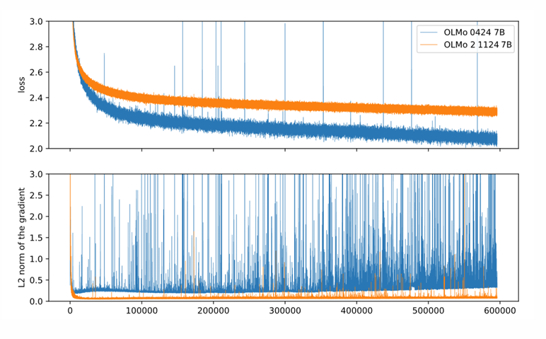

##### softmax

softmax有指数运算 , 而且要做除法运算 , 这二者都很容易产生梯度爆炸
softmax出现在output layer 归一化和norm layer

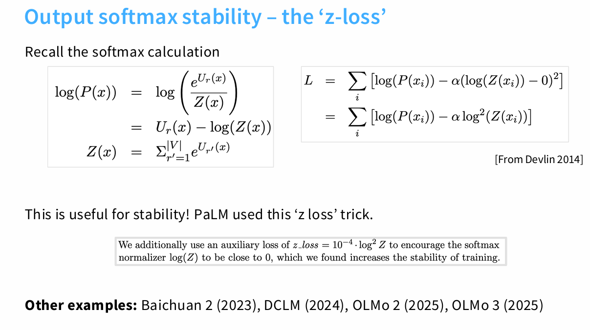

softmax 交叉熵计算中，输出分布具有平移不变性：即使所有的 logits $U_r(x)$ 同时加上一个极大的任意常数，最终计算出的概率 $P(x)$ 依然保持不变 ; 这会导致在网络优化过程中，模型倾向于不受约束地不断推高 logits 的绝对幅值。当 logits 的数值过大时，极易在 FP16 或 BF16 等低精度浮点计算中引发 LogSumExp 操作的数值溢出（Overflow），进而导致梯度爆炸或整体训练崩溃（Loss Spike）

通过为loss部分添加归一化项$-log^2z$  , 来约束Z(x)尽可能小  , 最终$\sum e^{U} \approx 1$

这个z loss在业界常见且友好

#### attention

##### Layer norm and pose embedding

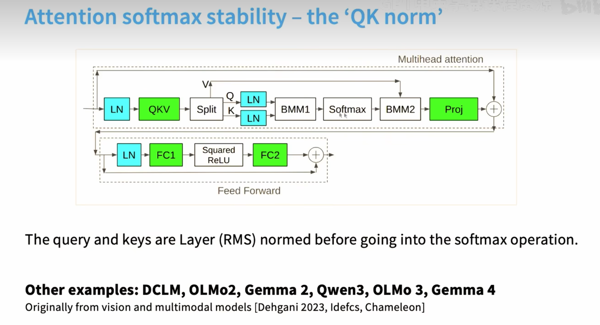

QK Norm 专门针对的是**注意力机制（Attention）中的 Softmax 层** , 强制将其方差拉回到 1 附近，从而为注意力机制提供了一个极度稳定的训练环境。


利用 $\tanh$（双曲正切）函数对 Logits 进行非线性压缩。当输入的 logits 数值较小时，$\tanh(x) \approx x$ , 输入 logits 绝对值极大时 , 最终的输出值会被严格限制在 $[-\text{soft\_cap}, +\text{soft\_cap}]$ 的绝对区间 ; 但这些norm也会带来一些性能损失 , 下面的表有对比几种约束带来的效果
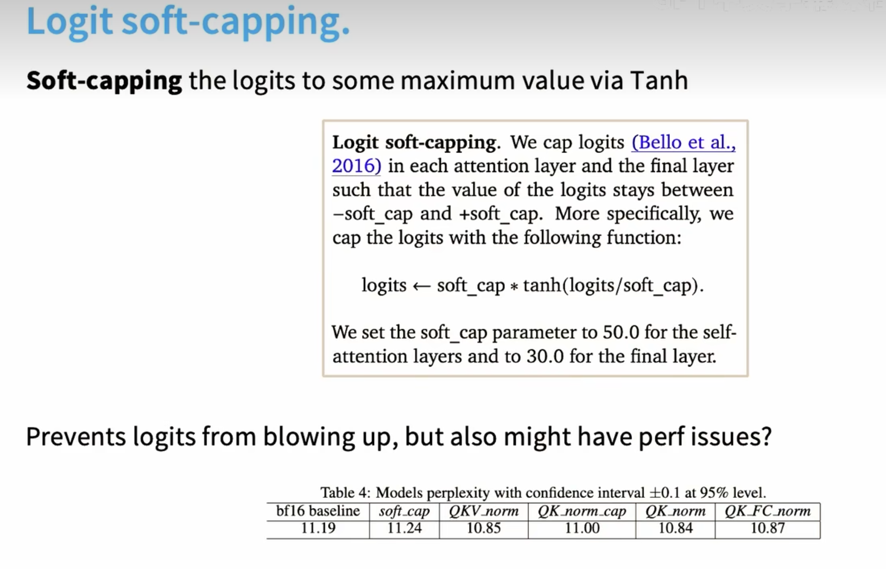


在训练和prefill 阶段 , **otal arithmetic operations (总浮点运算量/FLOPs)**：量级为 $O(bnd^2)$。这主要来自于 $Q, K, V$ 的线性变换以及最后的输出投影矩阵乘法。

**Total memory accesses (总显存访问量/Bytes)**：量级为 $O(bnd + bhn^2 + d^2)$。这包括了读取输入/写入输出的激活值（$bnd$）、读写 $n \times n$ 的注意力矩阵（$bhn^2$）以及加载模型权重（$d^2$）。

算术强度 = **计算量 / 访存量**=$$ O\left(\left(\frac{1}{k} + \frac{1}{bn}\right)^{-1}\right) $$  ,当bn相当大时 ,算术强度趋近于O(k), 此时为计算密集 , 计算效率高
但是在推理阶段( Decoding) , 一次只能生成一个token(n=1) , 为了计算一个 Token，GPU 都必须把过去所有 Token 的 KV Cache（总显存占用与注意力头数 $h$ 成正比）从 HBM 显存中全部搬运一次 , 此时模型从compute-bound变成了memory-bound 
因此MQA ,GQA等减少KVcache的模型架构诞生是很自然的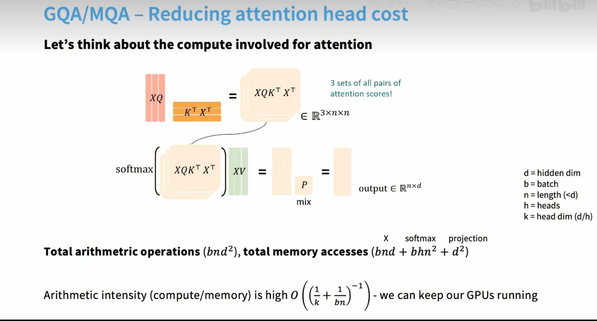

标准multi-head attention ,GQA和MQA 对比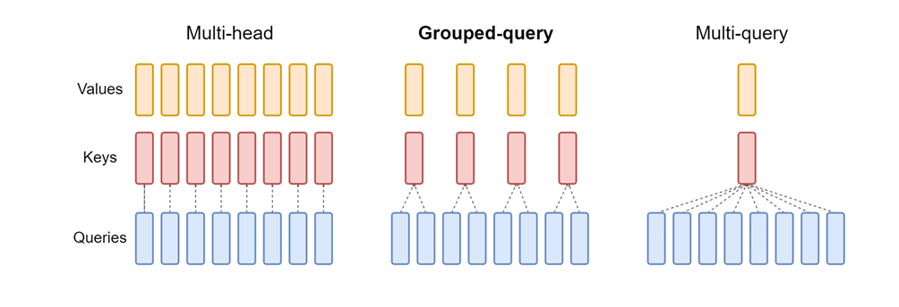

GQA算是MQA和MHA的折中 , 取适当的G值可以在模型性能损失较小的同时获得更高的推理速度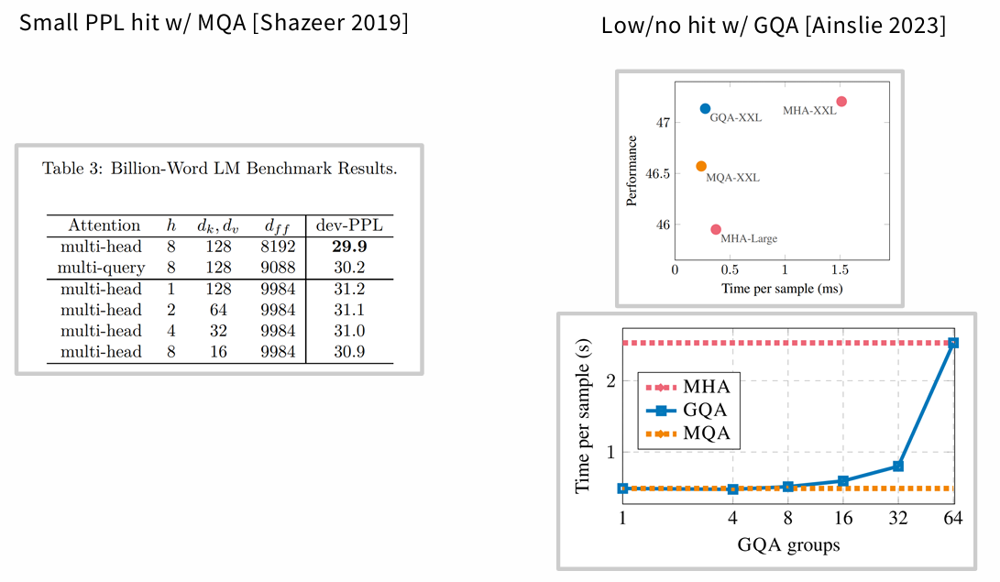

对于O(n^2)的标准attention ,可以使用 **3:1 的交替策略**。即每 3 层 **SWA（Sliding Window Attention，滑动窗口注意力）** 之后，接 1 层 **Full Attention（全局注意力）** SWA时间复杂度为O(n) ; 每 4 层插入一次的full attention则作为“信息枢纽”，负责将局部窗口内的信息进行全局路由和交互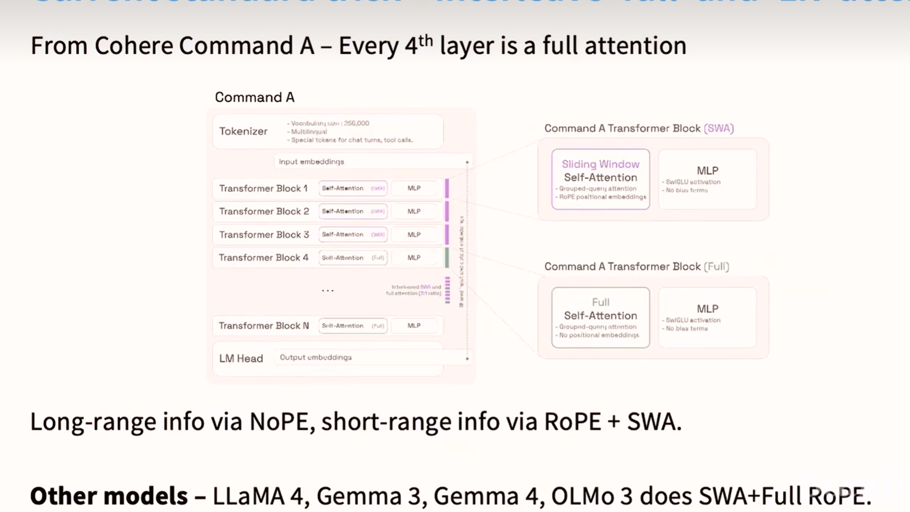

**短程信息 (SWA 层 + RoPE)**：在 **SWA 局部窗口层**，模型使用了标准的 **RoPE（旋转位置编码）**。这使得模型能够极其敏锐地捕捉 token 之间的细粒度、高频的局部相对位置关系（例如句法结构、相邻词汇搭配）。

**长程信息 (Full 层 + NoPE)**：在全局注意力层，模型直接**丢弃了位置编码（NoPE，No Positional Embeddings）**。因为高频的局部相对位置已经在 SWA 层被处理并融合到了特征表征中。在全局层去掉 RoPE，可以有效规避传统位置编码在面对超长、未见过的序列长度时所产生的长度外推（Length Extrapolation）灾难，纯粹依靠特征本身的语义相似度来进行全局 Attention 聚合。

##### liner attention 线性注意力

$$ \text{Attention}(Q, K, V) = \text{softmax}\left( \frac{QK^T}{\sqrt{d_k}} \right) V $$ $ Q\in R^{n\times d_{k}},K\in\mathbb{R}^{n\times d_{k}},V\in\mathbb{R}^{n\times d_{k}}$  计算量为$$O( n^2 d_k + n^2 d_v )$$
而如果我们能**用一个线性函数代替softmax** , 则此时可以满足乘法交换律 , 即$$ (QK^T)V = Q(K^T V) $$ 此时计算量为$O(2 n d_v d_k) $ ,一般而言n远大于d_k和d_v , 因此这样子可以节省大量的计算 ,把Attention计算量从$O(N^2)$变成了O(N)

这样子的结构有点类似RNN , RNN在推理时十分友好 , 但是训练不太好处理 ,

Minimax M1 就使用了这种线性attention , 根据我们上面的描述其实也可以推断 , 并非完全是O(N)的推理计算复杂度 , 但总归是计算量相较于之前的减少了部分 ($n->d_k$)

**线性注意力 (Linear Attention):**

$$S_t = S_{t-1} + k_t v_t^T$$

$$y_t = q_t^T S_t$$

在线性注意力中，隐藏状态 $S_t$ 是通过简单的**无权重累加**来更新的。这意味着历史状态 $S_{t-1}$ 被无差别地保留到了当前时刻，模型缺乏一种机制来“遗忘”不重要的历史信息。这限制了其上下文压缩的表达能力。

**Mamba-2 (泛化后的线性注意力):**

$$S_t = \gamma_t S_{t-1} + k_t v_t^T$$

$$y_t = q_t^T S_t + v_t^T D$$

**核心改进在于红色的 $\gamma_t$ 项。** 幻灯片指出 $\gamma_t = f(x_t)$，即这个衰减系数是**依赖于当前输入**的。

它赋予了模型类似 LSTM 中遗忘门的能力（选择性状态空间，Selective SSM）：模型可以根据当前的输入动态决定是保留还是清除之前的隐藏状态 $S_{t-1}$。正是这个输入依赖的门控机制，极大地增强了 Mamba-2 的特征提取和表达能力（"make linear attention more expressive via gating"） ; 后面的 $+ v_t^T D$ 则可以看作是一种直通项或残差连接。

**推理时（RNN 视角）：** 它可以像上述公式一样，以**串行（Sequential）的方式一步步更新状态** $S_t$，实现 $O(1)$ 的推理显存占用和极高的自回归生成速度。

**训练时（CNN/Attention 视角）：** 尽管引入了依赖输入的 $\gamma_t$，但通过并行前缀和（Parallel Associative Scan）或结构化矩阵乘法等硬件感知算法，依然可以在序列维度上**并行计算**所有的状态更新，避免了传统 RNN 无法并行训练的致命缺点。
**串行块展示了数据的逻辑流向** , **并行块**将多个独立的线性变换**合并成一个大的并行矩阵乘法** , 从而提高了硬件吞吐量

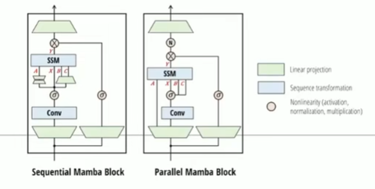

**门控 Delta 网络 (Gated Delta Net)**。

如果说 Mamba-2 的核心贡献是给线性注意力加上了“全局遗忘门”，那么 Gated Delta Net 的核心创新就是引入了“输入门控”**和**“选择性擦除”机制，它能更精准地控制记忆的写入与覆盖。

以下是具体的深度拆解：

1. 核心公式对比：从标量衰减到矩阵投影

对比 Mamba-2 和 Gated Delta Net 的状态更新逻辑：

- **Mamba-2 的更新：**

  $$S_t = \gamma_t S_{t-1} + k_t v_t^T$$

  这里的 $\gamma_t$ 作为一个由当前输入决定的标量，作用在整个隐藏状态矩阵 $S_{t-1}$ 上。这是一种相对粗放的“全局缩放”，它只能决定整体衰减多少，无法针对性地遗忘某部分特定的信息。

- **Gated Delta Net 的更新（基于 Delta 规则）：  **$$S_t = \gamma_t (I - \beta_t k_t k_t^T) S_{t-1} + \beta_t k_t v_t^T$$    这个公式引入了第二个依赖输入的门控标量 $\beta_t = f(x_t)$，并构造了一个极其关键的矩阵乘子 $(I - \beta_t k_t k_t^T)$。

标准 RNN 的状态更新像是在做简单的加法。而 Gated Delta Net 的更新公式$$S_t = S_{t-1} - \beta_t k_t (k_t^T S_{t-1} - v_t^T)$$ 在数学结构上**完全等价于一步梯度下降（Gradient Descent）**

**① 输入门控机制（'no input operation' gate）** 通过标量 $\beta_t$ 来控制新知识的写入。

**② 沿着特定方向选择性擦除（Selective Erasure）**

在线性注意力的累加更新中，状态矩阵 $S_t$ 的容量是有限的，一直累加容易饱和。

- 乘上 $(I - \beta_t k_t k_t^T)$ 这个项，本质上是一个**基于当前查询特征的空间投影**操作。
- 在向矩阵中写入新的键值对外积 $k_t v_t^T$ 之前，它会先扫描历史记忆 $S_{t-1}$，并把其中**与当前 Key ($k_t$) 方向高度重合/对齐的旧记忆提前抹除掉**。
- 这赋予了模型一种**精准修改自身记忆**的能力：当它看到一个相同主语的新事实时，它可以洗掉该主语关联的旧事实，再写入新事实，避免了新旧知识在矩阵中的混叠冲突。

这个模式在qwen3.5中也有使用

#### Hybrids attention混合注意力

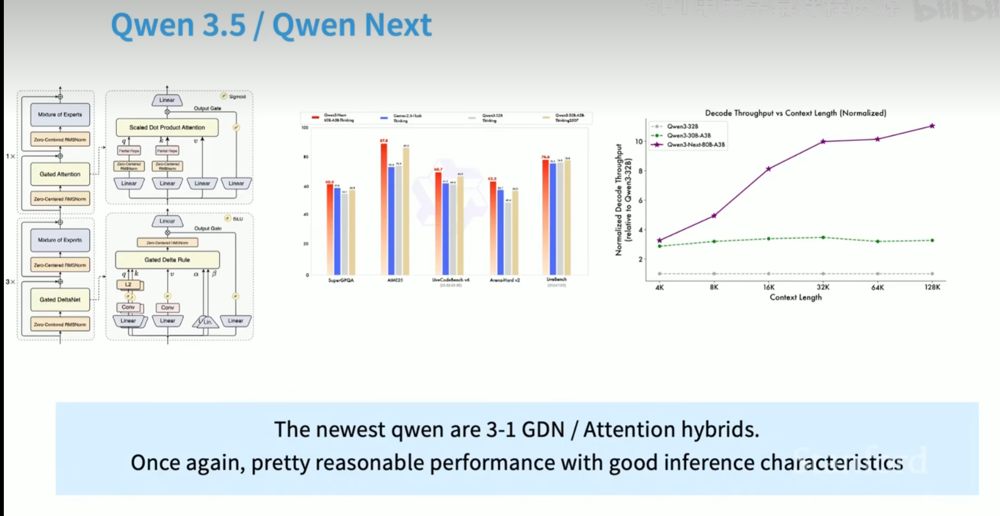

每堆叠 3 层 Gated Delta Net，再交替 1 层标准注意力层

图中展示了这两种不同的 Block 结构，它们都结合了 **MoE (混合专家)** 和 **Zero-Centered RMSNorm**：

- **上半部分（Gated Attention Block）：** 这是保留的传统注意力层。但做了一些优化，比如引入了 Partial RoPE（部分旋转位置编码）和类似于门控机制的 Output Gate。保留一层 Attention 的目的是为了**弥补线性 RNN 在精确全局检索（如大海捞针任务）上的固有劣势**。
- **下半部分（Gated DeltaNet Block）：** 这正是我们上一张图讨论的内容落地。你可以清晰地看到内部包含了卷积（Conv）处理局部特征，然后计算 $q^\intercal k$，并结合 $\alpha$ 和 $\beta$ 门控，最终执行 **Gated Delta Rule**。这部分取代了大部分的 Attention 层，负责高效的上下文状态压缩。

**原理解析：** 纯 Attention 模型在 Decode 阶段，其 KV Cache 的大小随着序列长度 $O(N)$ 增长，导致极高的显存带宽瓶颈（Memory-bound），解码速度会随上下文变长而显著变慢。

而采用了 3:1 混合架构后，占多数的 GDN 层在推理时将历史信息压缩在了**固定大小的隐状态矩阵**中，不需要读取庞大的 KV Cache。因此，在超长文本生成时，它的速度优势被无限放大。

Hybrid performance

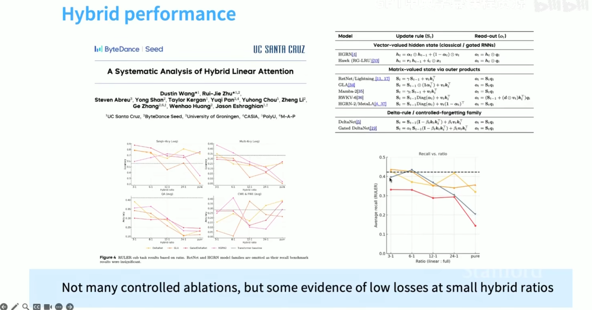

混合架构的优劣 : 虚线代表dense架构的标准参考性能 , 右下角可以看出 , 随着线性layer的混合比例增加 , 性能会下降
但**部分架构在低比例混合下性能下降其实并不明显** ,而这可以大大提高推理性能

#### 稀疏适应（Sparse Adaptation）

不改变底层架构，而是通过“稀疏适应（Sparse Adaptation）” , **与其在计算注意力时“关注所有历史 Token（Dense）”，不如只挑最重要的那几个看（Sparse）。** 这种方法被称为 DSA（动态/解耦稀疏注意力）。

DSA 引入了一个计算**代价极低的“预筛选”**机制。(这个虽然也是$O(N^2)$ , 但是计算量比softmax小得多 , 因此可以节省时间)

- $I_{t,s} = \sum_{j=1}^{H^I} w_{t,j}^I \cdot \text{ReLU}(\mathbf{q}_{t,j}^I \cdot \mathbf{k}_s^I)$ 不计算softmax 而是ReLU , 计算**相关性分数 ($I_{t,s}$)** 极快 , 且精度要求低
- $\mathbf{u}_t = \text{Attn}(\mathbf{h}_t, \{\mathbf{c}_s | I_{t,s} \in \text{Top-k}(I_{t,:})\})$ 现在只对分数排名前 K (`Top-k`) 的历史 Token 进行计算 ,降低计算量

- **混合架构 (Hybrids)：** 靠换零件（换上线性 RNN 引擎）来提速，适合大厂从头预训练下一代旗舰模型。
- **稀疏适应 (Sparse Adaptation)：** 靠优化工作流（加个前置筛选器）来提速，是一种极具性价比的“外挂”方案，非常适合现有模型的长文本能力改造。


通过左下方折线图可以看出 , 随着上下文长度增加 , 推理成本大大降低
上方柱状图可知稀疏并没有导致性能损失过多
右下角的图表中 

GLM-4.7 团队在 RULER（一个极其严苛的长文本大海捞针测试集）上的消融实验：

- **GLM-4.7-Flash（基线）：** 传统的密集注意力，128K 时准确率为 79.21%。
- **+ DSA warmup（仅预热）：** 这就是你提到的“只训练 Indexer，冻结主模型”。可以看到在 128K 时，成绩掉到了 71.35%。这说明如果主干模型完全不适应突然变稀疏的输入，性能还是会有所损耗。
- **+ DSA（联合训练）：** 在经过 warmup 之后，开放主干网络一起进行联合微调（Jointly trains both for 150B tokens）。此时 128K 的成绩回升到了 **78.86%**。

- 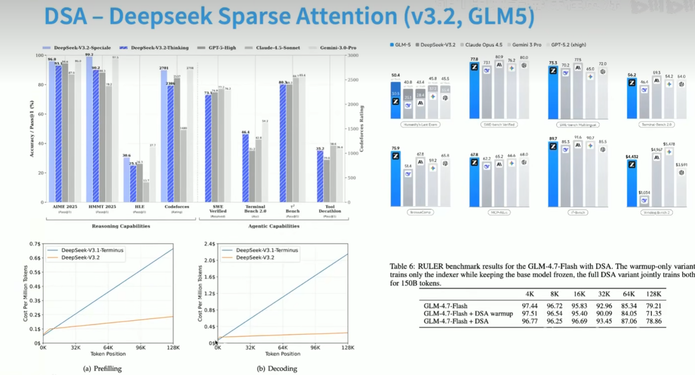

##### 解耦训练:

分为两阶段

##### 第一阶段：密集注意力预训练 (Dense Short-context Pretraining)

在这个阶段，模型**完全没有**长文本能力，也没有任何“稀疏（Sparse）”的黑科技。

- **状态：** 一个最标准、最古典的 Transformer 架构。
- **输入长度：** 限制在极短的窗口（通常是 4K 或 8K Token）。
- **注意力机制：** 密集注意力（Dense Attention）。即每一个 Token 在计算时，都必须老老实实地和前面所有的 Token 进行 $O(N^2)$ 的全量计算。

如果一开始就用稀疏注意力（只挑几个词看），模型根本学不会人类语言的复杂逻辑、世界法则和代码常识。


##### 第二阶段：稀疏适应与上下文扩展 (Sparse Adaptation & Context Extension)


通常会**直接复制主模型中已经训练好的 Query 和 Key 的投影矩阵权重**，作为 Indexer 的初始权重。
然后将输入上下文拉长（比如拉到 32K），**冻结（Freeze）主模型的所有参数**，确保它的智商不掉。只开放新加的 Indexer 参数进行训练。
在**后台跑一个极其昂贵的全量 Dense Attention 作为“老师”**，然后让小巧的 Indexer 作为“学生”去预测：“如果老师来看这段 32K 的文本，**它会把注意力集中在哪几个 Token** 上？” Indexer 通过**模仿老师的注意力分布**，迅速掌握了在长文本中“抓重点”的能力。

##### 第三截断：小学习率的联合微调 (Joint Fine-tuning)

- **状态：** 上下文长度拉到最大）。此时，解锁主模型的部分或全部参数。
- **发生了什么：** 主干模型突然发现，原本输入给它的、极其丰富的全量历史信息（Dense KV Cache）不见了，变成了被 Indexer 过滤后的稀疏信息（Sparse KV Cache）。主模型最初会有些不适应（性能会有微小波动）。
- **对齐：** 通过极小学习率的联合微调，主模型逐渐学会了如何在这种“信息不完整但绝对精确”的稀疏输入下，继续保持它原有的高智商推理能力。

**使用解耦训练的优点：** 前 99% 的训练数据都在极省显存的 4K 长度下跑完，算力成本是线性的、可控的。**只有在最后不到 1% 的数据（Post-hoc stage）时，才拉长到 128K 进行微调。**

### Mixture of expert MoE

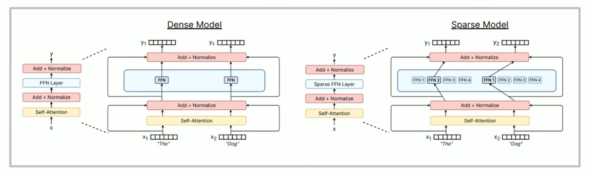

如图所示 , MoE 把大的FFN拆成多个小的FFN , 推理时仅使用一个或几个而非全部 , 从而降低计算量提高推理速度


如图 , 在**相同推理运算量**下 , 随着模型参数的增加 , 

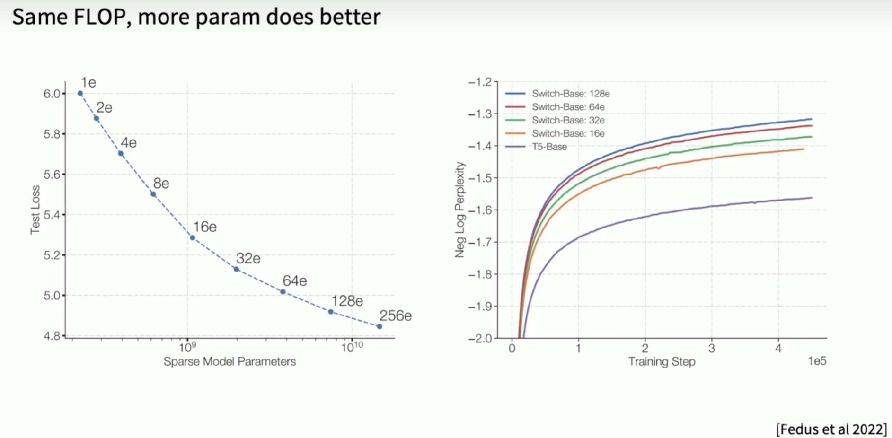

##### Switch Transformer

创新：

1. **从 Top-N 变为 Top-1 路由**

2. **优化了专家容量因子（Capacity Factor）：**

   - 在 MoE 中，如果所有 Token 都涌向同一个专家，会导致该专家计算溢出（Token Dropping），而其他专家闲置。传统 MoE 通常需要留出很大的冗余容量（Capacity Factor 较高）。
   - Switch Transformer 证明了在 Top-1 路由下，即使将 Capacity Factor 降得很低（比如 1.0 或 1.25），依靠辅助负载均衡损失函数（Auxiliary Load Balancing Loss），依然能实现很好的路由均衡。

3. **精度混合训练（Selective Precision）：**

   为了解决稀疏模型难以收敛和不稳定的问题，Switch Transformer 在模型主体使用 BFloat16 甚至更低精度时，强制**将 Router（门控网络）的计算保留在 FP32 精度**，这成为了后来所有大厂训练 MoE 模型的标准操作（Base practice）

Switch Transformer 证明了 **Top-1 是可行且高效的**。

但在今天（2024-2026年），你研究的 Qwen MoE、Mixtral 8x7B 以及 DeepSeek 系列，为了在有限规模下追求极致的性能（Reasoning / Math），往往又回到了 **Top-2 甚至细粒度多专家路由（Fine-grained Expert Routing）** 的思路上。

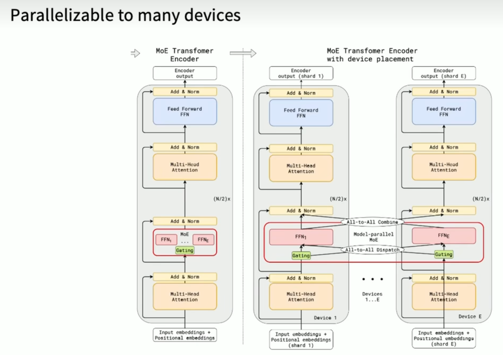

上图体现了MoE天然支持设备级并行 ， 将expert拆开显然很合理 ， 但负载均衡问题该怎么解决呢

1. 辅助负载均衡损失 (Auxiliary Load Balancing Loss) ， 必备

2.  专家容量限制与 Token 丢弃 (Expert Capacity & Token Dropping)

   如果发往 Device 1 的 Token 超过了容量 $C$，多出来的 Token 就直接被**丢弃（Dropped）**——即跳过该专家的 FFN 计算，直接通过残差连接流向下一层。

   虽然丢弃 Token 会轻微损害模型的推理质量，但这反过来构成了巨大的压力，迫使负载均衡损失发挥作用，因为模型为了降低 Loss，必须学会把 Token 分配给没满载的闲置专家。

3. 反向路由：专家选择 Token (Expert Choice Routing)

   这是近年来（如 Google 的部分研究）为了彻底解决硬件浪费提出的一种更优雅的架构。传统 MoE 是“Token 选专家”，很容易扎堆；新的设计改为“专家选 Token”。强制规定每个 Device 上的专家必须挑选出 Top-K 个对自己来说权重最高的 Token。这样在物理层面上，每个 Device 每一轮分配到的计算量是绝对相等的，彻底实现了 0 算力浪费。

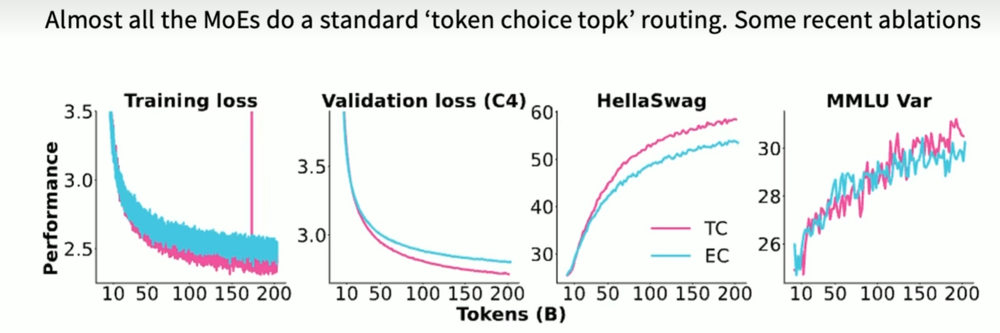

token choice top-k 相较于expert choice , loss更低

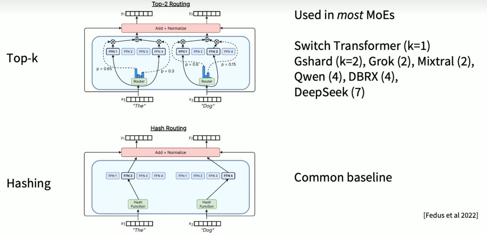

##### 哈希函数 hashing

1. 哈希表是均匀散列的 ， 意味着token分布一定是均匀的 ；
2. 哈希计算的开销约等于零。不需要在反向传播时更新路由器的权重，极大地加快了训练速度 ； 
3. 因为没有参数，路由规则是写死的。不管模型怎么训练，它不会只训练某一个专家，训练过程会变得稳定。

缺点：使用hashing会导致路由失去意义 ， 所有专家接收的token没有规律 ，expert这个专家不够“专”  ， 因此在相同参数量下的性能会低于learningable  MoE

shared expert : 通用专家 ， MoE中的dense部分 ， apply all the time

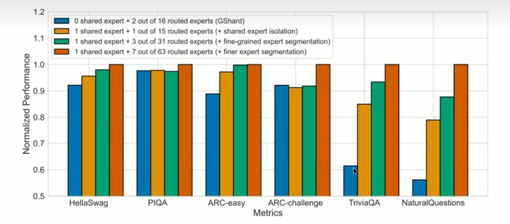
如图是deepseek MoE 的实验结论 带有shared expert在大部分数据上效果都更好 ，且更细粒度的切分专家效果也会变好

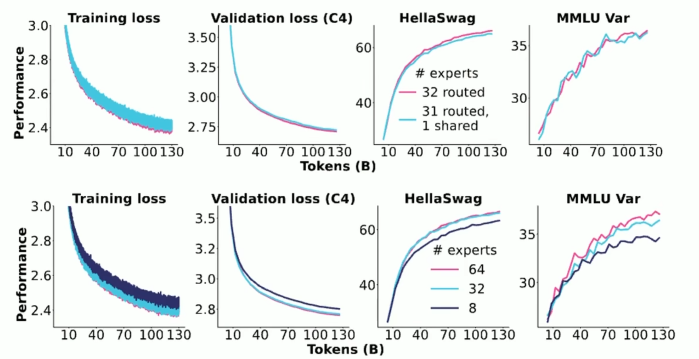Olmo表示有帮助的并非shared expert , 而是**更细粒度的expert切分**


##### how to train

训练时我们需要**稀疏训练每一个专家** ， 但这种**稀疏决策是不可导**的(路由错了你反向传播也不可能传播到别的expert上) 
solution

1. RL训练门控路由
2. 随机扰动（类比 Noisy Top-k ，**将硬性选择变成软性选择** ，近似出可传递的梯度(类似重参数化 , 随机采样不可导的节点用噪声取代) )
3. **启发式均衡损失**（最常用）

**RL太重**了 ， 性价比很低

Input Jitter 这种**物理加噪**手段效果可以见下表 ， 根据消融实验可知 ， 
虽然模型不崩溃了，但因为输入被噪声污染了，**性能变差**（相较于baseline）

| Method                   | Fraction Stable | Quality (↑)   |
| ------------------------ | --------------- | ------------- |
| Baseline                 | 4/6             | -1.755 ± 0.02 |
| Input jitter ($10^{-2}$) | 3/3             | -1.777 ± 0.03 |
| Dropout (0.1)            | 3/3             | -1.822 ± 0.11 |

##### Heuristi Balancing Loss启发式均衡损失

为了强迫模型对专家的训练足够均衡，我们需要在总 Loss 里加一个惩罚项。**但Token 分配（`argmax` 操作）是不可导的，梯度传不过去。**

在一个 Batch（$T$ 个 Token）中，**实际上**有多少比例的 Token 被发给了专家 $i$。$$f_i = \frac{1}{T} \sum_{x \in \mathcal{B}} \mathbb{1} \{\text{argmax } p(x) = i\}$$
在一个 Batch 中，Router 网络给专家 $i$ 打出的 Softmax 概率 $p_i(x)$ 的平均值。$$P_i = \frac{1}{T} \sum_{x \in \mathcal{B}} p_i(x)$$
混合点积（**Hybrid Dot-Product**）  $$\text{loss} = \alpha \cdot N \cdot \sum_{i=1}^N f_i \cdot P_i$$ 

可以这么理解 ， 分配越不均匀(单独的expert) ，这个loss越大(虽然不太好直接理解， 但是求梯度的时候可以对softmax均值 做梯度下降 ， 从而优化路由器) 

而且不单只是 repert balance , 这个做法也可以 pre-device balance  , 具体做法区别不大 , 但可以提高训练设备的利用率

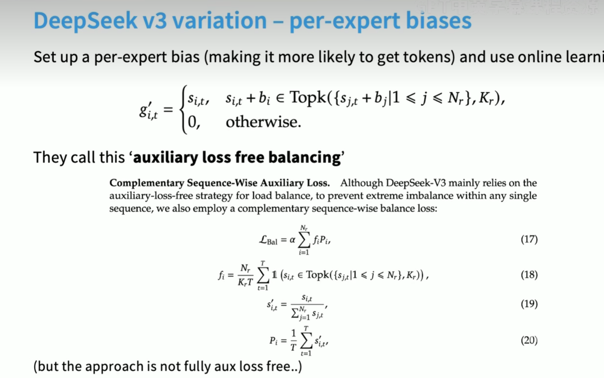

上图是DeepSeek-V3 在混合专家模型（MoE）中解决负载均衡（Load Balancing）问题的核心策略

1. 核心创新：基于 Expert Bias 的“无辅助损失”路由

幻灯片上半部分的公式展示了 DeepSeek-V3 的主要负载均衡机制：**Per-expert biases**。

$$g'_{i,t} = \begin{cases} s_{i,t}, & s_{i,t} + b_i \in \text{Topk}(\{s_{j,t} + b_j | 1 \le j \le N_r\}, K_r), \\ 0, & \text{otherwise}. \end{cases}$$

**原理解析：**

- $s_{i,t}$ 是门控网络计算出的 token $t$ 对专家 $i$ 的**原始亲和度**（Routing Score）。
- $b_i$ 是专门为专家 $i$ 设置的**动态偏差项（Bias）**。
- **Top-K 决策阶段：** 在决定将 token 路由给哪 $K_r$ 个专家时，模型使用的是**加上 Bias 后的分数** ($s_{i,t} + b_i$)。
- **权重输出阶段：** 一旦专家被选中，最终参与 MoE 加权求和的门控权重 $g'_{i,t}$ **仍然是原始的 $s_{i,t}$**，而不是 $s_{i,t} + b_i$。

**为什么这样设计？**

这就是它被称为“无辅助损失”的原因。它通过**在线学习（Online Learning）动态调整** $b_i$：如果某个专家被分配的 token 太少，$b_i$ 就会增加，人为地将其“抬升”进 Top-K 的队列中；反之则降低。

**关键点在于梯度解耦**：因为最终乘到专家输出上的权重是原始的 $s_{i,t}$，所以在反向传播时，负载均衡的操作（$b_i$ 的调整）**不会产生影响 $s_{i,t}$ 梯度的惩罚项**。门控网络可以纯粹为了降低主任务 Loss 去优化 $s_{i,t}$，而**不用兼顾负载均衡**。

虽然 Bias 机制在大尺度（Batch 级别）上能很好地平衡负载，但对于**极端分布的单条长序列**（例如某段代码或特定语言的超长文本），可能会导致序列内部发生严重的负载失衡。因此，他们引入了一个**补充性的序列级平衡损失**：$$\mathcal{L}_{\text{Bal}} = \alpha \sum_{i=1}^{N_r} f_i P_i $$ 如果一个专家在序列中被频繁选中（$f_i$ 很大），Loss 就会惩罚网络，迫使其降低该专家的输出概率 $P_i$

**主要部分**：使用 **Per-expert bias** 进行全局路由干预，实现主梯度路径与负载平衡的解耦，最大化模型表达能力。
**兜底：使用一个极小权重 ($\alpha$) 的 **序列级辅助损失**，防止在极端长上下文中发生局部的路由崩溃。

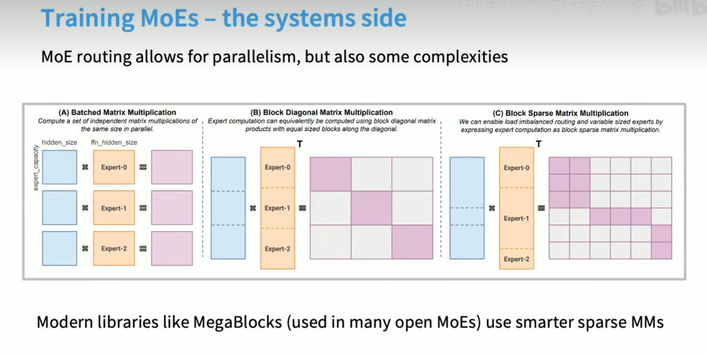

块稀疏矩阵乘法 :如果您把所有专家的权重和所有 token 放在一起看，它其实是一个巨大的矩阵乘法。但是，因为一个 **token 只会被路由给特定的 1-2 个专家**，它与**其他所有专家**的乘积结果必然是零。这意味着在这个巨大的运算中，绝大部分区域是“空”的，这就是**稀疏性 (Sparsity)**
现代MoE训练时 , 利用特殊的 CUDA 内核（Block-sparse GEMM），通过底层的**索引指针**直接告诉 GPU：“这里有一堆大小不一的输入块和对应的专家权重，**请精确地只在非零的数据块上进行乘法运算**，跳过所有空白区域 ,从而提高利用率

##### Fintuning

MoE的微调比较困难, 因为多专家在训练时就已经不好控制 , 一般这种情况下微调考虑微调非MoE 的 MLP or Attention

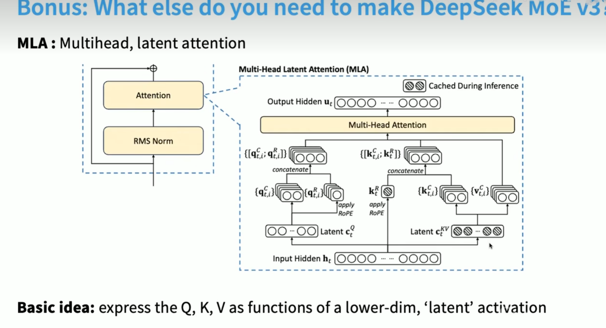

MLA :引入一个**瓶颈层 (Bottleneck)**。如图所示，输入的 $h_t$ 首先被“降维”投影成两个低维的潜在向量（Latent vector）：

- **$c_t^Q$**：用于生成 Query 的潜在向量。
- **$c_t^{KV}$**：用于生成 Key 和 Value 的潜在向量。
- 当需要计算注意力时，模型再从缓存中读取这个 $c_t^{KV}$，通过一个线性投影矩阵（“实时解压”），瞬间恢复出各个头的 $k_{t,i}^C$ (Content Key) 和 $v_{t,i}^C$ (Content Value)。
- 在实际工程实现中，解压 $c_t^{KV}$ 的权重矩阵可以直接与后续 Attention 计算中的投影矩阵吸收合并（Weight Absorption），从而不仅节省了显存，也没有增加太多的计算开销。
- KV Cache 中实际缓存的是两部分：压缩后的内容向量 **$c_t^{KV}$** , 未经压缩但维度很小的前置 RoPE 向量 **$k_t^R$**。最终在算 Attention 之前，把内容向量和位置向量直接拼接 (concatenate) 在一起。

## GPU,TPU  

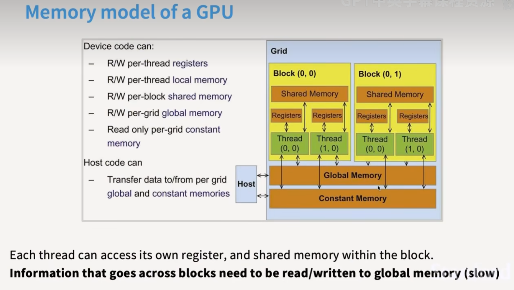

GPU , 有层次结构的内存 , 一个Block中最好能完成相同的运算(相同指令不同数据) , 而从shared memory 到Global Memory读取数据是很慢的 , 因此GPU的最大问题就是克服数据流动的时间
GPU**在同一个SM上是SIMT的**

相较于GPU , TPU有着**更大 , 数量更少的矩阵乘法单元** ,GPU计算更灵活 , 因为tensor core更多 , 可以同时计算更多种计算

GPU的线程代价更低 , 切换也很快捷;
**矩阵乘法在GPU中做了优化 , FLOPS的运算性能远超其他计算类型**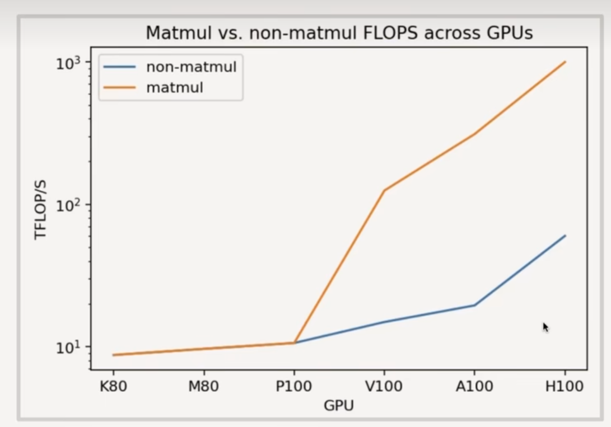

如图 , 我们的计算速度远超 内存传输速度 和 设备并行速度, 因此目前most operation is memory operation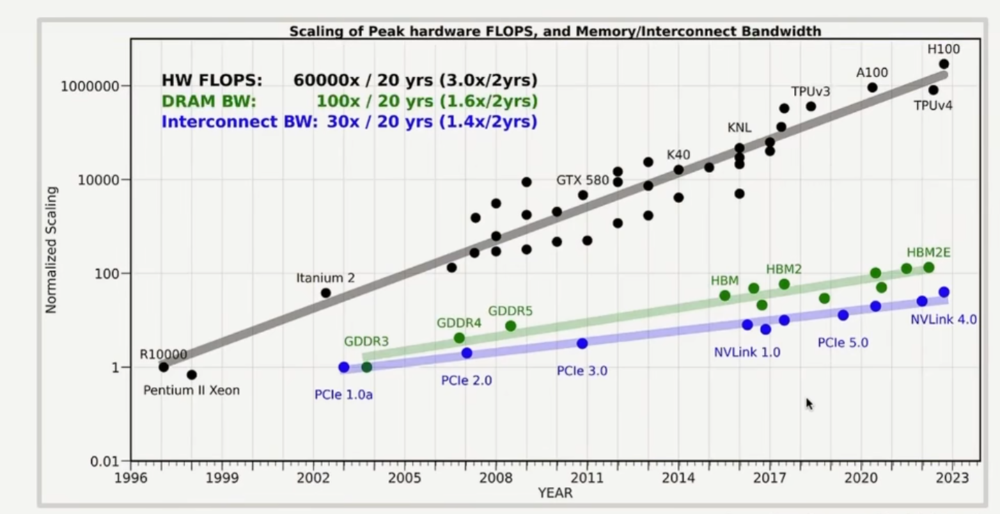
目前比较著名的应用是 prefill decode disaggregation (prefill decode 分离) , prefill compute bound , decode memory bound , 因此分离开用专有硬件进行处理

从寄存器到cpu memory , 随着运算量和内存带宽比的增加 , 最终会达到相同吞吐量(运算饱和) , 只要我们内存带宽增加 , 我们就可以提高我们的运算量从而增加利用率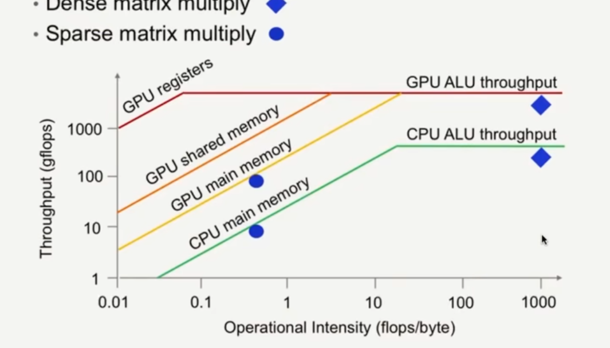

how to make GPUs go fast ()

1. Control divergence (除了他 ，其他都是memory相关)
2. Low precision computation (低精度计算 ，减少传输时间(甚至可能使用内存不减反增，但传输时间减少了))
3.   Operator fusion  （**算子融合**）
4.   Recomputation （重新计算的时间比读内存短）
5. Coalescing memory (Tiling **搬运数据** 的时候，要让**相邻的线程去读取相邻的内存地址**）
6. Tiling （分块）

除了1以外 , 其他方法都是通过 minimize memory movement实现的

##### Control divergence 控制发散

GPU是SIMT的 , 因此**if 语句的两个branch 都要被执行** ,然后根据if else 情况**mask 其中一个**

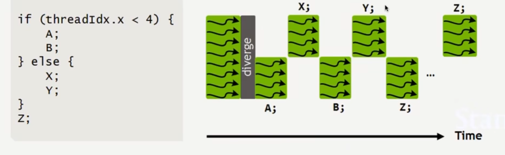

 实际执行情况如图 , SIMT依次执行不同分支部分 ; 编写程序较为简单 , 但存在**不小的性能浪费** , 因此**少使用if**

##### 低精度

近年来的flops 大幅增长主要来自于两个要素 : 一个是晶体管数量和时钟频率的增加 , 另外一个是**精度的下降**(fp32->fp16->…fp4 ,int8) , 低精度下的计算实际并不容易 , 重点在于我们要弄清楚**哪些部分是可以在低精度下运算的 , 哪些不行**

相同精度下也有很多特别的 , FP16以及 BF16; E4M3的FP8 以及 E5M2 的FP8 , 二者并没有具体的好坏 , 只有在那些场景下的具体使用 d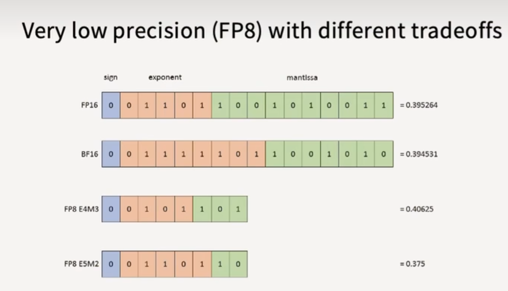


MXFP8 :**Micro-scaling FP8**，可以理解成“**带分块缩放因子的 FP8 量化格式**”
每个数据值用 **FP8 E4M3** 表示 , 从而得到更大的尾数精度  ; MXFP8 **不是整个 tensor 共用一个 scale**，而是 **每连续 32 个数共用一个 scale factor** , **scale 是 E8M0** ; 即真实值 = FP8(E4M3) 存的值 × 这个 32 元素小块的 scale

普通**矩阵转置**只是把行列交换；但 MXFP8 的 scale 是按“连续 32 个值”的方向绑定的。按行量化时，一个 scale 对应一行里的 32 个连续元素；按列量化时，一个 scale 对应一列里的 32 个连续元素。这两个分块方向不同，所以 **rowwise MXFP8 和 columnwise MXFP8 在数值上不是简单转置关系**，不能直接把量化后的数据和 scale 转置一下就完事，通常要从从 full-precision 数据量化 ;
NV官方做了一种优化 , 同时保存双向 MXFP8 , 虽然存储上相较于FP16和BF16并没有节省(两个fp8+scale , 体积还大了) , 但 GEMM 能直接吃 FP8/MXFP8，获得 Tensor Core 的吞吐收益 且避免 backward 时做：`反量化 rowwise FP8 -> 转置 -> 重新量化成 columnwise FP8` , 这个流程会有额外 kernel、额外带宽，以及二次量化误差。NVIDIA 的说明也强调，MXFP8 张量及其转置在数值上不等效；需要从高精度输入重新量化，以避免“转置已量化 FP8 tensor”带来的复合量化误差。

MXFP8 训练不是“整个模型都变成 MXFP8”，而是**只把适合低精度 GEMM 的部分临时量化成 MXFP8**，其它部分仍然用 BF16/FP32。 大部分 **linear / GEMM-heavy** 的地方用 MXFP8 ,LayerNorm , Softmax , Add / residual  , Activation function

##### 算子融合（Kernel Fusion）

本质是将多个独立的计算操作（算子）合并到一个单一的 GPU Kernel 中执行，以极大程度地**减少对高带宽内存（HBM）的读写开销**。


本次计算正常需要用到八次memory传输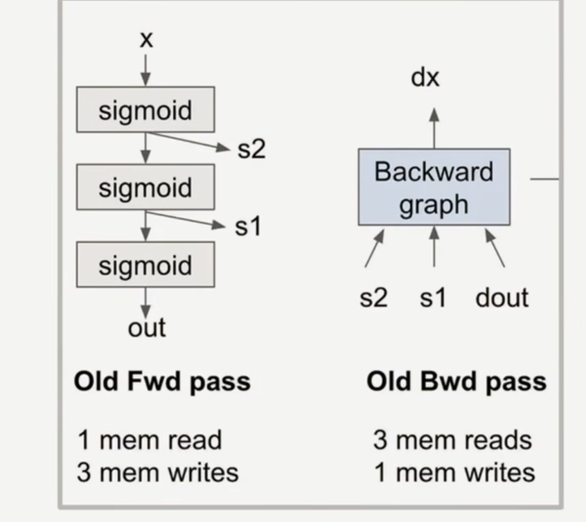
优化一下 :
左侧前向传播 ; 右图执行反向传播的 Kernel 时，我们**再次从显存读取 `x`**，并在计算单元内部**重新执行一次前向计算**（图右侧灰蓝色的 3 个 Sigmoid 模块）;
因为我们的计算资源十分廉价 , 相较于memory传输 , 重算一次时间更低 , 从而将memory次数从8降低至5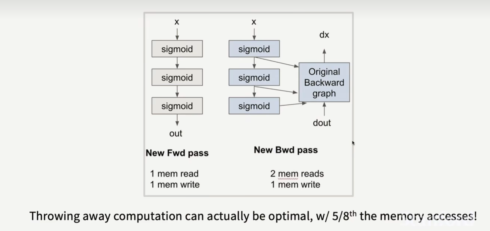

#####  memory

global memory采用的是 DRAM  , 采用突发存储 , 因此如果所需的数据在一行上 , 则一次可以取完
相反 , 如果在一列上 , 则需要取n次 , 效果大幅降低 , 此时如果是取转置 ,效果更好

##### tiling分块

目的就是把tensor移到share memory里面 ，尽可能提高一次读取的利用率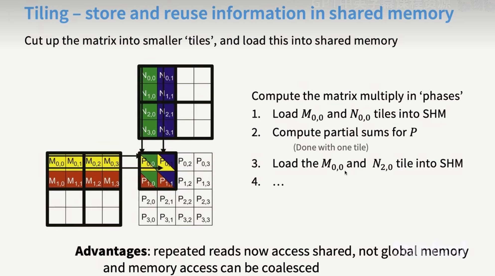

标准的矩阵乘法会要求多次读取单个元素 ， 这会要求多次反复访问memory ,而**tiling就是把矩阵切割成子矩阵** ， 然后再加载并操作 ；实际上图图中例子 n=4 , t=2 , 加载一个block进share memory里面的读取速度远超 global memory ,时间大大缩短


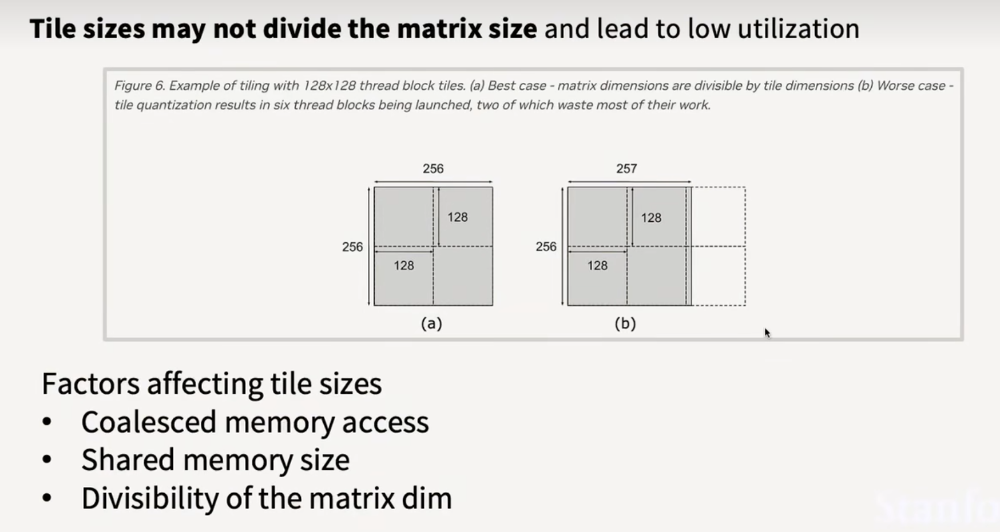
tiling也会带来问题， 如图 ，右侧刚刚好多了1列 ，tiling此时把右侧当全0读入 ，显然效果不佳 ，因此tiling需要调整很多部分，从而达到最优

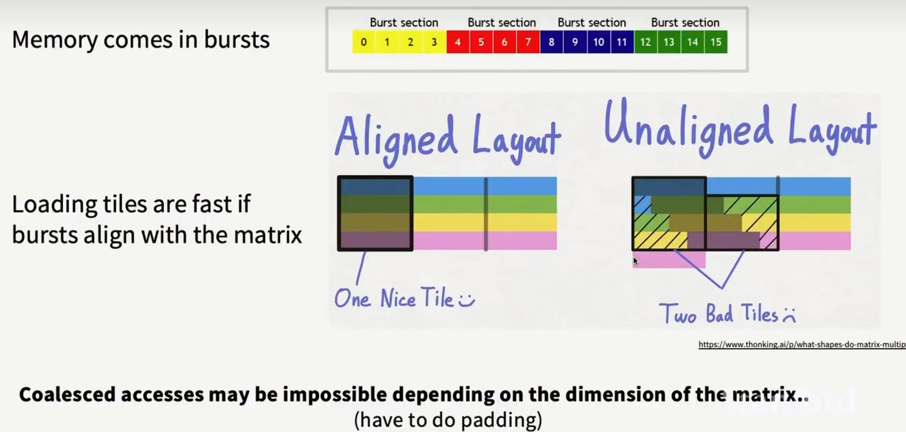
不好的tile也会带来问题 ， 如图就是一个bad tiles, 假设我们在每一行多了一个要读取的元素 ， 导致了要读取的元素拆分在两个sub matux 里面 ，无法合并读取一整个block , 带来了更多的传输量(要读两个block)

一般而言系统会自动帮你优化这些问题 ， 单我们构建的时候也可以做一些调整 ：比如矩阵尽可能接近2^n
经典案例 ：nanoGPT的vocab size从50257->50304 , speed up了20%+ ， 这也是我们可以考虑的部分

随着矩阵大小N的增加 ，趋势上是可以看成是不断上升 ，但这个性能是不平滑的线 ，这种抖动就是因为上面提到的 ， 分块多余部分(1025->1024+1) , 导致出现这样的波峰或者谷  ， 图中蛮明显的是 ，在**K是32的整数倍后性能比较稳定**
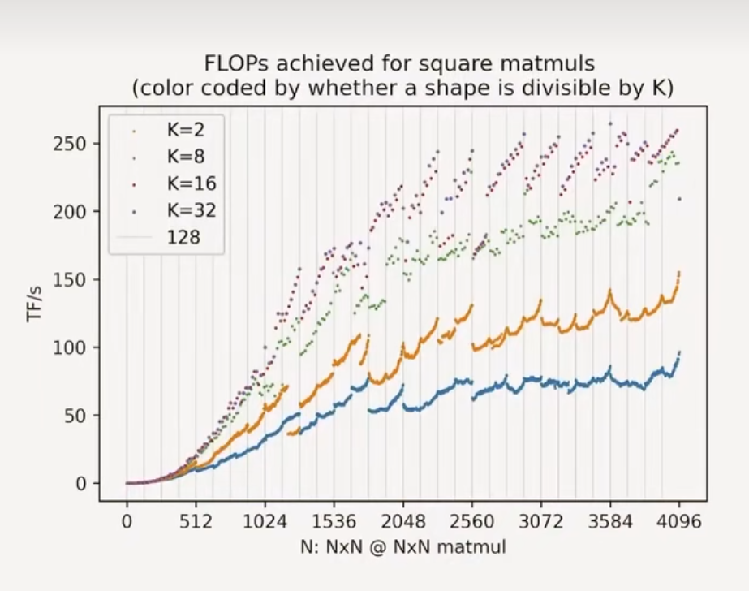

##### wave quantization

如图，这种wave quantization（**GPU 波次量化**），出现的原因就是因为对齐出现了问题
首先 ：矩阵n的szie+1 , 分块tile 的数量从98->120 ； 其次，A100只有108个SM , 120超出了这个范围 ，因此得运算两次，导致性能大幅下跌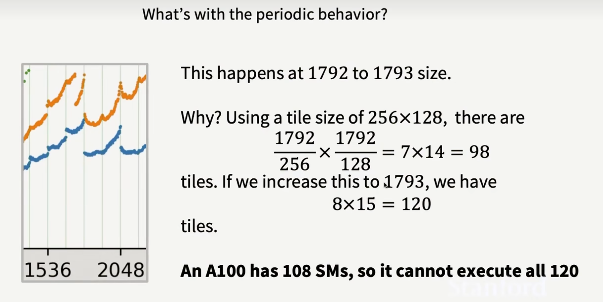

### flashattention

公式 ： 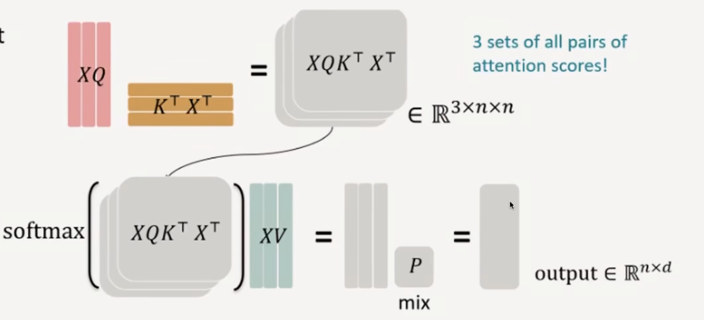

flashattention 做了online softmax， 使得不用一次性载入所有数据 ， online softmax允许分块导入数据，一边做softmax 一边normalization

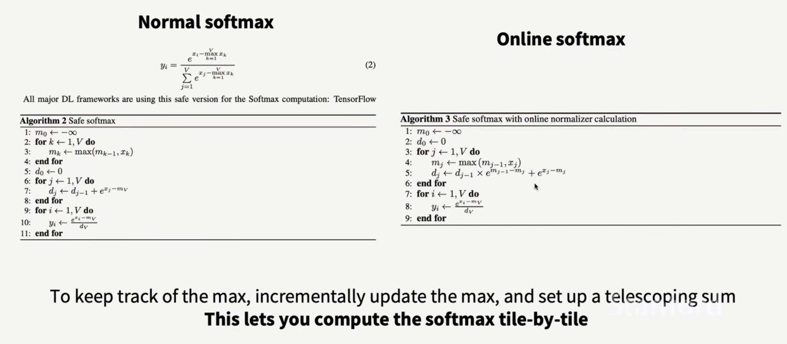

标准softmax 计算通常需要**三遍扫描**： 第一遍找最大值 $m=max⁡(x)$ ； 第二遍计算分母 $d=∑e^{x_i−m}$ ；最后再遍历一次计算 $y_i=e^{x_i−m}/d$ ；此时需要存储完整的input , 消耗大量内存和读取时间

Online softmax 通过**两次扫描**同时更新最大值和求和的分母，从而实现流式处理 ； 

# Lectures 6   Kernels   Triton   XLA

GPU 中的Kernel由多个Warps组成 ，Warps中的threads同时进行相同的计算(SIMT)   
一整个threads blocks同时访问同一个shared memory 而不是HBM , 从而减少数据运输时间

### Triton

warps :调度的基本单位 ， multi thread
**Thread** ： 一个时钟周期能完成一次计算
**Block** :复数个warps 组成
**SM**：block的硬件部分(block将sm抽象成一个block)

Triton是目前编写操作threads blocks的主要方式

Warps :线程束 ，可以理解为blocks的细分抽象 ，Warps中的所有threads都遵循相同的instruction
**Control divergence**: 不同Warps中的threads需要执行不同的instructions ,当遇到 `if (A) { 指令1 } else { 指令2 }` 这种分支代码时，**如果 Warp 里的 32 个线程有一部分走“指令1”，另一部分走“指令2”，这就叫“发散”。**因为硬件必须保持一致，这时 GPU 只能先让所有线程按顺序执行“指令1”（此时走指令2的线程闲置），然后再重新执行“指令2”（此时走指令1的线程闲置）。

SM 不断运行并切换Warps

- **背景**：当 Warp 去访问 **HBM（高带宽显存）** 读取/写入数据时，相比于 GPU 计算速度，显存是非常慢的，这时候 Warp 就会陷入“阻塞/等待”状态。
- **解决办法**：SM 上同时存有多个 Warp。当一个 Warp 在苦等显存数据回来时，SM 会**零延迟、零开销**地瞬间切换到另一个 Warp 去执行计算，等原本那个 Warp 的数据读回来了再切回去。
- **目的**：这完全是为了**掩盖内存延迟**。就像厨师，在做一份菜等水烧开的间隙，赶紧去切另一道菜的材料，不浪费任何时间。

##### share memory bank conflict

share memory就像L1 cache ,速度很快但容量很小 ，如果SM中多个thread同时访问同一个memory block， 就会产生conflict ;
swizzling可以重排memory从而减少conflict ，只能减少不能完全避免

wave quantization problem :上节课提过 ，SM和thread数量不匹配导致极端情况下SM用不满 ，性能浪费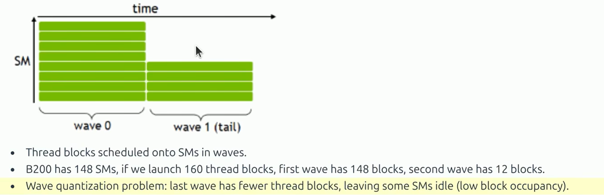

Programming model : grid (HBM)->thread block(shared memory)->thrend (registers)

benchmark ：torch.utils.benchmark 可以快速计算运算速度(**warmup** ,然后计算运行时间) warmup可以避免很多惰性载入的组件影响 
不仅如此 ，测试时还应测试多个尺寸的矩阵(256-8192) ,小尺寸时通常增长性质不明显， 大于一定尺寸后才会展现规律

profiling: torch原生 ，可以给出一些细节

torch.compile :优化函数 ，提高运算速度

计算GELU进行对比 ， 设计好的(F.gelu)函数运行最快(深度优化) ，conpile其次 ， native最慢
原因 ：每次计算都要launch a kernel , 都要从HBM 读出， 计算后再写入 ，效率很低下，大部分时间浪费在write read上
内置的GELU则有人写好了一个 CUDAKernel
compile会把计算优化成一个triton kernel ，因此速度次之(也是single kernel)

#### what is Triton

介于cuda和torch之间 ， 以线程块为操作单位
以下是一段triton代码 ， 编写一个简单的核函数gelu

```python
import triton.language as tl
def triton_gelu(x: torch.Tensor):
    # Check input
    assert x.is_cuda
    assert x.is_contiguous()

    # Allocate output tensor
    y = torch.empty_like(x)

    # Determine grid (elements divided into blocks)
    # | T T T T T T T T | T T T T T T T T | T T T T T T T T | T T T T T T T T |
    # |    Block 0      |    Block 1      |     Block 2      |    Block 3     |
    num_elements = x.numel()  # @inspect num_elements
    BLOCK_SIZE = 1024  # Number of threads
    num_blocks = triton.cdiv(num_elements, BLOCK_SIZE)  # @inspect num_blocks

    # Launch the kernel
    kernel = triton_gelu_kernel[(num_blocks,)](x, y, num_elements, BLOCK_SIZE=BLOCK_SIZE)

    # Write out PTX (look at this later)
    output_ptx("triton_gelu", kernel)  # @stepover

    return y


@triton.jit
def triton_gelu_kernel(x_ptr, y_ptr, num_elements, BLOCK_SIZE: tl.constexpr):
    # Input starts at `x_ptr`
    # Output starts at `y_ptr`

    # | T T T T T T T T | T T T T T T T T | T T T T T T T T | T T T T T T T T |
    # |    Block 0      |    Block 1      |     Block 2      |    Block 3     |

    pid = tl.program_id(axis=0)      # 识别 block
    start = pid * BLOCK_SIZE         # Starting index of this block(初始指针偏移量)

    # 各个block的初始偏移
    offsets = start + tl.arange(0, BLOCK_SIZE)

    # Don't read/write past the end of the tensor(超出num_elements的mask为false)
    mask = offsets < num_elements

    # Read(from HBM)
    x = tl.load(x_ptr + offsets, mask=mask)

    # Approx gelu is 0.5 * x * (1 + tanh(sqrt(2/pi) * (x + 0.044715 * x^3)))
    # Compute (tl.tanh doesn't exist, use tanh(a) = (exp(2a) - 1) / (exp(2a) + 1)
    a = 0.79788456 * (x + 0.044715 * x * x * x)
    exp = tl.exp(2 * a)
    tanh = (exp - 1) / (exp + 1)
    y = 0.5 * x * (1 + tanh)

    # Store(to HBM)
    tl.store(y_ptr + offsets, y, mask=mask)
```

更底层的计算可以看PTX ,有点类似汇编 ， 一般来说不会直接手写

##### Matmul kerenl

矩阵乘法是最常见的计算，A*B=C ，其中`A:m*k B:k*n ,C:m*n` 如果我们按行读取，则至少需要`m*n*k`次读取

 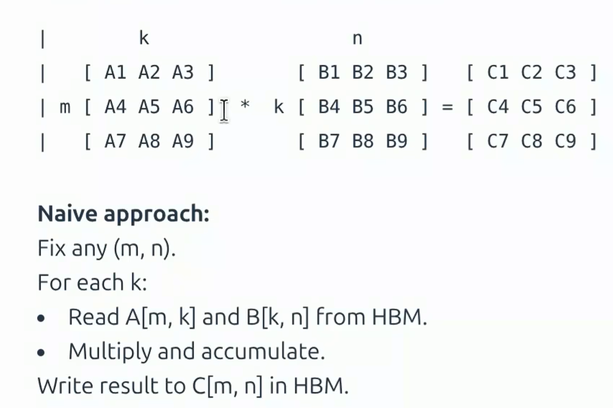
如图,我们希望能减少读取次数, 从而提高效率(比如计算c4-c6时,将a4-a6放在share memory中)
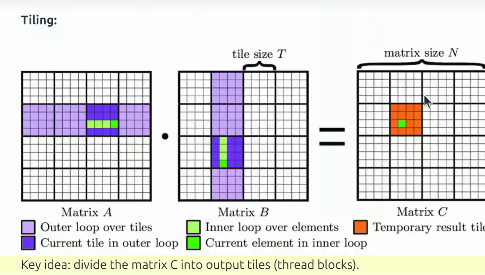

如图,通过将结果进行分块 ,我们可以分块矩阵求和的方式得到矩阵乘法的结果(这就是刚刚我们求的简单求和的结果)
通过tiling的方式 ,如果sm足够大 ,那读取次数可以优化到接近O(N)级别


# Lecture 7  Parallelism

tensor Parallelism , pipeline Parallelism

L6主要在讲单个GPU内的计算，因此HBM算作慢速存储 ， 本节主要讲multi GPU间的运算

Generalized hierarchy: 以下四个层级传输速率依次递减

- Single node, single GPU: L1 cache / shared memory (fastest)
- Single node, single GPU: HBM
- Single node, multi-GPU: NVLink/NVSwitch
- Multi-node, multi-GPU: Infiniband/Ethernet (slowest)

why multi-GPU：

1. scaling 导致单个GPU显存放不下
2. 加快运算速度 train faster 

## building blocks of distributed communication/computation

### collective operations 

并行计算时 多个设备间，使用一种指定的通信模式，其中：
RANK:单独的一个设备
world size：总设备数

Operations:( 定义的原子操作，这些操作都会将部分计算或者数据转移到其他设备上)

- Broadcast,scatter,gather,reduce (foundations) 
- All-gather,reduce-scatter,all-reduce (workhorse) 
- All-to-all (important for MoEs) 

###### Broadcast

copy tensor from rank0 to all ranks

###### scatter

```python
#input
rank0=[0,1,2,3]

#output
rank0=[0]
rank1=[1]
rank2=[2]
rank3=[3]
```

拆分成和rank相同的份数，然后到每一个rank上

###### gather

```python
#input
rank0=[0]
rank1=[1]
rank2=[2]
rank3=[3]

#output
rank0=[0,1,2,3]
```

opposite of scatter , gather to one rank


###### Reduce

apply operation

```python
#input
rank0=[0]
rank1=[1]
rank2=[2]
rank3=[3]

#output
rank0=[6] #sum of ranks
```


###### All-gather

```python
#input
rank0=[0]
rank1=[1]
rank2=[2]
rank3=[3]

#output
rank0=[0,1,2,3]
rank1=[0,1,2,3]
rank2=[0,1,2,3]
rank3=[0,1,2,3]
```

gather to all rank 
Use case: each rank holds parameter shard, gather to **get full parameters** for forward pass

###### reduce-scatter

```python
#output
rank0=[0,1,2,3]
rank1=[1,2,3,4]
rank2=[0,1,2,3]
rank3=[0,2,3,0]

#output
rank0=[6] #sum
rank1=[10]
rank2=[6]
rank3=[5]
```

对于每个rank做相同操作


all-reduce=reduce-scatter +all-gather

```python
#output
rank0=[0,1,2,3]
rank1=[1,2,3,4]
rank2=[0,1,2,3]
rank3=[0,2,3,0]

#output
rank0=[6,10,6,5] #sum
rank1=[6,10,6,5]
rank2=[6,10,6,5]
rank3=[6,10,6,5]
```

use case  : after backward pass, sum gardients from different data shards, but replicate full parameters

###### all-to-all

each rank send each other rank tensors(最通用)

```python
# Input
rank0 = tensor([0., 1, 2, 3])       # send  0 to rank 0,  1 to rank 1,  2 to rank 2,  3 to rank 3
rank1 = tensor([4., 5, 6, 7])       # send  4 to rank 0,  5 to rank 1,  6 to rank 2,  7 to rank 3
rank2 = tensor([8., 9, 10, 11])     # send  8 to rank 0,  9 to rank 1, 10 to rank 2, 11 to rank 3
rank3 = tensor([12., 13, 14, 15])   # send 12 to rank 0, 13 to rank 1, 14 to rank 2, 15 to rank 3

# Output
rank0 = tensor([0, 4, 8, 12])
rank1 = tensor([1, 5, 9, 13])
rank2 = tensor([2, 6, 10, 14])
rank3 = tensor([3, 7, 11, 15])
```

上面的代码通过巧妙的send数据 ，实现了矩阵转置 T 
MoE：each rank have split of data and subset of experts;need to route data to experts


## Part 2:distributed training

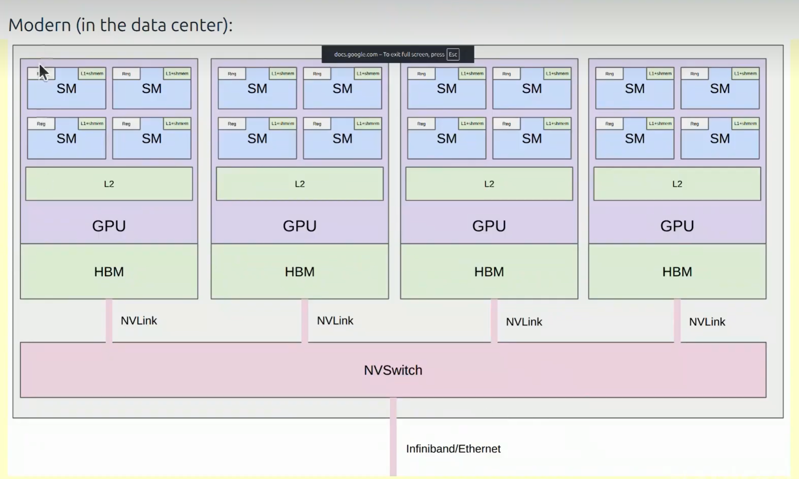
GPU通过NVswitch连接，然后再通过ethernet连接
如果使用Infiniband , 则直接通过PCIE到Infiniband ，不使用nvlink

bypass CPU：数据流通绕过CPU很重要 ， 传统的Ethernet数据要经过cpu kernel，速率大幅下降；
上述技术都是R(remote)DMA的 ，直接读写GPU’s memory

### NCCL（NICL）NVIDIA Collective Communicatrion Library

translate collective operation to low level packets between GPUs
translate collective -> GPU kernels send/receive data

normally, multiprocessing.spawn会帮助调用多线程
`dist.barrier()` :同步等待，但是会导致计算时间浪费
以下是一个all-reduce的示例

```python
    ### All-reduce (dist = torch.distributed)
    dist.barrier()  # Waits for all processes to get to this point (in this case, for print statements)

    data = tensor([0., 1, 2, 3], device=cuda_if_available(rank)) + rank  # Both input and output

    print(f"Rank {rank} [before all-reduce]: {data}", flush=True)
    dist.all_reduce(tensor=data, op=dist.ReduceOp.SUM, async_op=False)  # Modifies tensor in place
#async_op=False是为了统一输出格式
    print(f"Rank {rank} [after all-reduce]: {data}", flush=True)
```

  


#### data Parallelism

数据间做并行，模型完整保存在each rank上  
训练时大部分和非并行一致，只有最后求梯度时需要做all-reduce
ddp设计只对反向传播的梯度做平均，因此不影响各个参数做反向梯度求导

### tensor Parallelism

  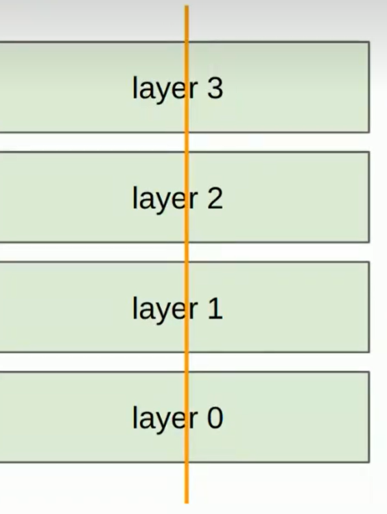 

如上图所示，每个rank负责layer的一部分，当然这样子会导致more data transfer 

```python
x = data
    for layer in range(num_layers):
        # Compute activations (batch_size x local_num_dim)
        x = x @ params[layer]  # Note: this is only on a slice of the parameters
        x = F.gelu(x)

        # Allocate memory for activations (world_size x batch_size x local_num_dim)
        activations = [torch.empty(batch_size, local_num_dim, device=cuda_if_available(rank)) for _ in range(world_size)]

        # Send activations via all gather
        dist.all_gather(tensor_list=activations, tensor=x, async_op=False)

        # Concatenate them to get batch_size x num_dim
        x = torch.cat(activations, dim=1)

    print(f"[tensor_parallelism] Rank {rank}: forward pass produced activations {summarize_tensor(x)}", flush=True)  # @stepover

```

通过将大的矩阵乘法拆成小的，然后再all_gather拼接汇总结果

### pipeline Parallelism

按layers拆分network,但是如果不同rank之间计算时间不相等，则会产生pipeline bubble,降低计算效率

sequence Parallelism :拆分sequence,使得attention计算并行
expert Parallelism:MoE expert

# Lec08-Parallelism：并行训练优化、MoE 扩展与系统瓶颈

GPU在网络拓扑上是全连接的，这意味着GPU的扩展在到达一定数量级后变得更加困难
早期TPU采用类似环形网络的架构，因此增加rank的开销是线性的

当然上面的两种拓扑结构也决定了GPU更适合MoE(expert不可预测)，TPU更适合Dense model (运算顺序易预测，因此性能损失小)

当然现在TPU也开始做全连接，因为MoE become popular

如果大量使用SRAM,并且增加芯片数量，则可以在单chip性能较低的基础上做到相近甚至更高性能—>Ascend 910

how to parallelism LLMs

data Parallelism ：naive data parallel ; ZeRO 1/2/3
Model Parallelism  :tensor Parallelism ; pipeline Parallelism
Activatation parallelism : Sequence parallel 

### data Parallelism ：

#### naive data parallel 

each rank have full model and part of data , so can’t save memory ,and translate gradient nearly 2 times(send/receive)

在一个step中显存占用情况:(using adam)
```
2字节用于 FP/BF 16 模型参数
2字节用于 FP/BF 16 梯度
4字节用于 FP32 主权重（即 SGD 中累加的内容） #optimizer state
4（或 2）字节用于 FP32/BF16 Adam 一阶矩估计 #optimizer state
4（或 2）字节用于 FP32/BF16 Adam 二阶矩估计 #optimizer state
```

 optimizer 占用了绝大部分的显存，因此我们可以优化这部分(尤其是在并行时)

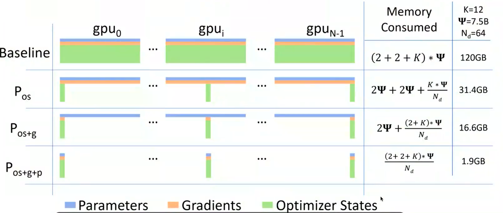
如图所示，我们可以通过拆分optimizer state，gradient 甚至是 parameters , 从而极大降低显存消耗量(当然传输时间自然会增加，但实际上很多transfer其实是for free的)

####  ZeRO 1/2/3

#### ZeRO 1

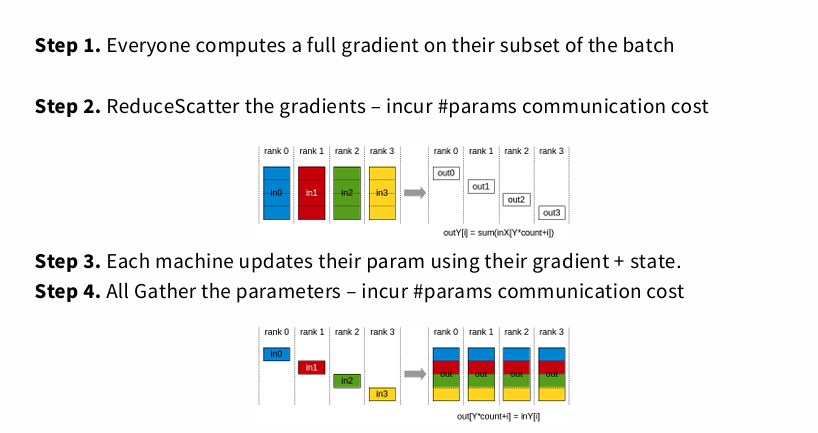

step1 :每部分参数和gradient 完全保存 ，计算
step2 : reduce-Scatter gradient后，each get 自己负责的 gradient
step3: updates part
step4:all-Gather parameters

传输相较于naive DDP ，数据传输次数从 One all-reduce –>One reduce scatter (send  gradients) + all gather  (collect params) 而 all gather  +reduce scatter 合起来约等于all-reduce，因此性能不变
,而Memory 从 `(4+K)  * params –> (4+K/Ngpu) * params`，大大减少

#### ZeRO 2

同时还要拆分 gradient，做法如下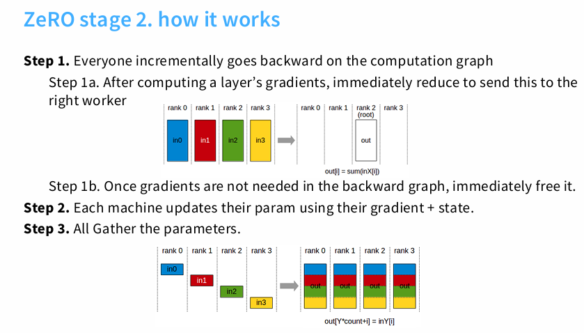Stage 2 optimizer state + gradient state , 反向传播中逐层通信，梯度无需全量存储

### ZeRO 3 FSDP

Model Parameter也做切分，所有rank共同协作，只储存一份完整 Model States

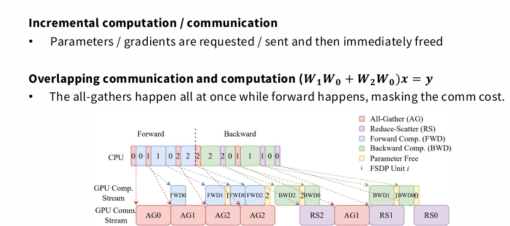

1.运算后立即释放参数

2.computation 和 communication 并行，从而使得 communication的开销比理论上低
all-gather layer1以后开始layer1的compute，同时all-gather layer2


Compute scaling
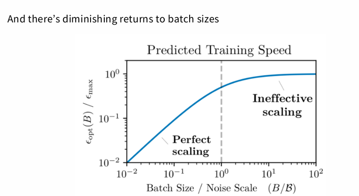
计算也会有scaling , batch size叫小时，由于噪声影响，增加batch能有效降低噪声，此时rank数和训练速度成线性相关；
但noise占比较小后，增加batch不再能线性提高训练速度了，此时到达 critical batch size(临界batch size)

### Model Parallelism

###   tensor Parallelism 

cut up matrices 

### pipeline Parallelism

communicate activation back and forth(传递激活值)

如果我们只做naive的layer cut,就会导致下述状态，pipeline完全不能并行运行，出现很多bubblej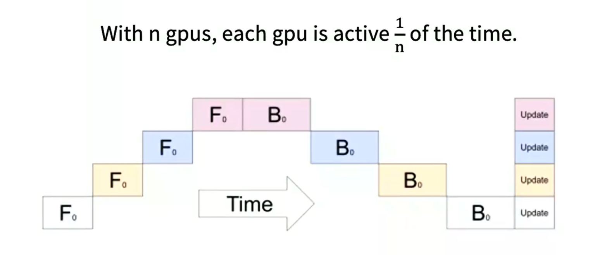

增大batch size 则可以减少bubble的占比，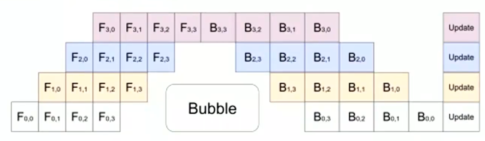

PP(pipeline parallel)

FSDP通常更简单,适合在模型较小时优先尝试;PP(pipeline parallel) 常用于超大模型,多节点训练时

NV关于Metatron的论文:如果batch_size太小,pipeline parallel的利用率会很低;
为了PP维持高利用率,则需要更大的batch size

#### 


和FSDP( **Fully Sharded Data Parallel** , 比如刚刚的ZeRO1/2/3)比,pipeline parallel 的传输数据量少的多(不用传参数矩阵),

因此如果能通过优化pipeline parallel 的pipeline communicate cost, cut up 不同layers 做不同安排,从而在backward间穿插forward,减少bubble 提高利用率(下图来自deepseek)


进一步优化:backwards拆分成b(backward)和w(weight gradients) ; 
b用于传递到再下一层进行进一步计算,因此需要优先计算;
而w仅用于本层参数优化(当前layer的导数),因此可以放在b后计算


分块矩阵计算原生支持切分(大的矩阵计算切成多个小的),就像tiling一样通过分块 ; 
因此model在wide上做cut up的运算也很常见

### Tensor parallel

如图,以下是一个MLP的demo
将parameter拆分成两份,正向传播时X copy 2份,同时进入$$A_1$$ $$A_2$$
在所给demo中,f和g中不同过程中的函数不同(为了计算同步)


对比我们可以看出tensor parallel 在不同参数矩阵中有着不同的cut up way;
Columnwise - QKV , up-projection
Rowwise – Attention output, down-projection
Replicated – norms, routers, etc (这些非liner是不用做copy和cut up的)


以下数据基于8GPUs一个 node做的实验
显然当tensor parallel 超出single node 时,性能会暴跌,因此最好控制在single node中


Tensor parallel 和 pipeline parallel 对比

优点

1. no bubble; no waiting
2. Low complexity
3. No need large batch

缺点

1. Cons — much larger communication than pipeline parallel.更多communication
2. 8bsh * ((n_devices - 1) / n_devices) per layer +all-reduce , 还要做all2all communicate , 传输开销超大 

如图,在运算过程中,存在很多dynamic memory cost , 如果能去掉那些高点的波峰,那我们就可以降低最大memory需求,


如下图,随着model scaling, activation 的占比远超 parameters的占比,因此我们需要考虑减少activation部分,而不是只考虑parameters

经验公式: 

$$\text{Activations memory per layer} = sbh\left(34 + 5\frac{as}{h}\right).$$ 
其中参数指代如图
一个激活张量通常可以记成[s,b,h] , 
5as/h这部分来自quadratic attention的dropout部分,如果用flash attention就没有这些东西

### Activation under tensor parallel

$$\text{Activations memory per layer} = sbh\left(10 + \frac{24}{t} + 5\frac{as}{ht}\right)$$
和上面的activation memory对比,大幅减少了;(大部分都/t)The remaining 10 term is for the LayerNorm (4sbh), Dropout (2sbh), and inputs to the attention and MLP (4sbh). These terms alone will continue to grow with size


### Sequence Parallel 


传统 Tensor Parallel 主要是沿着 **hidden 维度 h** 切分矩阵乘法，比如 Attention 里的 Linear、MLP 里的 Linear。
但也有很多layer其实并不需要跨 token 通信 , 如residual add ， GeLU ，LayerNorm，Dropout ，这些操作都可以独立处理，不用看别的token,因此LayerNorm / Dropout 这些层可以沿着 sequence 维度切分。
图片中Tensor Parallel部分主要是矩阵乘法运算

前向传播

$ g 和 \bar g$ :数据处于 Sequence Parallel 状态时，每张 GPU 只有一部分 sequence。但是进入 Tensor Parallel 的 Attention 或 MLP 之前，可能需要把 sequence 重新拼完整，所以需要：g =all-gather ,$\bar g$=reduce-scatter ; 反向传播时则反过来，不赘述

Sequence Parallel 的目标是：让这些 activation 也随着 GPU 数量线性切分。也就是说，GPU 数量翻倍，每张 GPU 上这部分显存接近减半。

下面是采用的配置以及对应的action memory，我们的parallal减少的内存总归有一个下限，即$sbh\left(\frac{34}{t}\right)$

| Configuration                                                | Activations Memory Per Transformer Layer             |
| ------------------------------------------------------------ | ---------------------------------------------------- |
| no parallelism                                               | $sbh\left(34 + 5\frac{as}{h}\right)$                 |
| tensor parallel (baseline)                                   | $sbh\left(10 + \frac{24}{t} + 5\frac{as}{ht}\right)$ |
| tensor + sequence parallel                                   | $sbh\left(\frac{34}{t} + 5\frac{as}{ht}\right)$      |
| tensor parallel + selective activation recomputation         | $sbh\left(10 + \frac{24}{t}\right)$                  |
| tensor parallel + sequence parallel + selective activation recomputation | $sbh\left(\frac{34}{t}\right)$                       |

### expert  parallelism

其实类似于 tensor parallelism ， 只是把expert的FFN部分拆分到不同的device上(Tensor parallel是矩阵拆分，上面讲了如何计算)

因此我们不需要将expert再做拆分放到不同设备上，直接做ep效率更高(GPU做大矩阵运算的利用率比小矩阵更高)

EP相较于TP的优势：

1. EP 可以让每张 GPU 上的本地矩阵乘法更大，因此 GPU 利用率更高

2. 对于 MoE 层，EP 的通信开销通常比 TP 更低。

3. EP 的计算图更简单，更容易把通信和计算重叠。

4. When EP = num_experts, local token permutation is eliminated(当每个 expert 都有自己的并行 rank 时，token 到 expert 的映射更直接，局部 permutation 开销更少 , 例子如下

   $[token3,token9,token12]→Expert0$
   $[token1,token7,token20]→Expert1$

DDP和DeepEP这两个库做了expert routing and dispatching ，可以大概看看


**Attention 层和 MoE Expert/MLP 层想要的并行方式不一样，所以最好把它们的并行配置解耦。**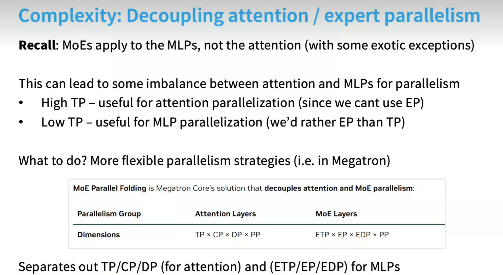

Attention 主要计算包括

1. QKV projection
2. attention score
3. softmax
4. attention output projection

因此更适合TP和CP(context Parallel)

而MoE更适合EP

为了折中，Megatron 提出了解决办法：MoE Parallel Folding

| 部分             | 并行维度            |
| ---------------- | ------------------- |
| Attention Layers | TP × CP × DP × PP   |
| MoE Layers       | ETP × EP × EDP × PP |

**MoE 只作用在 MLP 层，不作用在 Attention 层，所以 Attention 和 MoE-MLP 的最佳并行策略不同。Attention 更需要 TP/CP，MoE-MLP 更需要 EP、较低 TP。为了解决这个不匹配，Megatron 采用 MoE Parallel Folding，把 Attention 的 TP/CP/DP 和 MoE 的 ETP/EP/EDP 分开配置。**
**不要让 Attention 和 Expert Layer 被迫使用同一套并行配置；它们应该有各自最适合的 parallel group。**


### Context Parallel (ring attention)

通常用于**扩展长上下文**

也就是把一个很长的 sequence 沿着 token 维度切到多张 GPU 上，让每张 GPU 只保存一段 token 的 activation，从而支持更长上下文。
FFN不依赖其他token,因此这样计算不影响 
但是attention就比较麻烦，因为attention score要对比每一个token,要得到所有GPU的K/V， Ring Attention 的核心做法

不要一次性 all-gather 所有 K/V。
 而是让 **K/V block 在 GPU 之间像环一样传递**


如图，类似TPU那种成环而非全连接的拓扑结构，每次只拿一个 K/V block 来和本地 Q block 做 attention。用分块方式流式计算 attention，只不过 Ring Attention 的 block 分布在不同 GPU 上，从而节省了完整**上下文的 activation**

#### 3D/4D parallelism

把我们上述的并行策略结合起来，从而让GPU计算满载


在这些策略下，GPU，各种数据的增长都是可量化的
事实证明，TP=8是一个好的选择

而对于batch size,我们可以通过重计算降低显存占用，提高batch size,从而提升资源利用率(做了更多的compute,但是利用率反而更高了


Dolma-7B 全程FSDP ：如果model 不太大，full-FSDP实际上是一个不错的选择

DeepSeek V1 :ZeRO stage1+data parallel+tensor parallel +pipeline parallel

DeepSeekV3 :PP(16)+EP(64-way,8nodes)+ZeRO stage1
8个节点64卡作为一个expert的节点，从而实现高效运算


# Lec9 scaling law

#### data scaling

直接在大参数模型上调参效率低，通过在小参数模型上测试->推广到大参数模型上显然更合适

基于概率近似正确（PAC）学习框架下的经典泛化误差上界（Generalization Bound），针对有限大小的假设空间H：

有公式 ：$$\epsilon(\hat h)
\leq
\underbrace{\min_{h\in H}\epsilon(h)}_{\text{模型能力限制}}
+
\underbrace{2\sqrt{\frac1m\log\frac{2k}{\delta}}}_{\text{数据不足造成的误差}}$$

$\epsilon(\hat{h})$：当前学习算法输出的假设 $\hat{h}$（例如经验风险最小化器）的**真实风险（泛化误差）**。
$\min_{h \in H} \epsilon(h)$：假设空间 $H$ 中所有可能假设的最小真实误差，代表了模型的**近似误差（Approximation Error / Bias）**，即假设空间本身的表达能力极限。
$m$：训练样本的数量（Sample size）。
$k$：有限假设空间 $H$ 中包含的假设数量（$\vert{}H\vert{} = k$），代表了模型的容量/复杂度。
$\delta$：置信度参数，意味着该上界以至少 $1 - \delta$ 的概率成立。

因此，如果模型容量 $k$ 很大，你需要成比例增加样本量 $m$（对数级别）才能保证泛化性能，这是最基础的理论 Scaling 关系

通常而言，根据经验参数可以得知，模型性能acc和规模的对数成正相关，如下图


#### data mixture

假设input $x_1,x_2 ... x_n$~$N(\mu,\sigma^{2})$，$\hat{\mu} = \frac{\sum_{i} x_i}{n}$,则loss=$\mathbb{E}\left[\left(\hat{\mu}-\mu\right)^2\right]=\frac{\sigma^2}{n}$, 即
$$
log(loss)=2log\sigma-logn
$$


数据混合比例也很重要，相同数据量下，更多样化的数据比例可以降低err

而且根据这个图可以得知，增大数据量不改变截距，因此可以根据小参数模型在不同混合比例下的表现 scaling up

注意，上面说的所有参数不包括Embedding参数(不参与计算，只是查表)

data


**高质量数据是有限的**，有时候为了引入多样性，**使用质量稍差的数据，效果会比反复在高质量数据上训练效果更好**

如右图所示，
**如果计算量很小，例如只能看少量训练样本E，效果最好**，
**如果计算量变成中等，那么可以扩展到：E+D**  **效果最好**
**如果计算量很大，则进一步扩展：E+D+C** 效果最好

因此：**模型规模、计算量在 scaling，数据选择策略本身也应该 scaling，而不是所有规模都用同一个固定过滤阈值。**

### MoE

由于MoE,model parameter和activate parameter解耦，因此scaling law同时依赖这两个参数


根据右图可以看出，在相同activate parameter下 ，增加MoE model中那些deactivate parameter(即total parameter)仍有助于降低loss

#### batch size


如图，在到达 critical batch size之前，增加batch size 都能有助于 training speed；超过以后增大batch size的收益则放缓
**(主要影响因素从variance转向bias**)

那么怎么推断这个$B_{critic}$，见下图


S即step，E即examples ，中间的式子是固定的，通过它我们来拟合$B_{cridic}$


loss target 越小，batch要求越大

#### Learning rate


如图，随着scale up,需要逐步降低lr

上图为两种思路：

1. 根据low scale 的结果推scale up的
2. 先规定好参数随 width 应该如何 scaling，然后 tune 一个 base learning rate，模型扩大后$$\eta^*_{\text{base}}\approx2^{-10.5}$$，；μP 的目标就是让这个最佳“基础超参数”在 scale 变化后仍然保持稳定


### downstream 下游任务


如图，pretrain阶段的ppl基本和scale一致，但到了downstream阶段就出现各种问题，而这些问题很可能是pretrain阶段埋下的雷


> **fit scaling exponents on small data, small models. Predict rest.**
>  在小模型、小数据上拟合 scaling law 的指数，然后外推预测剩下的大规模实验。

核心可以理解成下面这个模型：

L(n,m)≈$An^{−α}+Bm^{−β}+C$

其中：

- n：训练数据量
- m：模型参数量
- L：test loss / error
- α：数据规模的 scaling exponent
- β：模型规模的 scaling exponent
- C：无法通过继续扩大数据、模型消除的误差下限
- A,B：比例系数

当然后续我们有个更简化的公式，即D=20N ，一个参数大约需要20token来训练(一个常用初始超参)


modern model 通常是overtrain的(远超上面提到的D=20N),因为$$\boxed{20\text{ tokens/param 是“固定训练算力下的最优点”}}$$，但现代 LLM 厂商真正关心的不只是训练成本，模型发布以后，每生成一个 token，推理成本大体和规模相关，因此overtrain会带来更高的收益；
即 $$\boxed{\text{训练时多花钱，把能力压进一个更小的模型里}}$$

Chinchilla 的意思**不是**：到 20 tokens/parameter 后再训练模型就不会提升。
而是 ： 如果你还拥有额外训练 compute，那么在那个特定优化设定下，与其继续训练这个模型，不如同时把模型做大，获得更高的训练算力利用效率。

如果为了 training-compute optimal 而把参数量提高很多，比如做成 30B、50B，可能预训练 FLOPs 更有效率，**却会让推理成本、显存和部署难度**大幅增加

# Lec10 inference

衡量快慢的meterics指标

TTFT(Time to first token)
latency :延迟，token appear for one query
Throughput : token appear for may queries

### kv cache

attention中$$q_i \text{ 只能和 } k_j,\; j\le i \text{ 做 attention}$$ ，下三角通过mask遮蔽，因此需要重复使用的只有 k,v ，所以需要留存kv cache(计算量仍然是$O(n^2)$ ,但计算次数少了一半)

$$\begin{array}{c|cccc}
 & k_1 & k_2 & k_3 & k_4\\
\hline
q_1 & \checkmark & \times & \times & \times\\
q_2 & \checkmark & \checkmark & \times & \times\\
q_3 & \checkmark & \checkmark & \checkmark & \times\\
q_4 & \checkmark & \checkmark & \checkmark & \checkmark
\end{array}$$

prefill阶段：B*T 的token进来，求K V
generate : T=1 , 每次只生成一个token(casual)

MLP中增大batch可以提高利用率(MLP中每个batch用同一个权重矩阵)
但attention中的权重矩阵共享，QKV各自独立，因此提升没有MLP大但attention中的权重矩阵共享，QKV各自独立，因此提升没有MLP大

增大batch 通常能提高利用率和Throughput，但也会导致latency 增大(等待每个batch处理完，且读取的kv cache变多) ,
 到达极限后再增大就无效了

关于MHA,GQA和MQA的 研究：


如图，通过MQA降低memory使用后，latency降低且throughput增大，因此这二者并非完全对立(可以同时变好)
而同时增大batch ， 则可以更大幅度提高throughput

MLA — Multi-head Latent Attention ：deepseek提出 Low-Rank KV Joint Compression，即
**我既想保留 multi-head 的表达能力，又不想真的缓存所有 head 的 K/V** ， 那么就**把 K 和 V 联合压缩成 latent** ， 然后使用时再还原(当然这里还有还原以及Decoupled RoPE的问题，不展开)

重点： 需要找到model中可以被squeeze的part

### Speculative Sampling / Speculative Decoding（推测采样/推测解码）

用**小模型 预测 大模型的 输出** ，big model critique draft model的概率q 
具体流程比较复杂，涉及拒绝采样等内容S


#### selective batching


训练时正常训练，attention部分正常计算，非attention部分直接拼接，从而减少传输次数

### page attention

 类似page memory的思路，而且prompt常常会共享system prompt 等前缀，保存kv cache能节省内存开销


# Lec11 scaling law2

这个lec主要讲两篇paper

## MiniCPM 2024

**Chinchilla 定律** : **在固定计算预算下，更小的模型 + 更多的训练 token 更优。**

$N∝ D^{0.73}$ 其中N为模型参数量，D为token总数 ，(之前的规律为N≈20D)

### μP to stabilize scaling

目标：随模型宽度、深度自动缩放训练超参数，**让小模型调出来的超参数，在放大模型后仍然大致有效**

先定义$$r=\frac{d_m}{d_{\text{base}}}$$ 宽度放大倍数，在模型扩大r倍后，**embedding、residual、初始化、learning rate、LM head 应该分别怎么跟着缩放。**


如图，通过μP可以基本不用调学习率s

batch size的设置：

如图，下面是一个target loss和BS的拟合曲线，可以大致参考(线性关系这个在之前有简单证明过，不解释

### WSD(warm-up stable decay)  learning rate 


固定的的warmup step,固定一段时间不变，快结束时集中decay;
图中是 **Warmup + Cosine Annealing**和WSD的对比图，cosine 需要知道训练终点而WSD不需要(可以随时continue train加数据进去)
而从图中可以看出实际上WSD也没比cosine差多少

## deepseek seq

直接用的 isoflops测算，简单用scaling law去拟合，思路上更简单直接()


qwen 2.5 qwen3 也用了类似的方法

## Kimi K2

上面的paper主要集中于 dense model ， 而modern model常用 MoE model , Kimi K2 则focus on MoE  scaling law


如图，针对不同程度的 sparsity ，分别观察效果；(一般而言在相同FlOPs下，sparsity 越高则loss越低）但重点在于上面的paper定量的展现了 sparsity和loss的关系


不同结构的attention对于数据的需求量是接近一致的


关于lr，batchsize 和scaling law 的error ； 这些数据都可以作为参考去尝试，但绝味真理


这也是一个，其中**越大的模型最优lr越小**。**数据量越多最优lr越大**
右侧则是最优


## optimizers and scale


这是不同optimizer的效果，Moun目前看来效果好而且耗时也比较理想

换了optimizer以后又有新的问题，WD和lr等超参数很多时候也要做相应的修改 


如图Meum在规模较小时比较理想，大了以后优势不明显

## Muon optimizer


把整个矩阵的梯度当做一整个整体，重新塑造其奇异值，因此专门针对Transformer 里的二维权重矩阵

$B_t$就是之前的动量
$O_t$把$B_t$变成一个近似$$UV^T$$的矩阵，即$${
\operatorname{NewtonSchulz5}(B)
\approx
UV^T
}$$ ,而这里的NewtonSchulz5是一个近似优化

 $$B=USV^T$$ 其中：

- U：左奇异向量
- V：右奇异向量
- S=Σ：奇异值组成的对角矩阵

比如：$$\Sigma=
\begin{bmatrix}
100&0&0\\
0&2&0\\
0&0&0.01
\end{bmatrix}$$说明这个梯度矩阵在三个主要方向上的强度分别是：100,2,0.01 ,差异较大
之前的SGD会直接更新，导致第三个方向的更新很少，非常不均匀

而Muon希望把S->E，即$O\approx UV^T$ 从而使得优化在各个方向上的程度接近

如果 B 是长方形矩阵，则更准确地叫：semi-orthogonal / polar factor ， 本质是：
**保留梯度矩阵的主要方向 U,V，但把各方向的奇异值拉到差不多一样。**

因此虽然Moun的单次计算更慢，但梯度下降速度更快，效果更好

# lec12 eval

eval之前先明确一个点：what is **good** ,我们评价的标准是什么

evaluation -> 把抽象的目标(思考更充分，更深入)变具体

### ppl perplexity困惑度

平均token loss (交叉熵)：$$L=-\frac1N\sum_{t=1}^N \log p(x_t|x_{<t})$$
$$PPL=e^{loss}$$=$$e^{-\frac1N\sum_{t=1}^N \log p(x_t|x_{<t})}$$

假设有K个等概率的token,则L=log K , PPL=K , 因此PPL可以理解为 **有效候选数量**
PPL对于scaling law比较smooth,用于研究较为合适


## chat benchmark

对话这类benchmark的指标不太好定义,以bie下是一些方式

1. 多个模型同时输出回复，让human选择哪个answer更优
2. LLM-as-judge(直接评价不好评，但加上check list(如cot,输出格式，评分标准) 可以明确评估范围，任务更准确 )

## agentic benchmark

比如编写python代码补丁 , 在不修改项目其他内容的前提下完成功能修复

#### Terminals bench

通过终端完成任务:任务明确，环境简单通用

## save-problem

llm安全也有相对应的benchmark

### jailbreak 越狱

llm会被训练成拒绝执行不好的prompt，但可以通过合适的prompt越过安全审核

#### flash eval

使用新的data 来测试(比training set 新)，但timestamps不一定准确，而且这些data以前也出现过

### private eval

私有 benchmark仍然是较高效的方法，注意data不要泄露到外网

# Lec12，13  Data

data is fundamentally a long-tail problem, scales with human effort（不像System，architectures , 人员需求大）

### data sourse

#### crawl

爬虫爬下来，然后清洗html等方式获取

#### wikipedia

general knowledge : 公众维护的wiki，获取大量通用领域的知识
而且还有部分小众领域的词条，这些知识也并不好获取，有些时候wiki上的answer质量反而更高

#### github

高质量高数量的代码托管，无需多言；
而且不仅是code, 还有issue ,git history等重要的信息也是值得获取的

#### arxiv

论文的pdf 或 LaTeX ，不过pdf2text是个问题

## data pipeline

去重，混合数据，

### pretrain

##### 数据转换 transformation

html,pdf， code respository -> text

网页：标准的模板样式，image , tables 等转换成text (简单的table可以转成markdown，但复杂的不太好处理)

PDF: FinePDFs ：hf出的一个处理pdf的工具，需要调用OCR，开销比上面处理Html用的规则脚本更难，但PDF的价值一般比普通网页更高(花心思去做PDF排版，一般不会太差)

### filtering 过滤

如图，filtering 过滤： 在 raw data中提取出和target 相似的 T’ (比如优质数据，语言相同，或者筛选有害数据）

通常而言，根据T和R构建一个model，然后根据这个model来筛选保留 T’
这个model可以是一个classifier(FastText),也可以是一个generative model (KenLM , GPT-3 ， LLaMA…)

**一般而言：短时间的训练要求高质量数据(less data)，长时间训练可以容忍较低质量的数据(more data)**
如图 中蓝色和紫色折线所示，可以很清楚地观察到loss 和token trained 的关联(高质量数据一开始效果更好，但后续数据量不够导致过拟合) 虚线是指数据训练完成一个epoch时使用的train token

### deduplication去重

精确去重相对简单：hash等映射函数对比即可，很常见且实现简单，不赘述；完全重复的文本直接删掉，
但Near duplicates近似重复的去重才是重点

### 模糊去重Near duplicates

```text
A:
I left for California in 1979,
and tracked Cleveland's changes on trips back.

B:
I left for California in 1979,
and tracked Cleveland's changes on trips back to visit my sister.
```

比如上面两句话，A不严格等于B,但二者近乎一个意思，相近度极高，而高相似度意味着人为提高了权重，这显然不符合我们的需求，且浪费了大量算力
还有就是**training val test 之间不应存在重复**，这也是要去重的


实际 LLM 数据处理通常使用类似：**MinHash + LSH**  ->MinHash实际上对元素进行复数个哈希函数然后取最小值，然后再在函数结果求交并比(优势：hash计算是线性可并行的)

大概过程是：

```
document
   ↓
切成 n-gram / shingles
   ↓
MinHash
   ↓
LSH 分桶
   ↓
寻找疑似相似文档
   ↓
计算 Jaccard similarity(交并比做阈值)
   ↓
删除 near duplicates
```

#### locality sensityve hashing 局部敏感哈希 

上面过程中的LSH分桶(12个hash function , 分三个桶 ， 每个桶4个hash )b=3 , r=4

上面的哈希函数还是可能会有碰撞的可能，导致部分非近似内容被误判，因此我们需要再做一下筛选
分桶我们可以设计阈值函数有 

```python
def get prob collision(sim,b,r):
    prob_match sim **r  #Probability that a fixed band matches
    prob_collision =1-(1-prob_match)**b Probability that some band matches
    return prob collision
```

下面例子概率如图，我们可以根据这样一个变化率较大的尖锐的函数来判断相似度(然后设计一个阈值来做判断)
通常而言，我们可以设`threshold=(1/b)**(1/r)` ，这个threshold就是上面所说的Jaccard similarity的过滤阈值

### data mixing 数据混合

假设有高质量数据10B, 低质量数据 10T :

方法一：high * 50epoch+low *0.05epoch 这样子高低质量1:1混合的效果
最好仅仅是浪费训练时间，最差会做高质量数据集上过拟合导致模型崩塌

法2 ：在batch中混合，部分来自高质量部分来自低质量

如图，我们先做小模型上训练不同比例的数据获取loss点，然后根据loss 训练一个 回归模型，
用这个回归模型来估计loss的点，从而获取最优配比  

当然，这种方法不一定奏效

如果训练一个很小的模型，那我们可以考虑尽可能减少low data的比例

#### simulated epoching

mup那节类似的思想：希望 low scale look like large scale

将data和model parameters 按相同的radio同步scaling low，通过实验来推断scaling up之后的结果

数据混合也有直接给你一大堆数据的，此时可以考虑按 领域—质量做二维分布，然后在用上面的数据处理方式来做相应的步骤

### post-train data

post-train data变的 very task-dependent , 因为需要做某些领域做特化训练

1. define a set of environment
2. define a set of test / prompt
3. 3.Collect responses from a strong model/human (teacher)

# Lec14 Mid-Post training

### SFT 

过程和pretrain阶段没什么太大区别，最大的区别来自于**数据上的差异**
如果pretrain阶段做的足够好，实际上可以帮你逃过很大程度上SFT部分的training

我们通过sft训练模型，可以通过以下三种指标来衡量

chattiness :对话更接近人类的感觉，而不是单纯的文本benchmark
detalils: 描述更细致，回答更长
tool use:训练模型实现工具调用，而非所有结果依赖模型输出

图中对model输出做了两个部分的teachIng,但如果数据较少，模型无法从所给的数据中获得泛化的feature，反而会干扰原本学会的能力

在model不知道的知识上做finetuning,很可能会导致其产生**hallucinate幻觉**

因此：

1. **You may not want to fine-tune on tail knowledge, even that’s the LM use case** 长尾数据做SFT效果不一定好，可以考虑外部知识库
2. In principle, ‘RL’ style correctness feedback could help ，类似RL等方式可以避免在未学习过的分布上训练
3. **LLM 的知识到底如何存储、什么时候能正确提取出来，本身是一个非常复杂的问题。**

也就是说，我们这里的post-training 更倾向于**激发模型原有的能力**，而非在这个阶段注入新的领域知识
而这样的STF也不需要大量数据，仅需要少量高质量数据即可
和RL相比，SFT不限制训练数据的分布情况(RL要求分布近似)

现代大模型通常会把SFT直接当做pre-training的一部分(比如放在pretrain的decay阶段）


### RLHF

在sft后，model的output已经有了一定结构，输出分布变得较为可用，此时可以考虑进行RLHF
RLHF的前提是分布已经有了一定正确性，否则随机性较大的分布上做RLHF效果不甚理想

具体做法：rater rates all of the examples，provide the ranking or binary ranking; 然后模型基于ranking进行standard RL , maximize the score of examples on the **reward model**
reward model：一个回归或者分类器，用于得到分数

PPO，GRPO,DPO

PPO有传统的reward model , base model , cridit model
GRPO去掉了cridit model , 用组间平均分代替 cridit
DPO 去掉了reward model ， 把on policy部分删掉，进一步减少显存占用 (最大化good 和 bad 的reward差异)，但是DPO需要有binary-answer，因此在部分问题上不适合拿来直接做优化(比如没有固定路径或目标的非二元问题)

注意：RLVR等训练必然会导致overfit， 因为不改变reward model则肯定会被过拟合，

### PPO

一个完整的PPO流程图如下 

在LLM的RL过程中，PPO实际上是一个multi-step RL 过程，因此训练过程相较于以往常见的RL场景更加复杂，超参数敏感

RL数据筛选：需要题目偶尔(采样k次)能答对(全对-全错 都不适合)，也因此题目通常需要经过SFT(知识 or 格式补充)和post-train 再进RL阶段

#### RL Infra

RL需要同时考虑roll out 的on/off oplicy ,  以及 training-rollouts 切换


# Lec15 Multimodal models 多模态模型

目标：omni model :全模态大模型，输入可以同时是语音，视频等

transformer 的input和output都是token，因此输入部分我们要将上面提到的东西转换为token

#### image：

clip:2021年的clip实现了image2token (用image encoder 和 text encoder 之间的tensor相似度(点积 )来做判断,因为这种数据量够多),分类任务
VIT:把image 切成16*16的小patch，分别送进embedding里面，一个patch出一个token
SigLIP: binary classification ,**align text 和 image**
LLaVA:如图，picture通过encoder+MLP映射为token，再输入到LLM中 

 且对于不同的input，可以做不同的处理(单张图片用全局+patch , 多张图片减少 patch , video进一步降低分辨率) 

#### qwen-vl: 

3-stage training  

pretraining:只训练VIT和cross attention部分,类似pre train
Multi-task :根据任务做训练，类似 post-training部分，比如(VQA,OCR等)
最后阶段冻结ViT，只训练adapter 和 language model

### qwen3-vl

如图，做了qwen2vl同款的动态分辨率，长上下文(256k), vision-encoder改用SigLIP2 , MRoPE从之前的顺序排列改成交错排列
(之前：[ttttwwwwhhhh] 现在:[twhtwhtwhtwh])  ; 为video的pic增加了时间戳，便于model理解pic间的关系(之前这部分信息隐含在位置编码中，现在直接以token形式给出)  

长上下文训练：

也是通过分stage训练来得到更长的上下文，因此很多时候模型的attention在前1/4或1/2的性能较好，后面部分因为训练少了性能降低  

### VQ-VAE

和标准VAE相比，多了中间的VQ量化操作，
**把复杂的视觉信息变成有限个“可复用的视觉 token”，这样后面的 Transformer 就可以像处理文字 token 一样处理图像。**
缺点：离散化确实会丢失信息，效果不如想象中的好 


### PD分离

prefill:类似pretrain中的做法，一次性填充所有的kv cache进入显存开始推理，因此IO密集
decode: 计算瓶颈，decode loop不用过多描述

因此通过pd分离，使得不同的集群可以使用不同的技术栈来优化计算，减少设备空转时间 
